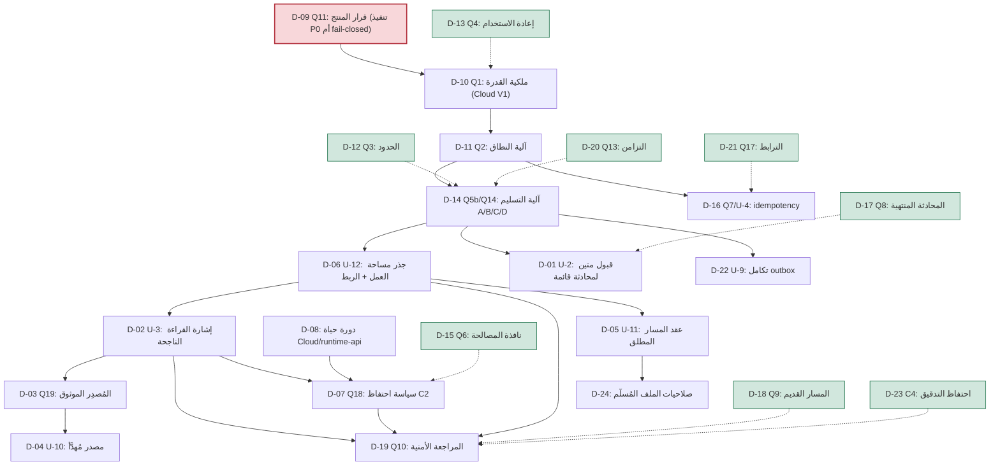

# OHB2-P0 — سجل قرارات المالك والتوصيات (Owner Decisions Register)

- **Task ID:** `OHB2-P0-OWNER-DECISIONS-REGISTER-AND-RECOMMENDATIONS`.
- **النوع:** تحليل وتوثيق فقط (analysis + documentation only). **لا تنفيذ.**
- **المقترح المرجعي:** `docs/proposals/OH-P0-SECURE-CONVERSATION-ATTACHMENT-UPLOAD-API.md` (r12).
- **المراجعة المستقلة المرجعية:** `docs/reviews/OHB2-P0-SECURE-UPLOAD-PROPOSAL-R12-INDEPENDENT-ADVERSARIAL-REVIEW.md` (r12).
- **حُكم المراجعة:** `PASS_WITH_NOTES` — وهو حُكم على **جودة المقترح** فقط، و**لا يُصرّح بأي تنفيذ**.

> **تحذير صريح.** هذه الوثيقة **لا تُنفّذ شيئًا**، و**لا تُقرّر** نيابةً عن المالك، و**لا تُحوّل أي توصية
> إلى متطلّب**. كل توصية فيها تحمل الوسم **`RECOMMENDATION — NOT OWNER-APPROVED`**. كل القرارات في §9
> **غير مُجاب عنها**. **P0 لا يزال غير مُنفَّذ وغير مُصرّح به.**

---

## 1. حالة الوثيقة ونطاقها (Document status and scope)

**الغرض.** تحويل **كل قرار مالك غير محسوم** و**كل اعتماد خارجي** يُعيق تنفيذ مسار رفع المرفقات الآمن
(secure conversation attachment upload / P0) إلى **سجل قرارات** واضح يستطيع مالك المستودع تقييمه
والموافقة عليه أو رفضه **صراحةً** — دون الحاجة إلى إعادة بناء التاريخ التقني من r6 إلى r12.

**النطاق.** الوثيقة:
- **تقرأ** المقترح r12 كاملًا (3185 سطرًا) والمراجعة المستقلة r12 كاملًا، وتستند إلى الأدلّة المثبّتة فيهما.
- **تُصنّف** كل قرار: **قرار مالك** (owner decision) أو **اعتماد خارجي** (external dependency) أو **سؤال
  تقني** (technical question).
- **تقدّم** خيارات واقعية + توصية موسومة + نتيجة عدم القرار + سؤالًا صريحًا للمالك.

**ما هي ليست.** ليست خطة تنفيذ، ولا اختيارًا معماريًا نهائيًا. **في إصدارها الأصلي** لم تتضمّن أي قرار
مالك مُتَّخذ. **تحديث 2026-11-13 (D-09-R1):** تُضيف الآن **قرار مالك واحدًا فعّالًا** (تنفيذ P0) مع الحفاظ
على السجل التاريخي (**الخيار C مُستبدَل لا مُلغى**). **تحديث لاحق 2026-11-13 (D-09-R2):** تُضيف **قرارًا
فعّالًا ثانيًا محدودًا** (استثناء تنفيذ محلي للـ A0–A4) دون إلغاء أي سجل تاريخي ودون توسيع التنفيذ خارج
A0–A4. **تحديث لاحق 2026-11-13 (D-25):** تُسجّل **قرار مالك ثالثًا** على سؤال **F-5/F-6** — **الخيار
(1) = D** (إبقاء A2 كما هو؛ حسم صلاحية route/الدفعة عند نقطة الإرسال في A3)، **دون** تغيير A2 أو أي
مهلة ودون بدء A3. **تحديث لاحق 2026-11-13 (D-26):** تُسجّل **قرار مالك رابعًا** على **A3-BLOCK-1** —
**الخيار B** (انتهاء نافذة route وحدها لا يُبطل دفعة مرفقات ما زالت داخل مهلة الدفعة المستقلة؛ إعادة
التحقّق من الهوية/الملكية/الربط/صلاحية الدفعة عند حدّ A3)، **دون** تغيير A2 أو أي مهلة ودون بدء A3،
ومع بقاء **A3-BLOCK-2** و**A3-BLOCK-3** غير محسومين آنذاك. **تحديث لاحق 2026-11-13 (D-27…D-31):** تُسجّل
**خمسة قرارات مالك** تحسم **A3-BLOCK-2** (النية المحلية المتينة — **D-27**)، و**A3-BLOCK-3** (تعريف
«النص المؤهّل» — **D-28**)، وأسبقية التوجيه/الدفعات المتعدّدة (**D-29**)، والرفض الدائم/الإقرار/تسليم
الردّ (**D-30**)، ونطاق نوع الرسالة (**D-31**) — **دون** تغيير A2 ولا أي مهلة ودون بدء تنفيذ A3. **تحديث
لاحق 2026-11-13 (D-32):** تُسجّل **قرار مالك إضافيًّا** يحسم **F1-1a/F1-1b** (أيّ حالات دفعة المرفقات غير
`pending` تحجب البرومت العادي عند حدّ A3↔B) — **دون** تغيير A2 ولا أي مهلة ودون بدء تنفيذ A3 (انظر §5 →
D-32). **تحديث لاحق 2026-11-13 (D-33):** تُسجّل **قرار مالك إضافيًّا** يحسم **F1** — **الخيار A**
(**هوية رسالة↔دفعة متينة** لتمييز البرومت الجديد الفعلي عن النصّ المتأخّر/المكرّر المرتبط بدفعة **نهائية**)،
**دون** تغيير A2 ولا أي مهلة ودون بدء تنفيذ A3 (انظر §5 → D-33). **تحديث لاحق 2026-11-14 (D-34/D-35):**
تُسجّل **قرارَي مالك** إضافيَّين — **D-34** (سياسة **fail-closed** للرسالة «غير مُثبَتة الارتباط بدفعة
نهائية» — `TERMINAL_UNPROVEN`؛ الخيار A) و**D-35** (احتفاظ **دليل هوية الرسالة** مستقلًّا عن تقليم
`processed_updates`، مع منع حذفه مع الدفعات/التنظيف قبل إثبات أمان الحذف — الخيار A) — **دون** تغيير A2 ولا
أي مهلة ودون بدء تنفيذ A3 (انظر §5 → D-34 وD-35). تبقى: لا
تفترض قرارات غير مُعتمَدة، ولا تُدخل افتراضات صامتة.

**قاعدة الأدلّة.** كل ادّعاء تقني هنا إمّا:
- **[F] مُتحقَّق** من المصدر المثبّت (pinned SHA) كما وثّقه المقترح r12 وأكّدته المراجعة المستقلة r12
  (استرجاع مستقل + تجزئات مطابقة)، أو
- **[G]/[UNVERIFIED] غير مُتحقَّق** أو يعتمد على سلوك خارجي (upstream / runtime-api) — ويُوسَم كذلك صراحةً.

**لا اختراع.** حيث لا يوجد دليل، لا تُختلق تفاصيل تقنية؛ يُسجَّل النقص بصدق.

---

## 2. خط الأساس المُتحقَّق منه (Verified repository baseline)

- **مسار المستودع:** `/workspace/project/OpenHandBot`.
- **الفرع:** `openhands-workspace-3jrWkL2U5fdqzu2fVdxOcW`.
- **HEAD:** `907b20de3fa6627795c14f29677e9f39c68e82f4`.
- **`origin/main`:** `a29164ff0e5fdc34e35af39b89ff5d8cfa324c3c`.
- **ملف السجل الهدف:** `docs/decisions/OHB2-P0-OWNER-DECISIONS-REGISTER.md`.
  - عند الفحص: **غير موجود** (لا يوجد تعارض استبدال). المجلد `docs/decisions/` أُنشئ لهذه المهمة.
- **حالة الشجرة الابتدائية** (`git status --short`) — محفوظة حرفيًا:

```
 M .agent/PROGRESS.md
 M bot/handlers.py
 M docs/proposals/OHB2-AGENT-SERVER-FILE-UPLOAD-ARCHITECTURE.md
 M docs/proposals/OHB2-TELEGRAM-ACK-ARCHITECTURE-ADR.md
?? docs/proposals/OH-P0-SECURE-CONVERSATION-ATTACHMENT-UPLOAD-API.md
?? docs/reviews/OHB2-P0-SECURE-UPLOAD-PROPOSAL-R10-INDEPENDENT-ADVERSARIAL-REVIEW.md
?? docs/reviews/OHB2-P0-SECURE-UPLOAD-PROPOSAL-R10-SELF-REVIEW.md
?? docs/reviews/OHB2-P0-SECURE-UPLOAD-PROPOSAL-R11-INDEPENDENT-ADVERSARIAL-REVIEW.md
?? docs/reviews/OHB2-P0-SECURE-UPLOAD-PROPOSAL-R11-SELF-REVIEW.md
?? docs/reviews/OHB2-P0-SECURE-UPLOAD-PROPOSAL-R12-INDEPENDENT-ADVERSARIAL-REVIEW.md
?? docs/reviews/OHB2-P0-SECURE-UPLOAD-PROPOSAL-R12-SELF-REVIEW.md
?? docs/reviews/OHB2-P0-SECURE-UPLOAD-PROPOSAL-R2-INDEPENDENT-REVIEW.md
?? docs/reviews/OHB2-P0-SECURE-UPLOAD-PROPOSAL-R3-INDEPENDENT-ADVERSARIAL-REVIEW.md
?? docs/reviews/OHB2-P0-SECURE-UPLOAD-PROPOSAL-R3-SELF-REVIEW.md
?? docs/reviews/OHB2-P0-SECURE-UPLOAD-PROPOSAL-R4-INDEPENDENT-ADVERSARIAL-REVIEW.md
?? docs/reviews/OHB2-P0-SECURE-UPLOAD-PROPOSAL-R4-SELF-REVIEW.md
?? docs/reviews/OHB2-P0-SECURE-UPLOAD-PROPOSAL-R5-INDEPENDENT-ADVERSARIAL-REVIEW.md
?? docs/reviews/OHB2-P0-SECURE-UPLOAD-PROPOSAL-R5-SELF-REVIEW.md
?? docs/reviews/OHB2-P0-SECURE-UPLOAD-PROPOSAL-R6-INDEPENDENT-ADVERSARIAL-REVIEW.md
?? docs/reviews/OHB2-P0-SECURE-UPLOAD-PROPOSAL-R6-SELF-REVIEW.md
?? docs/reviews/OHB2-P0-SECURE-UPLOAD-PROPOSAL-R7-INDEPENDENT-ADVERSARIAL-REVIEW.md
?? docs/reviews/OHB2-P0-SECURE-UPLOAD-PROPOSAL-R7-SELF-REVIEW.md
?? docs/reviews/OHB2-P0-SECURE-UPLOAD-PROPOSAL-R8-INDEPENDENT-ADVERSARIAL-REVIEW.md
?? docs/reviews/OHB2-P0-SECURE-UPLOAD-PROPOSAL-R8-SELF-REVIEW.md
?? docs/reviews/OHB2-P0-SECURE-UPLOAD-PROPOSAL-R9-INDEPENDENT-ADVERSARIAL-REVIEW.md
?? docs/reviews/OHB2-P0-SECURE-UPLOAD-PROPOSAL-R9-SELF-REVIEW.md
?? docs/reviews/OHB2-P0-SECURE-UPLOAD-UPSTREAM-PROPOSAL-INDEPENDENT-ADVERSARIAL-REVIEW.md
?? tests/test_stage2_high_ack_blocking_fix.py
?? tests/test_stage4_f1_status_cost_operational_ack.py
```

- **ملف السجل هذا** (بعد الإنشاء) يُضاف كملف جديد وحيد: `?? docs/decisions/OHB2-P0-OWNER-DECISIONS-REGISTER.md`.

---

## 3. الوثائق المرجعية والتجزئات (Source documents and hashes)

| الوثيقة | المسار | الأسطر | SHA-256 (مُحسوب مستقلًّا) |
| --- | --- | --- | --- |
| المقترح r12 | `docs/proposals/OH-P0-SECURE-CONVERSATION-ATTACHMENT-UPLOAD-API.md` | 3185 | `6ea52debd62918e831555a7ea4787cde75fa62c75e376ac5df93ece33e34e4dc` |
| المراجعة المستقلة r12 | `docs/reviews/OHB2-P0-SECURE-UPLOAD-PROPOSAL-R12-INDEPENDENT-ADVERSARIAL-REVIEW.md` | 395 | `b19b07bdcf1f30052e0760be67cf493bdd4755df33727358817956fecc8928ad` |
| المراجعة الذاتية r12 | `docs/reviews/OHB2-P0-SECURE-UPLOAD-PROPOSAL-R12-SELF-REVIEW.md` | 96 | `9e39bf033dbba0cb04ed5fb0a4c475a0ea650d6460fe26713ff4c6d009abfa99` |
| المراجعة المستقلة r11 | `docs/reviews/OHB2-P0-SECURE-UPLOAD-PROPOSAL-R11-INDEPENDENT-ADVERSARIAL-REVIEW.md` | 258 | `09963ded7bcc7279aabc77f99adf488fe9339686ff248b197ba367414ce6b990` |
| المراجعة المستقلة r10 | `docs/reviews/OHB2-P0-SECURE-UPLOAD-PROPOSAL-R10-INDEPENDENT-ADVERSARIAL-REVIEW.md` | 235 | `14d4d8a6c621abdd8d9211b4fdf08b7df2856ec21504d46fa21cdf7d18c24415` |

- **تطابق التجزئات:** تجزئة المقترح تطابق الهدف المرجعي المُعلن
  (`6ea52deb…e4dc`)، وتجزئة المراجعة المستقلة r12 تطابق الهدف (`b19b07bd…28ad`) — أُعيد حسابهما فعليًا.
- **المصادر المثبّتة (pinned) التي يستند إليها المقترح** (تجزئاتها مؤكَّدة في المراجعة المستقلة r12 §3):
  `OpenHands/enterprise@3fac53df8c2efcb67ff3537d1162e8c8a108f565`،
  `OpenHands/software-agent-sdk@9f7d5cb11b1256c1878f5584a657401feca9ad16`،
  `OpenHands/sandbox-server@43e91604ccd0a9960c8d5c52faadd60b30f10e63`،
  `OpenHands/OpenHands@a8aaf6813753803cae5182d050909705b0eb02d0`،
  والمواصفة الحيّة `https://app.all-hands.dev/openapi.json` (`info.version = 1.91.0`, 244 paths,
  sha256 `f0f4d4e9…`).

### 3.1 سجل المراجعات — ملاحظة N12-1 (مرجعية فقط)

- المراجعة المستقلة r12 سجّلت **N12-1 (LOW، تنسيقي/Markdown، غير حاجز)**: السطر الفارغ عند `§13` سطر
  **3184** يقسم جدول سجل المراجعات في المقترح، فيُعرض صف `r12` كجدول منفصل من صف واحد.
- **قرار هذه المهمة:** N12-1 **لا يُعالَج** هنا، و**لا يُعدَّل المقترح** لإصلاحه. هو مُسجَّل هنا **للتاريخ
  فقط**. المراجعة المستقلة r12 خلصت إلى أن صف r12 موجود **مرة واحدة** ومحتواه صحيح، وأن الأثر تنسيقي بحت.
- **لا يُعاد فتح** مراجعة استشهادات المصدر المكتملة (r12) ما لم يُبرّرها دليل جديد — ولا يوجد دليل جديد.

---

## 4. جرد كامل للقرارات غير المحسومة (Complete unresolved-decision inventory)

هذا الجرد يغطّي **كل** سؤال مفتوح في `§12` من المقترح (Q1–Q22) وكل متطلّب upstream جديد (U-1…U-12)
وكل قرار مالك صريح في متن المقترح. **المعرّف `D-nn`** هو معرّف هذا السجل؛ ويُربط بمراجع المقترح.

| D-ID | مرجع المقترح | العنوان المختصر | النوع | خطورته على P0 |
| --- | --- | --- | --- | --- |
| **D-01** | U-2 / Q12 / Q15 / §5.9.1 | قبول رسالة متين لمحادثة **قائمة** (active-conversation durable accept) | قرار مالك + اعتماد خارجي | **حاجز** |
| **D-02** | U-3 / Q5c / Q16 / §5.14.2 step 6 | إشارة دليل القراءة الناجحة (successful-read signal) | قرار مالك + اعتماد خارجي | **حاجز** |
| **D-03** | U-3 / Q19 / §5.15.1–§5.15.3 | حدّ المُصدِر الموثوق (trusted issuer boundary) + المصادقة | اعتماد خارجي | **حاجز** |
| **D-04** | U-10 / Q20 / §5.15.4 | مصدر دليل مُهدَّأ/مُنهى (quiesced evidence source) | اعتماد خارجي | **حاجز** |
| **D-05** | U-11 / Q21 / §5.15.5 | عقد المسار المطلق للملف المُسلَّم (absolute delivered-path) | سؤال تقني + قرار مالك | شبه حاجز |
| **D-06** | U-12 / Q22 / §5.15.6 | مصدر جذر مساحة العمل وربطه بالهوية/التفويض | قرار مالك + اعتماد خارجي | **حاجز** |
| **D-07** | Q18 / Q6 / §5.10.4 | سياسة احتفاظ مقيَّدة للنسخة المادّية C2 | قرار مالك | **حاجز (تشغيلي)** |
| **D-08** | §5.10.4 / §5.10.1 / R9-3 | انطباق دورة حياة/تفكيك Cloud/runtime-api + الحذف الفيزيائي | اعتماد خارجي | **حاجز (لضمان الاحتفاظ)** |
| **D-09** | Q11 / §5.14 / §8 | قرار المنتج: تنفيذ P0 أم الاستمرار في الرفض fail-closed | قرار مالك | **حاجز** — **محسوم: تنفيذ P0** (2026-11-13، D-09-R1؛ الخيار C مُستبدَل). **استثناء ضيّق لاحق:** **D-09-R2** (A0–A4 محلي، 2026-11-13) |
| **D-10** | Q1 | ملكية القدرة: Cloud V1 أم Agent Server | قرار مالك (معماري) | حاجز (تصميم) |
| **D-11** | Q2 | آلية النطاق: مسار Cloud لكل عملية أم capability token (+TTL/ربط/إبطال) | قرار مالك | حاجز (تصميم) |
| **D-12** | Q3 / §5.7 | حدود الحجم/النوع غير المتّسقة (`3 MiB == 3 MiB`) | قرار مالك (سياسة منتج) | حاجز (سياسة) |
| **D-13** | Q4 / §7.0 | تأكيد حدّ إعادة الاستخدام (reuse boundary) | قرار مالك (تأكيد) | غير حاجز إن أُكِّد |
| **D-14** | Q5a / Q5b / Q14 / §5.14.3 | آلية التسليم (design A/B/C/D) وهل يُوسَّع `send-message` | قرار مالك (معماري) | **حاجز** |
| **D-15** | Q6 / §5.9 / §8.4 | نافذة المصالحة `expires_at` (15 دقيقة) وعدم نمذجة الدفعة | قرار مالك (تأكيد) | شبه حاجز |
| **D-16** | Q7 / U-4 / §5.6 / §5.15 | Idempotency-Key + dedup بـ `sha256` + idempotency التسليم | قرار مالك + متطلّب جديد | حاجز (تصميم) |
| **D-17** | Q8 / §5.10.1 | سلوك المحادثة المنتهية/المحذوفة (409) + الاستعادة | قرار مالك (تأكيد) | غير حاجز إن أُكِّد |
| **D-18** | Q9 / §5.13 | إهلاك المسار القديم `/api/file/upload` + ترحيل واجهة enterprise | قرار مالك + اعتماد خارجي | خارج نطاق P0 |
| **D-19** | Q10 / §7.8 | المراجعة الأمنية المستقلة: مَن ينفّذها وهل هي بوابة إصدار | قرار مالك | حاجز (حكم) |
| **D-20** | Q13 / §5.9 | إعادة إدخال `uploading`/`delivering`؛ تزامن staging/delivery | قرار مالك (تأكيد) | غير حاجز إن أُكِّد |
| **D-21** | Q17 / §5.16 | عقد معرّف الترابط `client_operation_id` | قرار مالك (تأكيد) | غير حاجز إن أُكِّد |
| **D-22** | U-9 / §8.3 / S-2 | حدّ تكامل outbox في OpenHandBot (payload للمرفقات) | قرار مالك (تكامل) | **حاجز (تكامل)** |
| **D-23** | §5.10.1 (C4) | سياسة احتفاظ سجلات التدقيق/العمليات على الخادم | قرار مالك | غير حاجز (تشغيلي) |
| **D-24** | §7.4 / §5.15.5 / Q14 | صلاحيات/ملكية الملف المُسلَّم (mode/uid/gid قابل للقراءة) | سؤال تقني + معامل نشر | شبه حاجز |
| **D-25** | موجز F-5/F-6 (F-5/F-6) | نافذة التوجيه (10 دقايق) مقابل نافذة الدفعة (15 دقيقة) — الخيار (1) = D | قرار مالك | **محسوم — موافقة مالك صريحة (2026-11-13، الخيار (1) = D)** |
| **D-26** | A3-BLOCK-1 (صلاحية route عند حدّ الإرسال) | صلاحية route عند حدّ إرسال A3 — الخيار B | قرار مالك | **محسوم — موافقة مالك صريحة (2026-11-13، الخيار B)** |
| **D-27** | A3-BLOCK-2 (النية المحلية المتينة) | تخزين النص المصاحب محليًّا: `intent_text` + حالة `intent_recorded` ذرّيًّا | قرار مالك | **محسوم — موافقة مالك صريحة (2026-11-13، الخيار B)** |
| **D-28** | A3-BLOCK-3 (تعريف «النص المؤهّل») | أهلية النص المصاحب ومعالجة Unicode (وجود/طول/محارف تحكّم/تطبيع) | قرار مالك | **محسوم — موافقة مالك صريحة (2026-11-13)** |
| **D-29** | A3 (أسبقية التوجيه) | أسبقية التوجيه/الدفعات المتعدّدة/الغموض — fail-closed | قرار مالك | **محسوم — موافقة مالك صريحة (2026-11-13)** |
| **D-30** | A3 (الرفض/الإقرار) | نتيجة `rejected_ineligible` مؤهّلة للإقرار + ردّ رفض أفضل-جهد + تأجيل التسليم المتين | قرار مالك | **محسوم — موافقة مالك صريحة (2026-11-13)** |
| **D-31** | A3 (نطاق نوع الرسالة) | A3: نصّ مستقلّ فقط؛ تعليقات المستند ومجموعات الوسائط مؤجَّلة | قرار مالك | **محسوم — موافقة مالك صريحة (2026-11-13)** |
| **D-32** | F1-1a/F1-1b (حالات دفعة المرفقات التي تحجب البرومت العادي عند حدّ A3↔B) | حجب `intent_recorded`/`dispatching`/`uncertain`؛ عدم حجب `delivered`/`expired`/`rejected`/`failed`؛ لا fallback/تحويل تلقائي | قرار مالك | **محسوم — موافقة مالك صريحة (2026-11-13)** |
| **D-33** | F1 (هوية رسالة↔دفعة عند حدّ A3↔B) | الخيار A: هوية رسالة/تحديث↔دفعة متينة لتمييز البرومت الجديد عن النصّ المرتبط بدفعة نهائية؛ fail-closed عند الغموض؛ تفاصيل التصميم مفتوحة | قرار مالك | **محسوم — موافقة مالك صريحة (2026-11-13)** |
| **D-34** | F1 (سياسة توجيه الرسالة غير مُثبَتة الارتباط بدفعة نهائية — `TERMINAL_UNPROVEN`) | الخيار A: **fail-closed** عند وجود دفعة نهائية ذات صلة بلا إثبات ارتباط؛ لا سقوط لمسار البرومت/`_send_prompt`/`outbox`؛ لا ادّعاء ارتباط؛ لا هوية بالنيابة عن التسجيل؛ حفظ D-32؛ الإفصاح عن سلوك N-2 عبر المحادثات؛ سياسة فقط | قرار مالك | **محسوم — موافقة مالك صريحة (2026-11-14، الخيار A)** |
| **D-35** | احتفاظ دليل هوية الرسالة (مستقلًّا عن تقليم `processed_updates`) | الخيار A: استقلال دليل الهوية عن تقليم الدي‑دَب؛ لا حذف عند انتقالات حالة الدفعة/تنظيفها؛ FK بـ`ON DELETE RESTRICT` كقيد تصميم مستقبلي؛ **بلا** مدّة رقمية؛ fail-closed عند غياب الدليل؛ سياسة فقط | قرار مالك | **محسوم — موافقة مالك صريحة (2026-11-14، الخيار A)** |

**إجمالي السجلات:** **35** قرارًا (D-01 … D-35).

**ملاحظة حسم A3-BLOCK-2/BLOCK-3 (D-27/D-28):** **D-27** يحسم **سؤال سياسة المالك** لـ **A3-BLOCK-2**
(تخزين النص المصاحب محليًّا + دلالة حالة النيّة) و**D-28** يحسم **سؤال سياسة المالك** لـ **A3-BLOCK-3**
(تعريف «النص المؤهّل» + معالجة Unicode). هذا يحسم **الأسئلة السياسية المفتوحة** لا **أسئلة التنفيذ
التقني**؛ فالمخطّط/الترحيل/الأكواد/الاختبارات تبقى **عملًا تنفيذيًّا مستحقًّا غير مُصرَّح به** حتى مهمة تنفيذ
منفصلة (انظر §5 → D-27…D-32 و§12).

**بنود إضافية من متن المقترح جرى فحصها واعتبارها مغطّاة داخل السجلات أعلاه** (كي لا يُغفَل أي سؤال):
- `U-1` (نقطة تسليم server-to-server) → داخل **D-14** (آلية التسليم).
- `U-5` (توثيق غياب مفهوم الدفعة + أن مهلة الدفعة **client-side**) → **مُغطّى جزئيًا في D-15**:
  D-15 يؤكّد أن الخادم **لا يملك مفهوم دفعة** وأن المهلة client-side (جوهر U-5 الوظيفي). **ما يبقى
  معلّقًا:** التزام **التوثيق** upstream («the server documents that it has no batch concept») — بند
  توثيقي في نطاق D-15. **اختيار المالك المتبقّي:** تأكيد **عدم** نمذجة الدفعة على الخادم (D-15).
- `U-6` (مفتاح idempotency **اختياري** على `send-message`) → **مُغطّى جزئيًا في D-16**: D-16 يعالج
  idempotency العملية/التسليم (U-4). **ما يبقى معلّقًا:** الإضافة **الاختيارية** لمفتاح idempotency على
  **مستوى الرسالة** (U-6) — لا سجل مستقل لها، وهي **مؤجَّلة** كإضافة upstream اختيارية. **اختيار المالك
  المتبقّي:** ضمن D-16 (هل يُطلَب مفتاح idempotency للرسالة؟).
- `U-7` (ضمانات نظام الملفات للملف المُسلَّم) → داخل **D-05** و**D-24**.
- `U-8` (عقد الترابط) → داخل **D-21**.
- `Q5a` (قبول `stored_path_ref` غير الشفّاف) → داخل **D-14**.

**ملاحظة (F-03):** طيّ U-5/U-6 أعلاه **جزئي وصريح** — أي أنهما **ليسا مُحلَّين بالكامل** بمجرّد الإحالة؛
الجانب المتبقّي من كلٍّ منهما موضَّح أعلاه، ويبقى **اختيار مالك** مفتوحًا.

---

## 5. سجلات القرارات الفردية (Individual decision records)

> **قاعدة عامة على كل السجلات.** كل توصية أدناه تحمل الوسم **`RECOMMENDATION — NOT OWNER-APPROVED`**.
> لا تُقرأ أي توصية على أنها قرار مُتَّخذ أو متطلّب.
>
> **استثناء (سجلات مُعتمَدة):** السجلات الموسومة صراحةً **`OWNER-APPROVED`** (**D-09**/**D-09-R2**،
> **D-25**، **D-26**، **D-27**، **D-28**، **D-29**، **D-30**، **D-31**، **D-32**، **D-33**، **D-34**، **D-35**) هي **قرارات مالك مُتَّخذة فعّالة**،
> لا توصيات؛ وما عداها يبقى توصية غير مُعتمَدة.

---

### D-01 — قبول رسالة متين لمحادثة **قائمة** (U-2 / Q12 / Q15)

**A. التحديد الدقيق.**
- **Decision ID:** D-01.
- **موضع المقترح:** `§5.15` (U-2)، `§5.9.1` (`consumed_at`)، `§12` Q12 وQ15، `§8.3` (ضمانات تتطلّب
  دعم upstream)، `§8.1` **I7/I8** (الملفات وحدها لا تُرسِل؛ فقط نص مصاحب داخل المهلة يُفعِّل الإرسال؛
  مهلة الـ15 دقيقة تبدأ عند استلام الملف — §8.2 S1/S3).
- **الحالة الحالية:** **غير محسوم**. `consumed_at` غير مُعرَّف كإشارة موثوقة للمحادثة القائمة.
- **قيد ثابت غير قابل للتفاوض (لا يتأثّر بهذا القرار):** هذا القرار يخصّ **إشارة قبول الرسالة**
  (`consumed_at`) فقط؛ ولا يُغيّر شرط **I7/I8**: لا إرسال بمجرّد وصول ملف، وفقط **نص مصاحب داخل المهلة**
  يُفعِّل الإرسال (تفصيله في §11 بند 15/16). أي خيار أدناه **لا يُنشئ** إرسالًا تلقائيًا ولا fallback إلى
  محادثة جديدة.
- **UNVERIFIED — «النص المؤهِّل»:** معايير ما يجعل النص **مؤهِّلًا** للإرسال **غير معرَّفة في المصدر**
  (لا مطابقة ولا تحقّق محتوى) ⇒ تبقى **سؤال منتج/تصميم مفتوحًا**، ولا يُعتمد أي تعريف هنا.
- **النوع:** **قرار مالك** (هل يُحتفَظ بـ `consumed_at`؟) + **اعتماد خارجي** (توفير قبول متين لمحادثة قائمة).

**B. بيان المشكلة.**
P0 يستهدف **محادثة موجودة قائمة** (invariant I1؛ لا إنشاء محادثة جديدة). لكن المسار المتين الوحيد
الموجود — `POST /api/v1/conversations/{id}/pending-messages` — **يُستنزَف فقط عند بدء المحادثة**
(بعد وصول مهمّة البدء إلى `READY`)، ويُحذف **بغضّ النظر عن نجاح التسليم**، وسقفه **10** (429 فوقه).
كذلك `send-message` هو **thin proxy** بلا كتابة متينة (لا يُثبّت `consumed_at`). لذا **لا يوجد اليوم**
قبول متين لمحادثة قائمة، و`consumed_at` ليس إشارة موثوقة. هذا مهم لأن `consumed_at` مذكور كمرحلة
«message-accept» — لكنه **لا يُصرّح بالحذف أبدًا** (M-3)، فغيابه لا يكسر السلامة، لكنه يمنع أي ضمان
يعتمد عليه.

**C. الأدلّة.**
- **[F] مُتحقَّق:** `pending-messages` بدء فقط؛ `_process_pending_messages` يُستدعى مرة واحدة بعد `READY`؛
  السقف 10؛ الحذف بلا شرط نجاح (`live_status_app_conversation_service.py`، `§5.9.1`).
- **[F] مُتحقَّق:** `send_message_to_conversation` = `httpx_client.post(...)` إلى
  `POST /api/conversations/{id}/events` بلا كتابة متينة خاصة (`§5.9.1`).
- **[F] مُتحقَّق:** `consumed_at` **لا يُصرّح بالحذف**؛ الحذف مدفوع بـ `delivered`/`expires_at` (M-3، I12).
- **[UNVERIFIED]:** لا يوجد upstream يوفّر قبولًا متينًا لمحادثة قائمة اليوم.

**D. الخيارات.**
- **الخيار A (Q15a) — مرجع تصميمي، *غير قابل للاعتماد في P0*:** إعادة استخدام `pending-messages` كما هو.
  - كيف يعمل: يكتب رسالة مرجعية في طابور SQL. **العيب:** بدء فقط ⇒ **لا يخدم** المحادثة القائمة.
  - الأمان/الملكية: متين ومقيَّد بالمحادثة، لكنه **غير قابل للاستخدام** في هدف P0.
  - الفشل/الاستعادة: يُحذف بلا شرط نجاح ⇒ لا يمكن الاعتماد عليه كإشارة.
  - الاحتفاظ/التنظيف: لا أثر (لا يصرّح بالحذف). التعقيد: صفر. التوافق: قائم لكنه غير كافٍ.
  - **التصنيف (مُصحَّح، F-04):** **مرفوض/غير قابل للاعتماد كخيار في P0** — لأنه «بدء فقط» فلا يخدم
    المحادثة القائمة. يُحتفَظ به **للسياق التاريخي/التصميمي فقط**؛ **ليس** خيار اعتماد متاحًا للمالك.
- **الخيار B (Q15b):** إضافة خطوة قبول متين **على `send-message`** (عمل جديد).
  - كيف يعمل: `send-message` يكتب سجل قبول متين قبل/مع التمرير.
  - الأمان: يمنح إشارة موثوقة؛ لكنه يغيّر مسارًا عامًّا قائمًا ⇒ يحتاج ضبط عدم-التكرار.
  - الفشل/الاستعادة: نافذة انهيار جديدة (commit قبل الاستجابة) — مُنمذَجة في `§8.3` (windows 1–7).
  - التعقيد: متوسط–مرتفع (تغيير مسار عام + ضمانات). التوافق: إضافي لكنه يمسّ مسارًا مستخدمًا.
- **الخيار C (Q15c):** **إسقاط `consumed_at`** والمصالحة عبر سجل الأحداث وحده.
  - كيف يعمل: لا إشارة message-accept؛ البوت يعتمد على حالة العملية + سجل الأحداث.
  - الأمان: **الأكثر تحفّظًا**؛ لا إشارة جديدة، ولا تفويض حذف (مطابق أصلًا).
  - الفشل/الاستعادة: مبسّط (لا مرحلة جديدة). التعقيد: أدنى. التوافق: لا يمسّ upstream.
- **الخيار D:** تأجيل القرار والاستمرار في الاعتماد على `expires_at` فقط.
  - الأمان: آمن (fallback قائم). لكن يترك `consumed_at` معلّقًا بلا تعريف تشغيلي.

**E. التوصية — `RECOMMENDATION — NOT OWNER-APPROVED`.**
الخيار **C** (إسقاط `consumed_at` من المسار الحرج، أو الاحتفاظ به **كملاحظة تشخيصية لا تُصرّح بشيء**)
هو الأكثر تحفّظًا وأقلّ تكلفة، لأنه لا يضيف مرحلة متينة جديدة ولا يمسّ مسارًا عامًّا؛ و`consumed_at` **لا
يُصرّح بالحذف أصلًا**، فلا خسارة أمنية. المقايضة: لا إشارة message-accept للتحليلات/التشخيص. إن أراد
المالك ضمانًا يعتمد على القبول، فالخيار **B** مطلوب (ويتطلّب دعم upstream).

**F. نتيجة عدم القرار.**
يبقى `consumed_at` بلا تعريف تشغيلي؛ أي ضمان يعتمد عليه **لا يمكن بناؤه**؛ لكن **التنظيف والاحتفاظ
يظلّان آمنين** (مدفوعان بـ `delivered`/`expires_at`). العمل المحجوب: أي «تأكيد قبول» للمستخدم.

**G. المطلوب من المالك.**
أي خيار لقبول الرسالة المتين للمحادثة **القائمة**؟

---

### D-02 — إشارة دليل القراءة الناجحة (U-3 / Q5c / Q16 / §5.14.2 step 6)

**A. التحديد الدقيق.**
- **Decision ID:** D-02.
- **موضع المقترح:** `§5.14.2` step 6، `§5.14.0` (F6b)، `§5.15` (U-3)، `§12` Q5c وQ16، `§9` بند 7c.
- **الحالة:** **غير محسوم**؛ `delivered` **غير قابل للوصول** اليوم.
- **النوع:** **قرار مالك** + **اعتماد خارجي** (قدرة جديدة غير موجودة).

**B. بيان المشكلة.**
لا بدائية موجودة تُثبت قراءة **ناجحة كاملة** للمحتوى (F6b). `Observation.is_error` افتراضيًا `False`؛
ومسار الطرفية المكتمل **لا يضبط** `is_error` حتى مع `exit_code != 0` ⇒ `cat <missing>` ينتج observation
**غير خطأ** أي F6a بينما القراءة فشلت. `file_editor view` أكثر أمانًا للمسار المفقود، لكن نجاحه يُعيد
إسقاطًا **مقطوعًا** (`MAX_RESPONSE_LEN_CHAR = 16000`). لذا لا يمكن الوصول إلى `delivered` إلا بإشارة
جديدة صريحة (U-3). هذا مهم لأن `delivered` هي الحالة الوحيدة التي تُصرّح باستعادة نسخة staging مبكرًا.

**C. الأدلّة.**
- **[F] مُتحقَّق:** `Observation.is_error` افتراضيًا `False` (`sdk/tool/schema.py`، `76b4f42a…`).
- **[F] مُتحقَّق:** `_handle_completed_command` يُعيد `TerminalObservation.from_text(...)` بلا `is_error`؛
  `is_error=True` فقط للتفاعل/الفارغ/أوامر متعددة/طرفية مغلقة (`terminal_session.py`، `72504a4d…`).
- **[F] مُتحقَّق:** `file_editor` يرفض المسار المفقود بـ `is_error=True`، لكنه يقتطع الردّ (`impl.py`
  `35353ad3…`؛ `constants.py` `a5b3f2bf…`).
- **[UNVERIFIED]:** لا مُصدِر موثوق (D-03)، ولا مصدر مُهدَّأ (D-04) ⇒ U-3 غير موجود.

**D. الخيارات.**
- **الخيار A:** اعتماد U-3 (إشارة قراءة كاملة جديدة من مُصدِر موثوق).
  - الأمان: الأعلى (يثبت F6b فعليًا)؛ يشترط D-03 وD-04.
  - الملكية/التفويض: الإشارة مرتبطة بـ `(principal, conversation_id, operation_id, file_id)`.
  - الفشل: غياب الإشارة ⇒ `stored` (fail-closed). الاحتفاظ: يُصرّح باستعادة C1 فقط.
  - التعقيد: مرتفع (upstream جديد). التوافق: إضافي.
- **الخيار B:** البقاء على fallback (لا `delivered`؛ احتفاظ staging حتى `expires_at`؛ احتفاظ C2).
  - الأمان: آمن (لا حذف مبكر). الفشل: لا إشارة نجاح أبدًا ⇒ لا استعادة مبكرة.
  - التعقيد: صفر. التوافق: لا يمسّ upstream. **العيب:** نمو تخزين (انظر D-07).
- **الخيار C:** إشارة أضعف (non-error observation) — **مرفوض صراحةً** في المقترح (F6a غير كافٍ).
- **الخيار D:** قراءة عبر أداة `read_file` المُهيكلة — لكنها **Gemini-preset** وليست في المجموعة
  الافتراضية ⇒ **معتمدة على النشر**، لا تُقدَّم كإشارة مضمونة.

**E. التوصية — `RECOMMENDATION — NOT OWNER-APPROVED`.**
الأمان لا يستدعي U-3 إلزاميًا: الخيار **B** (fallback) **آمن** وقابل للتنفيذ فورًا. لكن إن أُريد
`delivered` كمفهوم حقيقي (واستعادة staging مبكرة)، فـ U-3 (الخيار **A**) ضروري، وهو **غير موجود**
ويشترط D-03/D-04. التوصية: **اعتماد fallback B الآن** (آمن)، واعتبار U-3 عنصرًا **مؤجَّلًا** إلى أن
يوفّره upstream. المقايضة: بقاء تخزين staging محدودًا بـ 15 دقيقة، وبقاء C2 غير مُستعاد تشغيليًا (D-07).

**F. نتيجة عدم القرار.**
`delivered` يبقى غير قابل للوصول؛ أي منطق استعادة يعتمد عليه **لا يمكن تنفيذه**؛ والمسارات الوحيدة
القابلة للتنفيذ هي `expires_at` (staging) و`rejected`/`failed`/`expired`.

**G. المطلوب من المالك.**
هل يُعتمد **fallback** (لا `delivered`؛ احتفاظ حتى `expires_at`)؟ أم يُشترط **U-3** كمتطلّب upstream؟

---

### D-03 — حدّ المُصدِر الموثوق (U-3 / Q19 / §5.15.1–§5.15.3)

**A. التحديد الدقيق.**
- **Decision ID:** D-03.
- **موضع المقترح:** `§5.15.1` (المُصدِر)، `§5.15.2` (المصادقة/الملكية)، `§5.15.3` (الحقول/الثوابت)،
  `§12` Q19 (وQ16).
- **الحالة:** **غير محسوم**؛ **UNVERIFIED** — لا مُصدِر موثوق في المصدر المثبّت.
- **النوع:** **اعتماد خارجي** (قدرة upstream) — مع قرار مالك حول قبول النموذج.

**B. بيان المشكلة.**
U-3 لا معنى له إن كان المُصدِر **داخل سيطرة الوكيل**. أي حدث يصنعه الوكيل/الأداة/النموذج (tool result،
`ObservationEvent`، `AgentErrorEvent`، `UserRejectObservation`، ردّ رسالة) أو أي حقل يسمّيه العميل
`issuer/success/read/verified` **ليس دليلًا**. المطلوب مُصدِر **خدمي غير وكيلي** يملك هوية الملف
المادّي ويمكنه إثبات **عدد البايتات المقروءة** من ذلك الملف بالتحديد. هذا مهم لأنه بدون مُصدِر موثوق
تصبح U-3 قابلة للتزوير بواسطة الوكيل ⇒ لا يمكن الوثوق بـ `delivered`.

**C. الأدلّة.**
- **[F] مُتحقَّق:** لا توجد بدائية إقرار قراءة في SDK عند `9f7d5cb1…` ⇒ المُصدِر **جديد/UNVERIFIED**.
- **[F] مُتحقَّق:** الحقول والثوابت الإلزامية محدَّدة في `§5.15.3` (ack_id فريد، issuer، operation/file،
  conversation/principal، content_version، delivered_path، sha256+byte_length، bytes_read، truncated،
  read_op_id، read_at، issuer_sig/mac).
- **[UNVERIFIED]:** لا دليل على وجود قناة مصادقة service-to-service للإقرار.

**D. الخيارات.**
- **الخيار A:** مُصدِر Cloud/control-plane (يُنفّذ/يراقب القراءة بسلطته).
  - الأمان: أعلى؛ يملك هوية الملف وسلطة القراءة. الفشل: fail-closed عند غياب الإقرار.
  - التعقيد: مرتفع (خدمة جديدة + قناة داخلية). التوافق: إضافي.
- **الخيار B:** مُصدِر Agent-Server (يراقب القراءة على جانبه).
  - الأمان: مرتفع لكن **أقرب** إلى الوكيل ⇒ يحتاج فصلًا صريحًا عن الوكيل وقناة مصادقة.
  - التعقيد: متوسط–مرتفع. التوافق: إضافي، لكن حدود الثقة أضيق.
- **الخيار C:** لا مُصدِر؛ الاعتماد على fallback (بدون `delivered`).
  - الأمان: آمن. التعقيد: صفر. التوافق: لا يمسّ upstream. العيب: لا `delivered` (D-02/D-07).

**E. التوصية — `RECOMMENDATION — NOT OWNER-APPROVED`.**
إن أُريد U-3، فالمُصدِر **A (Cloud/control-plane)** هو الأنسب لأنه **خارج سيطرة الوكيل** تمامًا. لكن
التوصية العملية: **لا تعتمد U-3 كشرط تنفيذ الآن**؛ اعتمد fallback (الخيار **C**) إلى أن يتوفّر مُصدِر
موثوق **مُتحقَّق منه مستقلًّا** (لا يكفي ادّعاء الاسم). المقايضة: لا استعادة مبكرة لـ staging.

**F. نتيجة عدم القرار.**
لا يمكن اعتماد أي `delivered`؛ ولا يمكن بناء أي منطق يعتمد على إقرار القراءة. كل ما يعتمد على U-3 يبقى
**محجوبًا**.

**G. المطلوب من المالك.**
هل يُقبَل مُصدِر **Cloud/control-plane**؟ أم **Agent-Server**؟ أم **لا U-3** (fallback)؟

---

### D-04 — مصدر دليل مُهدَّأ/مُنهى (U-10 / Q20 / §5.15.4)

**A. التحديد الدقيق.**
- **Decision ID:** D-04.
- **موضع المقترح:** `§5.15.4`، `§12` Q20 (و`§2.2`/`§5.14.1`).
- **الحالة:** **غير محسوم**؛ `events/search` = **replica** غير متّسقة.
- **النوع:** **اعتماد خارجي** + سؤال تقني (ضمان الاتساق).

**B. بيان المشكلة.**
الحالة **الموثوقة** هي سجل أحداث **agent-server** نفسه. أما `GET /api/v1/conversation/{id}/events/search`
فهو **replica** يُحدَّث لاحقًا، **يكتب حدثًا واحدًا في المرة**، وطريقة تغذيته **معتمدة على النشر**
(حلقة polling فقط عند غياب URL عام، وإلا webhooks). لا هو لقطة متّسقة. النتيجة: قراءة **سالبة كاذبة**
(U-3 لم يُنسخ بعد) مجرّد تحفّظ ⇒ `stored`؛ لكن **موجبة كاذبة** (حدث خطأ لاحق لم يُنسخ بعد) **غير آمنة**.

**C. الأدلّة.**
- **[F] مُتحقَّق:** `remote_sandbox_service.py` → `poll_agent_servers` → `refresh_conversation` →
  `save_event` (حدث واحد)؛ الحلقة تُبدأ فقط عند `web_url is None or 'localhost' in web_url` (`d239ec43…`).
- **[UNVERIFIED]:** قيمة `sleep_interval` الدقيقة، وحدّ تأخّر مسار webhooks.

**D. الخيارات.**
- **الخيار A:** مصدر مُهدَّأ/مُنهى (قدرة جديدة) ⇒ ضمان اكتمال/اتساق للفعل المعني.
  - الأمان: الأعلى. التعقيد: مرتفع. التوافق: إضافي.
- **الخيار B:** إعادة التحقق مباشرة من سجل **agent-server** عند الحاجة.
  - الأمان: مرتفع (يفادي النسخة). التعقيد: متوسط (يحتاج وصولًا لجانب agent-server).
- **الخيار C:** لا تعتمد على دليل حدثي أصلًا (fallback بلا `delivered`).
  - الأمان: آمن (لا استنتاج خطأ). التعقيد: صفر. العيب: لا `delivered`.

**E. التوصية — `RECOMMENDATION — NOT OWNER-APPROVED`.**
اربط U-10 بـ U-3: **إن لم يُعتمد U-3 فلا حاجة عملية لـ U-10 الآن** (الخيار **C**). إن أُعتمد U-3،
فالخيار **B** (إعادة تحقق من agent-server) أنسب من بناء مصدر مُهدَّأ جديد، لأنه يستخدم الحالة الموثوقة
مباشرة. المقايضة: تكلفة وصول إضافية لجانب agent-server.

**F. نتيجة عدم القرار.**
أي دليل حدثي يُستخدَم لبوّابة `delivered` **غير موثوق**؛ لا يمكن تأكيد `delivered` من replica.

**G. المطلوب من المالك.**
أي ضمان اتساق للأدلّة الحدثية: **مصدر مُهدَّأ** أم **إعادة تحقق من agent-server** أم **لا دليل حدثي**؟

---

### D-05 — عقد المسار المطلق للملف المُسلَّم (U-11 / Q21 / §5.15.5)

**A. التحديد الدقيق.**
- **Decision ID:** D-05.
- **موضع المقترح:** `§5.15.5`، `§5.14.2` step 5، `§12` Q21، `§9` بند 7c، I14.
- **الحالة:** **غير محسوم** (جزئيًا جديد؛ القارئ المسمّى يرفض المسار النسبي).
- **النوع:** **سؤال تقني** + **قرار مالك** (تأكيد العقد).

**B. بيان المشكلة.**
`file_editor view` **يتطلّب مسارًا مطلقًا** (`validate_path` يرفض غير المطلق) ويرفض المسار المفقود
لغير أمر `create`. r6 سلّم الوكيل مسارًا **نسبيًا** ⇒ العبارة «الأدوات العادية للوكيل تفتحه» كانت
**غير قابلة للتنفيذ**. العقد الجديد: المسار المُسلَّم إلى الوكيل **مطلق** (مربوط بجذر مساحة العمل).
هذا مهم لضمان I14 (الوكيل يستطيع فعلًا القراءة).

**C. الأدلّة.**
- **[F] مُتحقَّق:** `validate_path` يرفض غير المطلق عند سطر 666؛ حرس المسار المفقود سطر 689/690
  (النطاق 689-694) (`editor.py`، `a1d735d4…`).
- **[F] مُتحقَّق:** جذر مساحة العمل يأتي من مصدر موثوق (D-06)، لا من `sandbox_spec.working_dir`.
- **[UNVERIFIED]:** قابلية قراءة الملف للمستخدم الفعلي للوكيل (mode/uid/gid) — D-24.

**D. الخيارات.**
- **الخيار A:** مسار **مطلق** يُولَّد على الخادم ويُسلَّم للوكيل عبر الرسالة.
  - الأمان: يمنع حقن المسار؛ لكن يعرض المسار الحقيقي للوكيل (مقصود). التعقيد: متوسط. التوافق: إضافي.
- **الخيار B:** رمز غير شفّاف + أداة قراءة على جانب الوكيل (design C، D-14).
  - الأمان: لا يكشف المسار؛ لكن يتطلّب أداة جديدة ⇒ تعقيد أعلى وتوافق أضيق.
- **الخيار C:** مسار نسبي — **مرفوض** (القارئ المسمّى يرفضه).

**E. التوصية — `RECOMMENDATION — NOT OWNER-APPROVED`.**
الخيار **A**: مسار مطلق مولَّد على الخادم، مربوط بجذر مساحة العمل الموثوق (D-06)، مع إعادة فحص
الاحتواء (`resolve().is_relative_to(workspace_root)`) مباشرةً قبل الكتابة. المقايضة: كشف المسار
المطلق للوكيل (مقصود وضروري للقراءة).

**F. نتيجة عدم القرار.**
ضمان «الوكيل يستطيع قراءة الملف» (I14) **لا يمكن تأكيده**؛ التدفّق end-to-end محجوب.

**G. المطلوب من المالك.**
هل يُعتمد عقد **المسار المطلق** (يُولَّد على الخادم) للقراءة عبر `file_editor view`؟

---

### D-06 — مصدر جذر مساحة العمل وربطه بالهوية/التفويض (U-12 / Q22 / §5.15.6)

**A. التحديد الدقيق.**
- **Decision ID:** D-06.
- **موضع المقترح:** `§5.15.6`، `§5.14.2` step 3، `§12` Q22، `§9` بند 7c، I15، T-25.
- **الحالة:** **غير محسوم**؛ **القراءة موجودة**، **الربط جديد/UNVERIFIED**.
- **النوع:** **قرار مالك** + **اعتماد خارجي** (قدرة ربط جديدة).

**B. بيان المشكلة.**
`_get_agent_server_context` **لا يحمل** جذر مساحة العمل لكل محادثة (يحمل فقط `sandbox_spec.working_dir`،
وهو القاعدة **غير المجمّعة**). الجذر الفعلي يُبنى بـ `grouped_workspace_dir(base, strategy, id)` لأي
استراتيجية غير `NO_GROUPING`، ويُثبَّت في وسم `archiveworkspacepath` (مكتوب من الخادم عند البدء).
**قراءة** الوسم→الجذر **موجودة وتشحن** (`AppConversationInfo.repositories`، ومكشوفة حيًّا كـ
`AppConversation.repositories.path`). لكن لا شيء يربط ذلك الجذر بـ `(principal, conversation_id,
operation_id)` **ويثبّت تفويض الكتابة** لهذه العملية. هذا مهم لأنه بدون الربط لا يمكن الوثوق بأن
الكتابة تذهب إلى وجهة **مصادَق عليها وثابتة**.

**C. الأدلّة.**
- **[F] مُتحقَّق:** `AppConversationInfo.repositories` `@computed_field` يقرأ الوسم ويستدعي
  `conversation_repositories` (`app_conversation_models.py` `7a4a54c0…`، الأسطر 250-265؛
  `additional_repositories.py` `a8d0bbe3…`، def عند 89 والتعبير عند 106).
- **[F] مُتحقَّق:** `RESERVED_TAG_KEYS` سطر 86؛ الوسم يُكتب من الخادم (`live_status_app_conversation_service.py`
  `9f4f1596…`، سطر 1124)؛ مكشوف حيًّا في OpenAPI `1.91.0` (`f0f4d4e9…`).
- **[F] مُتحقَّق:** `_get_agent_server_context` (`app_conversation_router.py` `c43ed4f7…`) لا يحمل حقل مسار.
- **[UNVERIFIED]:** لا بدائية مثبّتة تربط الجذر بالثلاثي وتفوّض الكتابة.

**D. الخيارات.**
- **الخيار A:** جذر من الوسم `archiveworkspacepath` + طبقة ربط/تفويض جديدة (U-12).
  - الأمان: يبني على قراءة قائمة ويضيف الربط الناقص. التعقيد: متوسط (طبقة جديدة). التوافق: إضافي.
- **الخيار B:** استعلام agent-server عن `workspace.working_dir` الحقيقي + الربط.
  - الأمان: يعتمد على القيمة المُشتقّة على جانب agent-server. التعقيد: متوسط (رحلة إضافية). التوافق: إضافي.
- **الخيار C:** fail-closed (لا كتابة) حتى يتوفّر الربط.
  - الأمان: الأعلى تحفّظًا (لا كتابة على مسار غير مُثبت الهوية). التعقيد: صفر. العيب: يعطّل التسليم.

**E. التوصية — `RECOMMENDATION — NOT OWNER-APPROVED`.**
إن أُريد التسليم: الخيار **A** (وسم + ربط U-12) لأن القراءة **موجودة ومُتحقَّقة**، والجديد محدود في
طبقة الربط/التفويض. **fail-closed** يبقى إلزاميًا عند غياب الربط. المقايضة: عمل upstream جديد للربط.

**F. نتيجة عدم القرار.**
وجهة التسليم **لا يمكن الوثوق بها**؛ يجب أن تفشل الكتابة fail-closed ⇒ I15/T-25 محجوبان، ولا تسليم.

**G. المطلوب من المالك.**
مصدر الجذر: **وسم `archiveworkspacepath` + ربط جديد**؟ أم **استعلام agent-server**؟ أم **fail-closed**؟

---

### D-07 — سياسة احتفاظ مقيَّدة للنسخة المادّية C2 (Q18 / Q6 / §5.10.4)

**A. التحديد الدقيق.**
- **Decision ID:** D-07.
- **موضع المقترح:** `§5.10.4`، `§5.10.1` (C2)، `§12` Q18 وQ6، I12.
- **الحالة:** **غير محسوم**؛ **الوضع الافتراضي المحافظ** قائم (C2 تبقى).
- **النوع:** **قرار مالك** (سياسة منتج/تشغيل).

**B. بيان المشكلة.**
C2 (نسخة مساحة العمل المادّية) **لا تُستعاد** بمؤقّت العملية (`expires_at`)، ولا بأرشفة/حذف المحادثة
(فالأرشفة **تحفظ** المجلد)، ولا بإشارة F7 (غير مُنمذَجة). لذا تبقى C2 **بعد عمر المحادثة** ⇒ نمو تخزين
**غير مقيَّد لكل محادثة**. هذا مهم تشغيليًا (ليس ثغرة أمنية)، ويتطلّب سياسة مقيَّدة متوافقة مع F7.

**C. الأدلّة.**
- **[F] مُتحقَّق:** `expires_at` يستعيد **staging فقط**؛ أرشفة/حذف المحادثة **يؤرشف ويحفظ** المجلد
  (`_finalize_sandbox_delete` → `archive_conversation_workspace`؛ `c43ed4f7…`).
- **[F] مُتحقَّق:** دورة حياة sandbox (managed) تحذف الـ container (`docker_sandbox_service.py`
  `container.remove()` سطر 698) بعد `delete_after_seconds` (افتراضي 10 أيام).
- **[UNVERIFIED]:** الحذف الفيزيائي لبيانات مساحة العمل **المربوطة host**؛ ودورة حياة Cloud/runtime-api (D-08).

**D. الخيارات.**
- **الخيار A:** حدّ تخزين لكل محادثة (storage cap) — يقيّد النمو لكنه يقتطع ملفات الوكيل.
  - الأمان: مقبول؛ لكن الاقتطاع يجب أن يكون آمنًا (لا يُحذف ملف قيد الاستخدام النشط).
  - التعقيد: متوسط. التوافق: يحتاج منطق Cloud جديدًا.
- **الخيار B:** تنظيف صريح عند **نهاية المحادثة** (end-of-conversation cleanup).
  - الأمان: معقول؛ لكن يتعارض مع أن الأرشفة **تحفظ** المجلد ⇒ يحتاج تعريفًا جديدًا للـ«نهاية».
  - التعقيد: متوسط. التوافق: يحتاج تغييرًا في semantics.
- **الخيار C:** اعتماد **إشارة F7** (نهاية الاستخدام) — وهي **غير مُنمذَجة** ⇒ تتطلّب قدرة جديدة.
  - الأمان: الأعلى دلاليًا؛ التعقيد: مرتفع جدًّا (قدرة جديدة). التوافق: upstream جديد.
- **الخيار D:** الإبقاء على الافتراضي (C2 تبقى؛ النمو مُفصح عنه). لا تغيير.

**E. التوصية — `RECOMMENDATION — NOT OWNER-APPROVED`.**
الخيار **D** (الافتراضي المحافظ) **آمن** ويُوصى به ما دام لا يوجد دليل حذف فيزيائي مضمون (D-08). إن
أُريد حدّ تشغيلي، فالخيار **A** (cap لكل محادثة) هو الأبسط الممكن دون اختراع إشارة F7. المقايضة: إمّا
نمو تخزين غير مقيَّد (D)، أو خطر اقتطاع ملف (A) بضوابط.

**F. نتيجة عدم القرار.**
يستمر النمو غير المقيَّد لـ C2 (مُفصح عنه)؛ أي وعد تشغيلي باحتفاظ مقيَّد **لا يمكن تقديمه**.

**G. المطلوب من المالك.**
سياسة C2: **حدّ تخزين لكل محادثة**؟ أم **تنظيف عند نهاية المحادثة**؟ أم **إشارة F7 جديدة**؟ أم **الافتراضي المحافظ**؟

---

### D-08 — انطباق دورة حياة/تفكيك Cloud/runtime-api (Q18 / §5.10.4 / R9-3)

**A. التحديد الدقيق.**
- **Decision ID:** D-08.
- **موضع المقترح:** `§5.10.4`، `§5.10.1`، `§12` Q18 (الشقّ الخاص بـ Cloud/runtime-api)، R9-3.
- **الحالة:** **غير محسوم**؛ **مُفوَّض إلى runtime-api** — خارجي/غير مُنمذَج في هذه المستودعات.
- **النوع:** **اعتماد خارجي**.

**B. بيان المشكلة.**
مسار Cloud الذي يستخدمه هذا المقترح هو `RemoteSandboxService` (يرث `SandboxService`، **لا**
`ManagedSandboxService`) ⇒ دورة حياته **مُفوَّضة إلى runtime-api**، ومدّته/محفّزه **غير مُنمذَجَين** في
هذه المستودعات. لذلك لا يمكن الجزم بأن مساحة عمل Cloud تصل إلى حالة نهائية آمنة. مهم لأنه يحدّد ما
إذا كان C2 سيُحذف فيزيائيًا (وما إذا كان يمكن الوثوق بذلك كإشارة).

**C. الأدلّة.**
- **[F] مُتحقَّق:** دورة حياة Enterprise تغطّي **managed** (Docker/E2B/k8s) وتشمل `container.remove()`؛
  النصّ: «runtime-api manages the remote backend's sandboxes itself» (`lifecycle/__init__.py` `446effa0…`).
- **[UNVERIFIED]:** محفّز/تأخير تفكيك Cloud؛ والحذف الفيزيائي للمجلد المربوط host (`mounts` افتراضيًا فارغ
  `docker_sandbox_service.py` سطر 741) ⇒ `container.remove()` **لا يحذف** البيانات المضيفة.

**D. الخيارات.**
- **الخيار A:** توثيق/تأكيد حدّ تفكيك Cloud من فريق runtime-api (اعتماد خارجي).
  - الأمان: يوفّر أساسًا للسياسة. التعقيد: صفر (توثيق). التوافق: خارجي.
- **الخيار B:** عدم الاعتماد على أي تفكيك في منطق التطبيق (fail-safe: C2 تبقى).
  - الأمان: آمن. التعقيد: صفر. العيب: نمو (D-07).
- **الخيار C:** افتراض حدّ ثابت من طرف OpenHandBot — **مرفوض** (لا دليل، وقد يكون خطأ).

**E. التوصية — `RECOMMENDATION — NOT OWNER-APPROVED`.**
الخيار **B** الآن (لا اعتماد على تفكيك خارجي)، مع **طلب تأكيد مكتوب** (الخيار **A**) من runtime-api قبل
أي سياسة احتفاظ تعتمد على التفكيك. المقايضة: بقاء النمو حتى يصل التأكيد الخارجي.

**F. نتيجة عدم القرار.**
أي سياسة احتفاظ تعتمد على «التفكيك سيحذف المساحة» **لا يمكن بناؤها بأمان**؛ C2 تبقى (نمو مُفصح عنه).

**G. المطلوب من المالك.**
هل يُطلَب **تأكيد حدّ تفكيك Cloud/runtime-api**؟ أم يُعتمد **fail-safe** (لا اعتماد على تفكيك)؟

---

### D-09 — قرار المنتج: تنفيذ P0 أم الاستمرار في الرفض (Q11)

**A. التحديد الدقيق.**
- **Decision ID:** D-09.
- **موضع المقترح:** `§12` Q11، `§5.14`، `§8`.
- **الحالة:** **محسوم الآن** (كان: غير محسوم). **القرار الفعّال الحالي:** **تنفيذ P0** — مُسجَّل في
  **H. D-09-R1** بتاريخ **2026-11-13** (انظر أسفله). **الخيار C (التأجيل) مُستبدَل لا مُلغى تاريخيًا.**
  القرار الأصلي أدناه (A–G) محفوظ كما هو للسياق التاريخي؛ وما يليه في **H** هو المرجع للسير.
  **لاحقًا: أُضيف القرار الفعّال المحدود `D-09-R2` (استثناء تنفيذ محلي للـ A0–A4، 2026-11-13) في §I —
  انظر §5 → D-09/I.**
- **النوع:** **قرار مالك** (منتج).
- اختيار المالك المبدئي **[مُستبدَل بـ D-09-R1 — محفوظ تاريخيًا]** (PROVISIONAL — غير نهائي؛ ليس اعتمادًا): الخيار C (تأجيل) — لا شروط إضافية.
  بيان المالك: «قراري المبدئي … هو الخيار C. لا توجد شروط إضافية.» لا يعني هذا رفضًا نهائيًا لـ P0
  (الخيار B)، ولا موافقة على التنفيذ (الخيار A)، ولا تصريحًا ببناء/إتاحة واجهة رفع أو سير
  مرفقات. الرفض fail-closed يبقى كما هو تشغيليًا، وكل المتطلّبات الأمنية والقيود سارية. لا يُنشئ هذا
  البند أي إذن تنفيذي؛ ويقتصر المسموح به على العمل غير التنفيذي (التوثيق وجمع الأدلّة) — بلا تنفيذ
  P0، وبلا قدرة رفع جديدة، وبلا تغيير في سلوك الإنتاج، وبلا تجاوز أي بوّابة أمنية/تقنية غير محلولة. الحالة
  تبقى غير محسومة/مؤجَّلة، ولا يُحلّ أي قرار مصبّ (D-10…D-24) بمجرد هذا التأجيل. (التسجيل النهائي
  في §9 يبقى غير معلَّم؛ لا يُعلَّم "Approve option C" ولا "Defer" في هذه المرحلة.)
  **[مُستبدَل بـ D-09-R1: §9 صار مُعلَّمًا (Approve option A: تنفيذ P0).]**

**B. بيان المشكلة.**
حتى مع توفّر القدرة، هل يريد المالك **تنفيذ P0** في OpenHandBot، أم **الإبقاء على الرفض fail-closed**
الحالي؟ هذا مهم لأنه **بوّابة** كل العمل: r6 أضاف متطلّبين upstream جديدين (U-2/U-3) ⇒ P0 يعتمد على
**أكثر** من عملية الرفع وحدها.

**C. الأدلّة.**
- **[F] مُتحقَّق:** حالة الرفض الحالية قائمة ومُختبَرة (اختبارات رفض المرفقات في OpenHandBot تبقى خضراء).
- **[F] مُتحقَّق:** P0 يعتمد على U-2 وU-3 (D-01/D-02) وU-12 (D-06) — كلها جديدة/UNVERIFIED.

**D. الخيارات.**
- **الخيار A:** **تنفيذ P0** (يتطلّب حلّ كل الحواجز D-01…D-08 وD-14).
  - الأمان: ممكن مع الحواجز مُحلّة؛ التعقيد: مرتفع. التوافق: يحتاج قدرات upstream.
- **الخيار B:** **الإبقاء على الرفض fail-closed** (لا تغيير سلوك المستخدم).
  - الأمان: الأعلى (لا سطح هجوم جديد). التعقيد: صفر. التوافق: لا يمسّ شيئًا.
- **الخيار C:** **تأجيل** القرار (مواصلة التوثيق/التحقق دون تنفيذ).

**E. التوصية — `RECOMMENDATION — NOT OWNER-APPROVED`.**
الخيار **B** (الإبقاء على الرفض fail-closed) هو الأكثر تحفّظًا وأقلّ كلفة، ويظلّ صحيحًا طالما الحواجز
الأمنية (U-3/U-12) غير مُتحقَّقة. إن أراد المالك P0، فلا يجوز بدء التنفيذ قبل حلّ الحواجز صراحةً.
المقايضة: فقدان ميزة المرفقات الآمنة مؤقّتًا.

**F. نتيجة عدم القرار.**
لا يمكن بدء أي تنفيذ P0 (وهذا هو الوضع الحالي المقبول). كل العمل يبقى توثيقًا.

**G. المطلوب من المالك.**
هل يُنفَّذ **P0**؟ أم يُبقى **الرفض fail-closed**؟ أم **تأجيل**؟

**H. القرار الفعّال — D-09-R1: تنفيذ P0 (2026-11-13).**
> هذا **قرار مالك لاحق يستبدل الخيار C** للوضع الحالي. **لا يُلغي** السجل التاريخي أعلاه (A–G)؛ بل يضيف
> القرار الفعّال. **الخيار C مُستبدَل، لا مُلغى.**

- **المعرّف:** **D-09-R1** (قرار استبدالي لاحق لـ D-09).
- **التاريخ:** **2026-11-13** (تاريخ النظام المتاح وقت التسجيل؛ لا تاريخ مُختلَق).
- **الجهة:** **المالك** (قرار منتج صريح — تغيير للقرار السابق).
- **القرار:** **يوافق المالك على تنفيذ P0** (مسار رفع المرفقات الآمن لمحادثة **قائمة**). هذا **يستبدل**
  الخيار C (التأجيل) للوضع الحالي، ويجعل **التنفيذ هو القرار الفعّال** — مع بقاء السجل التاريخي للخيار C سليمًا.
- **الأثر:** يُعتمَد هذا القرار **مرجعًا فعّالًا** لأي **تخطيط/تنفيذ لاحق** لـ P0، **رهنًا** بالقيود المعمارية
  والأمنية القائمة، وبالتنفيذ **المرحلي (staged)**، وبالمراجعة **المستقلة** (§11؛ والمقترح
  `docs/proposals/OH-P0-SECURE-CONVERSATION-ATTACHMENT-UPLOAD-API.md`). **لا يُضيف هذا البند أي متطلّب مالك
  جديد، ولا يحلّ أي قرار آخر (D-10…D-24).**
- **تمييز إلزامي — تصريح ≠ إتمام:** **التصريح بالتنفيذ ليس إتمامًا لـ P0.** **P0 يبقى غير مُنفَّذ** حتى تُنجَز
  مهامّ التنفيذ فعليًا وتُتحقَّق باستقلال. هذه الوثيقة **ليست** تنفيذًا ولا خطة تنفيذ.
- **القرارات الحاجزة المتبقّية (سارية — لا يحلّها D-09-R1):** **D-10، D-11، D-14، D-06، D-02، D-03، D-04،
  D-01، D-22** تبقى **غير محسومة**؛ ولا يبدأ التنفيذ العملي قبل حسمها (§7، §8).
- **نطاق P0 وقيوده (محفوظة كما هي — لا تُغيَّر لتبسيط التنفيذ):**
  1. المرفقات تخصّ **سياق محادثة OpenHands محدّدة**.
  2. حالة المرفقات المؤقّتة تُرتبط بـ **المستخدم والمحادثة والدفعة** الصحيحة.
  3. بعد استلام المرفقات، **ينتظر البوت نصًّا مصاحبًا 15 دقيقة**.
  4. **الملفات الإضافية لا تُمدّد ولا تُعيد ضبط المهلة.**
  5. **لا إرسال مرفقات بلا نص مصاحب.**
  6. **لا fallback صامت إلى إنشاء محادثة جديدة** (المحادثة القائمة فقط — I1).
  7. **إعادة استخدام قاعدة SQLite الحالية والعمّال الحاليين فقط** (لا مالك قاعدة ثانٍ، ولا عملية بوت ثانية،
     ولا معمارية عمّال غير ضرورية — I2/I3).
  8. **الحفاظ على فحوص الملكية** والحماية من الوصول عبر المستخدمين/المحادثات (I9).
  9. **التحقّق من المسارات وأنواع الملفات وحدود الحجم.**
  10. **لا ادّعاء تسليم exactly-once** (at-most-once + مصالحة).
  11. **سلوك fail-closed** عند تعذّر التحقّق من الحالة المطلوبة.
  12. **لا ميزة نسخ احتياطي**، ولا مالك قاعدة بيانات آخر، ولا عملية بوت أخرى، ولا معمارية عمّال زائدة.

**I. القرار الفعّال اللاحق — D-09-R2: استثناء تنفيذ محلي محدود للـ A0–A4 (2026-11-13).**
> هذا **قرار مالك لاحق صريح** يُضاف بعد **D-09-R1**؛ **لا يُلغي** أي سجل تاريخي أعلاه (A–H) بل يضيف
> قرارًا فعّالًا محدود النطاق. **D-09-R1 يبقى سليمًا تاريخيًا**، و**الخيار C يبقى مُستبدَلًا لا مُلغى**.

- **المعرّف:** **D-09-R2** (قرار استثناء لاحق لـ D-09، لاحق لـ D-09-R1).
- **التاريخ:** **2026-11-13** (تاريخ النظام المتاح وقت التسجيل؛ لا تاريخ مُختلَق).
- **الجهة:** **المالك** (قرار مالك صريح — استثناء محدود).
- **القرار:** **يوافق المالك (YES)** على **استثناء تنفيذ محلي محدود النطاق للـ A0–A4**، يسمح لهذه المراحل
  بالمُضيّ **قبل** حسم القرارات الحاجزة للمجموعتين B وC وقبل إتمام **D-19**، **كاستثناء ضيّق من بوّابة
  التنفيذ العامة في §7**. هذا الاستثناء **لا يوسّع** نطاق التنفيذ خارج A0–A4.
- **النطاق المعتمد (A0–A4 فقط — محلي):**
  - **A0** — المخطّط ونموذج الدفعة (schema + batch model).
  - **A1** — التخزين المؤقّت والتحقّق الآمن (temporary storage + secure validation).
  - **A2** — هوية الدفعة ومهلة الـ 15 دقيقة (batch identity + 15-minute deadline).
  - **A3** — النص المصاحب ونية الإرسال المتينة (accompanying text + durable send intent).
  - **A4** — التنظيف والانتهاء والمراقبة (cleanup + expiration + observability).
  تُسمح هذه المراحل بالمُضيّ **كمجموعة تنفيذ محلية فقط** تحت الاستثناء المعتمد، **رهنًا** بمتطلّبات
  واعتماديات كل مرحلة كما هي في خطة التنفيذ المرحلية، و**دون** أي عمل بعيد/تسليم/إصدار.
- **الاستثناء الصريح (توقيت):** يُصرّح المالك بأنّ **A0–A4** يجوز أن تمضي **قبل** حسم القرارات الحاجزة
  للمجموعتين **B** و**C** وقبل إتمام **D-19**، كاستثناء ضيّق من بوّابة **§7** العامة.
- **الحدود التي تبقى دون تغيير (هذا التصريح لا يُجيز):**
  - **B1**، **B2**، **B3** — تبقى **غير مُصرَّح بها**.
  - **C1**، **C2**، **D0** — تبقى **غير مُصرَّح بها**.
  - **تكامل النقل البعيد أو عمل التسليم البعيد** الذي يخصّ مراحل محجوبة.
  - **الإصدار، أو النشر على الإنتاج، أو القبول (acceptance).**
  - **أي تخفيف لمتطلّبات D-19 الأمنية** المنطبقة على الإصدار/القبول.
  - **عملية بوت ثانية، أو مالك قاعدة بيانات مستقل، أو معمارية عمّال جديدة، أو ميزة نسخ احتياطي.**
  - **ادّعاءات تسليم exactly-once.**
  - **نداءات إنتاج أو جلسات مستخدم حقيقية أثناء الاختبار.**
  كل القيود المعمارية والأمنية وحدود ملكية البيانات والتحقّق وسلامة Git تبقى **سارية**.
- **الدلالة الدقيقة للتصريح (تمييز الحالات):**
  - **التخطيط:** يبقى **GRANTED**.
  - **A0–A4:** **مُصرَّح بها محليًا** تحت الاستثناء المسجَّل هنا، **رهنًا** بمتطلّبات واعتماديات كل مرحلة
    في خطة التنفيذ المرحلية (R3).
  - **B1–B3:** **NOT AUTHORIZED**.
  - **المجموعة C:** **NOT AUTHORIZED**.
  - **الإصدار/القبول:** **NOT GRANTED**.
  - **D-19:** يبقى **إلزاميًا** لتسلسل الأمان/الإصدار؛ هذا الاستثناء **يسمح فقط** بعمل A0–A4 المحلي
    المُحدَّد **قبل** D-19.
  - **لا** يعني هذا الاستثناء أنّ تنفيذ P0 كامل صار مُصرَّحًا به.
- **بوّابة §7 العامة تبقى سارية (لا إلغاء ولا تخفيف عام):** هذا **استثناء ضيّق**، مسبوق بتسجيل صريح
  بتاريخ **2026-11-13**، **يُقيَّد حصرًا بـ A0–A4**، و**لا يُلغي** شرط §7 لبقية المراحل (B1–B3،
  المجموعة C، والإصدار/القبول). **الأسبقية:** يُطبَّق الاستثناء على A0–A4 **فقط**؛ وتبقى بوّابة §7
  العامة سارية على كل ما عدا ذلك.
- **تمييز إلزامي — تصريح ≠ إتمام:** تسجيل هذا الاستثناء **ليس** تنفيذًا ولا إتمامًا. **P0 يبقى غير
  مُنفَّذ**، و**A0–A4 لم تبدأ** بموجب هذا البند؛ التسجيل **لا يُشغّل** أي مرحلة.
- **لا يحلّ هذا البند أي قرار آخر:** **D-10…D-24** تبقى غير محسومة كما هي؛ **ولا** يُعدّ هذا الاستثناء
  حلًّا ضمنيًا لأي منها.
- **المرجع المرتبط:** خطة التنفيذ المرحلية `docs/proposals/OHB2-P0-STAGED-IMPLEMENTATION-PLAN.md`
  (R3، SHA-256 `70858fd7b8563e690e1ee3d01e3d43a4ad71ec0c6d30fcfc334c8e293d5b0997`)، التي كانت تسجّل
  A0–A4 كـ `NOT AUTHORIZED TO START` وتترك استثناءً محليًا **غير محسوم** في §12 — **هذا البند هو القرار
  الذي يحلّ ذلك السؤال بـ YES** (مع بقائه محدودًا بـ A0–A4). يلزم **مواءمة/تحديث** الخطة (R3) لتعكس هذا
  القرار؛ ذلك **خارج نطاق هذه المهمة**.

---

### D-10 — ملكية القدرة: Cloud V1 أم Agent Server (Q1)

**A. التحديد الدقيق.**
- **Decision ID:** D-10. **الموضع:** `§12` Q1، `§5`، `§4`، `§7.0`. **الحالة:** غير محسوم.
- **النوع:** **قرار مالك (معماري)**.

**B. بيان المشكلة.**
هل تعيش عملية الرفع المقيَّدة في **Cloud V1** (موصى به) أم على **Agent Server**؟ الخيار على Cloud يزيل
مشكلة الأصل/الثقة (origin) ويمنح رحلة server-side؛ الخيار على Agent Server يُبقي مشكلة الأصل (لا
allowlist مستقر — `§2.4`).

**C. الأدلّة.** **[F] مُتحقَّق:** `conversation_url` معتمد على النشر بلا allowlist مستقر (`§2.4`)؛ Cloud
يحلّ الـ runtime/key على الجانب الخادمي (`_get_agent_server_context`، `c43ed4f7…`).

**D. الخيارات.**
- **A (Cloud V1):** يزيل مشكلة الأصل؛ تفويض مقيَّد؛ يتطلّب خدمة Cloud جديدة. الأمان: أعلى.
- **B (Agent Server):** يعيد مشكلة الأصل؛ يحتاج اعتمادًا على نقطة أصل. الأمان: أدنى (ثقة أوسع).
- **C:** لا شيء (الاستمرار في الرفض، D-09).

**E. التوصية — `RECOMMENDATION — NOT OWNER-APPROVED`.** الخيار **A (Cloud V1)** لأن المقترح بُني عليه
(`§5`) ويزيل اعتماد الأصل. المقايضة: عمل Cloud جديد.

**F. نتيجة عدم القرار.** لا تصميم نهائي لسطح الـ API؛ لا يمكن كتابة عقد مستقر.

**G. المطلوب من المالك.** **Cloud V1** أم **Agent Server**؟

---

### D-11 — آلية النطاق: مسار Cloud لكل عملية أم capability token (Q2)

**A. التحديد الدقيق.**
- **Decision ID:** D-11. **الموضع:** `§12` Q2، `§4`، `§5.3`. **الحالة:** غير محسوم.
- **النوع:** **قرار مالك**.

**B. بيان المشكلة.**
مسار Cloud مفوَّض لكل عملية مقابل **capability token** مقيَّد بالمحادثة. إن كان token: ما مدّته (TTL)،
وما ربطه، وما نموذج إبطاله؟

**C. الأدلّة.** **[F] مُتحقَّق:** لا يوجد scoped token اليوم؛ الاعتماد الوحيد هو المفتاح server-wide
(`X-Session-API-Key`) الذي يبلغ أيضًا تنفيذ الأوامر (`§5.1`).

**D. الخيارات.**
- **A (مسار مفوَّض):** لا حاجة لاعتماد جديد دائم؛ البوت يستخدم Bearer الخاص به. الأمان: أعلى (لا مفتاح
  agent-server). التعقيد: متوسط. التوافق: إضافي.
- **B (capability token):** يحتاج إدارة TTL/إبطال/ربط؛ سطح اعتماد جديد. الأمان: جيد إن أُحسِن. التعقيد: أعلى.
- **C:** لا شيء.

**E. التوصية — `RECOMMENDATION — NOT OWNER-APPROVED`.** الخيار **A** (مسار Cloud مفوَّض لكل عملية)
لأنه لا يُدخل اعتمادًا جديدًا قابلًا للتسرّب. المقايضة: لا token قابل للمشاركة (قد يكون مطلوبًا لسيناريو
آخر).

**F. نتيجة عدم القرار.** لا نموذج تفويض مستقر؛ لا يمكن تصميم التحقق (authz).

**G. المطلوب من المالك.** **مسار Cloud مفوَّض** أم **capability token** (مع TTL/ربط/إبطال)؟

---

### D-12 — حدود الحجم/النوع غير المتّسقة (Q3 / §5.7)

**A. التحديد الدقيق.**
- **Decision ID:** D-12. **الموضع:** `§12` Q3، `§5.7`. **الحالة:** غير محسوم (القيم **PROVISIONAL**).
- **النوع:** **قرار مالك (سياسة منتج)**.

**B. بيان المشكلة.**
`max_total (3 MiB) == max_per_file (3 MiB)` ⇒ عمليًا **ملف واحد بالحجم الكامل**، و`max_files = 10`
لا يُبلَغ إلا بملفات صغيرة مجتمعة ≤ 3 MiB. عدم الاتّساق هذا يجب حلّه صراحةً (لا صمتًا).

**C. الأدلّة.** **[F] مُتحقَّق:** واجهة OpenHands الرسمية تحدّ بـ **3 MB لكل ملف و3 MB إجمالًا**
(`file-validation.ts`، `51b16ff5…`). القيم الحالية **provisional** وموسومة **NOT APPROVED**.

**D. الخيارات.**
- **A:** الإبقاء على الاتّساق الحالي (ملف كامل واحد) — سلوك «single-full-file». التعقيد: صفر.
- **B:** رفع `max_total` (مثلًا `max_files × max_per_file`) — يسمح بعدة ملفات كاملة؛ سطح تخزين أكبر.
- **C:** خفض `max_per_file` ليتّسق مع `max_total` و`max_files`.

**E. التوصية — `RECOMMENDATION — NOT OWNER-APPROVED`.** الخيار **A** (توثيق سلوك الملف الواحد) إن كان
الاستخدام المتوقّع ملفًا واحدًا؛ وإلا فالخيار **B** مع ضبط واضح. المقايضة: A يحدّ عدد الملفات الكبيرة؛ B
يزيد التخزين/زمن الرفع.

**F. نتيجة عدم القرار.** السياسة تبقى **غير معتمَدة**؛ لا يمكن فرض حدود متّسقة في التنفيذ.

**G. المطلوب من المالك.** تأكيد الثلاثي (`max_per_file`, `max_total`, `max_files`) أو **قبول سلوك الملف الواحد**.

---

### D-13 — تأكيد حدّ إعادة الاستخدام (Q4 / §7.0)

**A. التحديد الدقيق.**
- **Decision ID:** D-13. **الموضع:** `§12` Q4، `§7.0`. **الحالة:** غير محسوم (تأكيد).
- **النوع:** **قرار مالك (تأكيد)**.

**B. بيان المشكلة.** تأكيد أن التصميم **يعيد استخدام** المسار المقيَّد الموجود + احتواء
`bind_local_conversation_runtime` بدلًا من بناء مسار مقيَّد موازٍ، وأن الاحتواء القائم كافٍ كأساس.

**C. الأدلّة.** **[F] مُتحقَّق:** `bind_local_conversation_runtime` يفرض
`resolve().is_relative_to(workspace_root)` → 422 (`runtime_router.py` `5bea70f0…`؛ اختبارات
`test_runtime_router.py` `98f931d8…`).

**D. الخيارات.** **A:** تأكيد إعادة الاستخدام (مطابق للمقترح). **B:** بناء مسار موازٍ (يزيد سطح الخطأ
والتكرار). **C:** لا شيء.

**E. التوصية — `RECOMMENDATION — NOT OWNER-APPROVED`.** الخيار **A**. المقايضة: لا شيء يُذكر.

**F. نتيجة عدم القرار.** لا يمكن حسم حدود التغيير upstream (توسيع vs بناء جديد).

**G. المطلوب من المالك.** هل تُؤكَّد **إعادة الاستخدام**؟ أم **مسار موازٍ**؟

---

### D-14 — آلية التسليم (design A/B/C/D) وهل يُوسَّع `send-message` (Q5a/Q5b/Q14 / §5.14.3)

**A. التحديد الدقيق.**
- **Decision ID:** D-14. **الموضع:** `§12` Q5a/Q5b/Q14، `§5.14.2`/`§5.14.3`، `§5.15` (U-1)، `§7.3`.
- **الحالة:** غير محسوم. **النوع:** **قرار مالك (معماري)**.

**B. بيان المشكلة.** كيف تصبح البايتات **قابلة للقراءة** من الوكيل؟ وهل يُنفَّذ ذلك بتوسيع `send-message`
(حلّ الـ ref والمادّية قبل التمرير) أم بنقطة server-to-server جديدة (U-1)؟ الخيارات A/B/C/D:
A (مادّية في مساحة العمل + مسار مطلق)، B (block محتوى رسالة جديد يستهلكه agent-server)، C (أداة على
جانب الوكيل تجلب بـ ref)، D (تضمين البايتات). B يتطلّب تغييرًا في مخطط الرسالة العامة (breaking/additive).

**C. الأدلّة.** **[F] مُتحقَّق:** نموذج رسالة agent-server نص/صورة فقط؛ لا استيعاب ملفات (`§2.2`، `§5.14`).
**[F] مُتحقَّق:** `send-message` = `anyOf[TextContent, ImageContent]` بـ `minItems: 1` (OpenAPI حيّ).
**[F] مُتحقَّق:** `_get_agent_server_context` + `_proxy_git_runtime_call` نمط رحلة server-side موجود.

**D. الخيارات.** **A:** الأبسط والأقل تغييرًا للمخطط العام (موصى به). **B:** يحتاج تغيير مخطط الرسالة
العامة. **C:** يحتاج أداة جديدة على الجانب الوكيلي. **D:** يضخّم حجم الرسالة (غير عملي للملفات الكبيرة).

**E. التوصية — `RECOMMENDATION — NOT OWNER-APPROVED`.** الخيار **A** (المادّية + مسار مطلق) لأن البقية
إمّا تكسر/توسّع المخطط العام (B) أو تتطلّب سطحًا جديدًا (C/D). المقايضة: يحتاج U-1 (نقطة تسليم server-to-server).

**F. نتيجة عدم القرار.** التصميم المحوري (H-1) غير محسوم ⇒ لا تسليم، ولا معنى للـ P0.

**G. المطلوب من المالك.** **design A**؟ أم **B**؟ أم **C**؟ أم **D**؟ وهل يُوسَّع `send-message`؟

---

### D-15 — نافذة المصالحة `expires_at` وعدم نمذجة الدفعة (Q6 / §5.9 / §8.4)

**A. التحديد الدقيق.**
- **Decision ID:** D-15. **الموضع:** `§12` Q6، `§5.9`، `§8.4`، `§5.9.1`. **الحالة:** غير محسوم (تأكيد).
- **النوع:** **قرار مالك (تأكيد)**.

**B. بيان المشكلة.** تأكيد `expires_at` = 15 دقيقة مثبَّتة عند القبول (لا تُمدَّد)، وأن `expires_at`
يستعيد **staging فقط** (لا C2)، وأن الخادم **لا يحتاج** نمذجة الدفعة (الدفعة client-side)، وأنه بعد
`expires_at` لا تُعرَض أي حالة غير نهائية.

**C. الأدلّة.** **[F] مُتحقَّق:** الدفعة client-side؛ الخادم لا مفهوم دفعة لديه (`§5.9`/`§8.4`).
**[F] مُتحقَّق:** `expires_at` يستعيد staging فقط؛ C2 تبقى (`§5.10.1`).
**[F] مُتحقَّق (U-5):** U-5 في المقترح (§5.15) يطلب أن **يوثّق الخادم** أنه **لا مفهوم دفعة لديه** وأن
مهلة الدفعة **client-side** (§8.4). **التغطية:** D-15 يؤكّد **جوهر U-5 الوظيفي** (لا دفعة على الخادم)،
لكن **التزام التوثيق upstream** يبقى بندًا ضمن D-15. **جزئيًا معلّق:** لا يُدَّعى أن U-5 **مُحلَّل بالكامل**
بمجرد الإحالة؛ **اختيار المالك المتبقّي:** تأكيد **عدم** نمذجة الدفعة على الخادم.

**D. الخيارات.** **A:** تأكيد النموذج الحالي. **B:** نمذجة الدفعة على الخادم (توسيع النطاق upstream).
**C:** نافذة مختلفة (غير 15 دقيقة).

**E. التوصية — `RECOMMENDATION — NOT OWNER-APPROVED`.** الخيار **A** (تأكيد). المقايضة: لا شيء.

**F. نتيجة عدم القرار.** نموذج الحالة/الاحتفاظ غير مؤكَّد ⇒ مصالحة غير مستقرة.

**G. المطلوب من المالك.** تأكيد **15 دقيقة مثبَّتة، لا دفعة على الخادم**؟ أم تغيير؟

---

### D-16 — Idempotency-Key + dedup بـ `sha256` + idempotency التسليم (Q7 / U-4 / §5.6 / §5.15)

**A. التحديد الدقيق.**
- **Decision ID:** D-16. **الموضع:** `§12` Q7، `§5.6`، `§5.15` (U-4)، `§5.16`. **الحالة:** غير محسوم.
- **النوع:** **قرار مالك** + **متطلّب جديد (U-4)**.

**B. بيان المشكلة.** هل `Idempotency-Key` + dedup بـ `sha256` مقبولان، وخلال أي نافذة؟ وهل تُؤكَّد
**idempotency التسليم** المفتاحية على `(operation_id, file_id)` (U-4) بحيث لا تُنشئ إعادةُ التسليم ملفًا ثانيًا؟

**C. الأدلّة.** **[F] مُتحقَّق:** `client_operation_id` **مطلوب**؛ التفرّد `(principal, conversation_id,
client_operation_id)`؛ نفس-المفتاح/نفس-الحمولة ⇒ نفس العملية؛ مختلف-الحمولة ⇒ 409 (`§5.16`).
**[UNVERIFIED]:** لا مفتاح idempotency على `send-message` اليوم (U-6).
**[F] مُتحقَّق (U-6):** U-6 في المقترح (§5.15) هو **إضافة اختيارية** لمفتاح idempotency على **مستوى
الرسالة** (`send-message`) بحيث لا تُكرِّر رسالةٌ مُعاد إرسالها. **التغطية:** D-16 يغطّي idempotency
العملية/التسليم (U-4)، و**يشمل اختياريًا** U-6. **جزئيًا معلّق:** U-6 **اختياري** وغير محسوم؛ **اختيار
المالك المتبقّي:** هل يُطلَب مفتاح idempotency للرسالة (U-6)؟

**D. الخيارات.** **A:** اعتماد `Idempotency-Key` + dedup `sha256` + U-4. **B:** الاعتماد على
`client_operation_id` فقط بلا U-4 (خطر ملف مكرّر عند إعادة التسليم). **C:** لا idempotency (غير آمن).

**E. التوصية — `RECOMMENDATION — NOT OWNER-APPROVED`.** الخيار **A** (شامل) لأنه الوحيد الذي يمنع
الملفات المكرّرة عند إعادة المحاولة. المقايضة: نافذة dedup يجب تعريفها (حجم/زمن).

**F. نتيجة عدم القرار.** مصالحة/إعادة محاولة غير آمنة ⇒ خطر ازدواج ملفات.

**G. المطلوب من المالك.** اعتماد **`Idempotency-Key` + dedup + U-4**؟ وما **نافذة dedup**؟ وهل يُطلَب
مفتاح idempotency على **مستوى الرسالة (U-6، اختياري)**؟

---

### D-17 — سلوك المحادثة المنتهية/المحذوفة (Q8 / §5.10.1)

**A. التحديد الدقيق.**
- **Decision ID:** D-17. **الموضع:** `§12` Q8، `§5.10.1`. **الحالة:** غير محسوم (تأكيد).
- **النوع:** **قرار مالك (تأكيد)**.

**B. بيان المشكلة.** تأكيد أن الإنشاء يُعيد **409 `conversation_ended`**، وأن الحالة تُعيد الحالة
النهائية، وأن العملية تُنهى `expired`/`failed` (لا تبقى غير نهائية)، وأن C1/C3 تُستعاد، وأن C2 **لا**
تُستعاد بالأرشفة/الحذف.

**C. الأدلّة.** **[F] مُتحقَّق:** الأرشفة **تحفظ** المجلد؛ الـ sandbox يُفكَّك فقط عند غياب محادثة شقيقة
(`_finalize_sandbox_delete`، `c43ed4f7…`).

**D. الخيارات.** **A:** تأكيد السلوك. **B:** سلوك بديل (مثلًا حذف C2 عند حذف المحادثة) — يتعارض مع
الحذف الآمن. **C:** لا شيء.

**E. التوصية — `RECOMMENDATION — NOT OWNER-APPROVED`.** الخيار **A** (تأكيد؛ C2 تبقى). المقايضة: لا شيء.

**F. نتيجة عدم القرار.** سلوك المحادثة المنتهية غير مؤكَّد ⇒ غموض في الاستعادة/الفشل.

**G. المطلوب من المالك.** تأكيد **409 + إنهاء نهائي + عدم استعادة C2**؟ أم سلوك آخر؟

---

### D-18 — إهلاك المسار القديم وترحيل واجهة enterprise (Q9 / §5.13)

**A. التحديد الدقيق.**
- **Decision ID:** D-18. **الموضع:** `§12` Q9، `§5.13`، `§11`. **الحالة:** غير محسوم. **خارج نطاق P0**.
- **النوع:** **قرار مالك** + **اعتماد خارجي**.

**B. بيان المشكلة.** هل يُهلك المسار القديم غير المقيَّد `/api/file/upload` (بمُدّة إهلاك مطلوبة) بعد
شحن المسار المقيَّد؟ وهل ترحيل واجهة `OpenHands/enterprise` (التي تستخدم المسار القديم) داخل النطاق؟

**C. الأدلّة.** **[F] مُتحقَّق:** واجهة enterprise V1 تستخدم المسار القديم
(`v1-conversation-service.api.ts` `0a0b80c6…`). الإهلاك يتطلّب مُدّة (سياسة REST).

**D. الخيارات.** **A:** عدم إهلاك القديم الآن (تعايش). **B:** إهلاك بمُدّة (خارج نطاق P0). **C:** ترحيل
واجهة enterprise (خارج نطاق P0).

**E. التوصية — `RECOMMENDATION — NOT OWNER-APPROVED`.** الخيار **A** (تعايش؛ لا إهلاك الآن) لأن الإهلاك
خارج نطاق P0 ويحتاج مُدّة. المقايضة: بقاء سطح قديم واسع الصلاحية.

**F. نتيجة عدم القرار.** لا يؤثّر على P0 (خارج النطاق)، لكن يبقى سطح أمني أوسع قائمًا.

**G. المطلوب من المالك.** إهلاك القديم الآن؟ **لاحقًا بمُدّة**؟ أم **تعايش دائم**؟

---

### D-19 — المراجعة الأمنية المستقلة: مَن وهل بوابة إصدار (Q10 / §7.8)

**A. التحديد الدقيق.**
- **Decision ID:** D-19. **الموضع:** `§12` Q10، `§7.8`، `§9` بند 10. **الحالة:** غير محسوم.
- **النوع:** **قرار مالك**.

**B. بيان المشكلة.** مَن ينفّذ المراجعة الأمنية المستقلة (التفويض، رحلة الـ runtime/SSRF، احتواء نظام
الملفات/symlinks، فرض الحدود، idempotency/المصالحة، اكتمال التدقيق)، وهل هي **بوابة إصدار** للقدرة؟

**C. الأدلّة.** **[F] مُتحقَّق:** المقترح نفسه **self-review فقط** وليس مراجعة أمنية مستقلة (ترويسة المقترح).

**D. الخيارات.** **A:** مراجعة مستقلة **بوابة إصدار**. **B:** مراجعة **استشارية** (غير بوابة). **C:** لا مراجعة.

**E. التوصية — `RECOMMENDATION — NOT OWNER-APPROVED`.** الخيار **A** (بوابة إصدار) لأن سطح القدرة
حسّاس (كتابة في مساحة عمل + تفويض + رحلة داخلية). المقايضة: زمن/كلفة إضافية قبل الإصدار.

**F. نتيجة عدم القرار.** لا معيار قبول أمني للإصدار ⇒ لا يمكن إعلان القدرة «مدعومة».

**G. المطلوب من المالك.** **مَن** ينفّذ المراجعة؟ وهل هي **بوابة إصدار**؟

---

### D-20 — إعادة إدخال `uploading`/`delivering`؛ تزامن staging/delivery (Q13 / §5.9)

**A. التحديد الدقيق.**
- **Decision ID:** D-20. **الموضع:** `§12` Q13، `§5.9`، `§5.5`. **الحالة:** غير محسوم (تأكيد).
- **النوع:** **قرار مالك (تأكيد)**.

**B. بيان المشكلة.** تأكيد أن staging **متزامن** داخل طلب الإنشاء (لا حالة `uploading`)، وأن التسليم
متزامن أيضًا — أو تحديد النموذج **غير المتزامن** مع الحالة الوسيطة + حدث الدخول + المالك + قاعدة استعادة
الانهيار. هذا مهم لثبات نموذج الحالة.

**C. الأدلّة.** **[F] مُتحقَّق:** `accepted` داخلي فقط ولا يُعاد أبدًا؛ `uploading` غير معلَن (`§5.9`).

**D. الخيارات.** **A:** تأكيد التزامن (لا `uploading`/`delivering`). **B:** نموذج غير متزامن (إعادة
إدخال الحالات + قواعد الاستعادة) — تعقيد أعلى. **C:** لا شيء.

**E. التوصية — `RECOMMENDATION — NOT OWNER-APPROVED`.** الخيار **A** (تأكيد التزامن) لأن غير المتزامن
يفتح حالات/انهيارات إضافية بلا حاجة. المقايضة: لا رفع كبير جدًّا (محدود بـ 3 MiB).

**F. نتيجة عدم القرار.** نموذج الحالة غير مستقر ⇒ مصالحة غامضة.

**G. المطلوب من المالك.** **متزامن** (لا حالات وسيطة)؟ أم **غير متزامن** (مع القواعد)؟

---

### D-21 — عقد معرّف الترابط `client_operation_id` (Q17 / §5.16)

**A. التحديد الدقيق.**
- **Decision ID:** D-21. **الموضع:** `§12` Q17، `§5.16`، `§5.6`. **الحالة:** غير محسوم (تأكيد).
- **النوع:** **قرار مالك (تأكيد)**.

**B. بيان المشكلة.** تأكيد أن `client_operation_id` **مطلوب** (UUID)، يُعاد في كل الردود، فريد لكل
`(principal, conversation_id)`، مع same-key/same-payload ⇒ نفس العملية، وsame-key/different-payload ⇒
409 `client_operation_id_conflict`.

**C. الأدلّة.** **[F] مُتحقَّق:** العقد مفصّل ومتّسق مع نموذج الحالة (`§5.16`).

**D. الخيارات.** **A:** تأكيد العقد. **B:** id مولَّد كليًا من العميل (مرفوض في المقترح). **C:** لا شيء.

**E. التوصية — `RECOMMENDATION — NOT OWNER-APPROVED`.** الخيار **A**. المقايضة: لا شيء.

**F. نتيجة عدم القرار.** ترابط/كشف الرفض غير مؤكَّد ⇒ رفض غير قابل للملاحظة.

**G. المطلوب من المالك.** تأكيد **عقد `client_operation_id`** كما هو؟

---

### D-22 — حدّ تكامل outbox في OpenHandBot (U-9 / §8.3 / S-2)

**A. التحديد الدقيق.**
- **Decision ID:** D-22. **الموضع:** `§5.15` (U-9)، `§8.3` (S-2)، `§8.2` S4–S7. **الحالة:** غير محسوم.
- **النوع:** **قرار مالك (تكامل)**.

**B. بيان المشكلة.** outbox الحالي في OpenHandBot (`bot/outbox.py`) يرسل **نصًّا فقط**
(`client.send_message(conversation_id, text)`)، وليس لديه نوع عنصر مرفقات. لذا يتطلّب إرسال المرفق إمّا
**(a)** قدرة payload جديدة في outbox، أو **(b)** آلية تكامل أخرى **معتمَدة صراحةً**.

**C. الأدلّة.** **[F] مُتحقَّق:** outbox نصّي فقط؛ لا مسار يرفع بايتات (`§8.3`).
**[F] مُتحقَّق:** ترتيب متين قبل الاستدعاء الخارجي (dispatch intent) مُنمذَج في `§8.3` (windows 1–7).

**D. الخيارات.** **A:** نوع عنصر جديد في outbox (payload للمرفقات). **B:** آلية تكامل أخرى معتمَدة
(مثلًا جدول dispatch منفصل). **C:** لا شيء (تعطيل إرسال المرفقات).

**E. التوصية — `RECOMMENDATION — NOT OWNER-APPROVED`.** الخيار **A** (نوع عنصر جديد في outbox) لأنه
يحفظ الملكية الواحدة (SQLite واحد، I2) والترتيب المتين. المقايضة: توسيع مخطط outbox.

**F. نتيجة عدم القرار.** لا يمكن إرسال المرفقات من OpenHandBot ⇒ P0 بلا معنى عملي.

**G. المطلوب من المالك.** اعتماد **نوع عنصر outbox جديد**؟ أم **آلية تكامل أخرى**؟

---

### D-23 — سياسة احتفاظ سجلات التدقيق/العمليات (C4) (§5.10.1)

**A. التحديد الدقيق.**
- **Decision ID:** D-23. **الموضع:** `§5.10.1` (C4)، `§5.11`، `§12` (إشارة «owner decision, §12»). **الحالة:** غير محسوم.
- **النوع:** **قرار مالك**.

**B. بيان المشكلة.** مدّة احتفاظ صفوف العمليات/التدقيق على الخادم (C4) — **ميتاداتا فقط** (لا محتوى).
هذا مهم للامتثال/التشغيل، وليس حاجزًا أمنيًا.

**C. الأدلّة.** **[F] مُتحقَّق:** C4 = ميتاداتا (op rows/audit)؛ الحذف «per the Cloud audit-retention
policy (owner decision, §12)» (`§5.10.1`). الأحداث تحمل `operation_id/conversation_id/principal/sizes/hashes`
ولا تحمل محتوى ولا اعتمادات (`§5.11`).

**D. الخيارات.** **A:** مدّة ثابتة (مثلًا 30/90 يومًا). **B:** سياسة Cloud قائمة (إعادة استخدام). **C:** غير محدّدة.

**E. التوصية — `RECOMMENDATION — NOT OWNER-APPROVED`.** الخيار **B** (إعادة استخدام سياسة Cloud
القائمة) لتجنّب اختراع سياسة جديدة. المقايضة: تعتمد على سياسة خارجية.

**F. نتيجة عدم القرار.** مدّة احتفاظ غير معروفة (ميتاداتا فقط) ⇒ أثر امتثالي محدود.

**G. المطلوب من المالك.** مدّة احتفاظ C4: **ثابتة**؟ أم **سياسة Cloud القائمة**؟

---

### D-24 — صلاحيات/ملكية الملف المُسلَّم (mode/uid/gid) (§7.4 / §5.15.5)

**A. التحديد الدقيق.**
- **Decision ID:** D-24. **الموضع:** `§7.4`، `§5.15.5`، `§12` (Q14 في §7.4/§5.15.5). **الحالة:** غير محسوم؛ **UNVERIFIED**.
- **النوع:** **سؤال تقني** + **معامل نشر**.

**B. بيان المشكلة.** يجب أن يكون الملف المُسلَّم **قابلًا للقراءة** لمستخدم تشغيل الوكيل (نفس المستخدم
الذي تعمل به أدوات agent-server). هل يفي الوضع/الملكية الافتراضيان؟ هذا **UNVERIFIED**؛ العقد يتطلّب
**الفحص**، لا وضعًا رقميًا محدّدًا.

**C. الأدلّة.** **[F] مُتحقَّق:** العقد يتطلّب قابلية القراءة (§7.4). **[UNVERIFIED]:** uid/gid/umask
الافتراضي؛ وما إذا كان يفي (معامل نشر).

**D. الخيارات.** **A:** ضبط mode/ownership صريح في التنفيذ (مثلًا chmod بعد النشر). **B:** الاعتماد على
umask/uid الافتراضي (يحتاج تحقّقًا). **C:** لا شيء.

**E. التوصية — `RECOMMENDATION — NOT OWNER-APPROVED`.** الخيار **A** (ضبط صريح) لضمان القراءة عبر
النشرات المختلفة. المقايضة: خطوة إضافية بعد النشر.

**F. نتيجة عدم القرار.** خطر ألّا يقرأ الوكيل الملف ⇒ I14 غير مضمون.

**G. المطلوب من المالك.** **ضبط صريح** لـ mode/ownership؟ أم **الاعتماد على الافتراضي** (مع تحقّق)؟

---

### D-25 — نافذة التوجيه (10 دقايق) مقابل نافذة الدفعة (15 دقيقة) — الخيار (1) = D (F-5/F-6)

**A. التحديد الدقيق.**
- **Decision ID:** **D-25**. **الموضع:** موجز قرار المالك
  `docs/decisions/OHB2-P0-F5-F6-ROUTE-ATTACHMENT-WINDOW-OWNER-DECISION-BRIEF.md` (F-5/F-6).
- **الحالة:** **محسوم — قرار مالك صريح.** **الخيار المختار:** **الخيار (1) = D**.
- **النوع:** **قرار مالك** (سياسة سلوك مسار المرفق عند انتهاء نافذة التوجيه).
- **الجهة:** **المالك** (قرار منتج صريح). **التاريخ:** **2026-11-13** (تاريخ النظام المتاح وقت التسجيل؛
  لا تاريخ مُختلَق).

**B. بيان المشكلة.** الفجوة **F-5** (نافذة التوجيه `AWAITING_TTL` = 10 دقايق **غير مفروضة** على مسار
المرفق `handle_attachment`) والفرق **F-6** (نافذة الدفعة `ATTACHMENT_BATCH_TTL` = 15 دقيقة **أطول**،
والمرفق **لا يجدّد** نافذة التوجيه). لم يكن هناك قرار مالك صريح يحكم هذا الحدّ؛ فطُلب قرار صريح **قبل A3**.

**C. الأدلّة.** **[F] مُتحقَّق:** الثابتان منفصلان عمدًا (`bot/db.py:217` للـ 10 دقايق، `bot/db.py:223`
للـ 15 دقيقة؛ R4 سطر 147). **[F] مُتحقَّق (تحقّق مستقل):** مرفق يصل على route منتهٍ (11 دقيقة) **يُقبَل**
ويُنشئ دفعة مرتبطة بمحادثة route، وroute **لا يُجدَّد**، **بلا أي إرسال بعيد** (A2 محلي فقط). **[F]
مُتحقَّق:** A2 لا تُرسل شيئًا (`outbox=0`, `creation_jobs=[]`) ولا تُنشئ محادثة (لا fallback).
**[F] مُتحقَّق:** لا يوجد أي بند في R4 Stage A2 يفرض نافذة route على مسار المرفق.

**D. الخيارات (من الموجز).** **A** (لا تغيير) — **B** (فرض نافذة route=10 على المرفق) — **C** (توحيد
النافذتين=15/دمج الثوابت) — **D** (تأجيل الحسم إلى نقطة الإرسال في A3). راجع الموجز للتفاصيل الكاملة.

**E. القرار الفعّال — `OWNER-APPROVED` (2026-11-13).** اختار المالك صراحةً **الخيار (1) = D**:
> «Option (1) — D: Keep A2 behavior unchanged. Resolve route validity and attachment-batch validity at
> the actual dispatch point in A3.»

- **القاعدة السلوكية المُعتمَدة (حرفيًّا):**
  - **الإبقاء على سلوك A2 الحالي دون تغيير.**
  - **لا نرفض مرفقًا في A2 لمجرد انتهاء نافذة التوجيه (10 دقايق) طالما نافذة الدفعة (15 دقيقة) سارية.**
  - **إبقاء مهلة التوجيه (10 دقايق) ومهلة الدفعة (15 دقيقة) منفصلتين** (لا دمج ولا تغيير لأيٍّ منهما).
  - **حسم صلاحية route وصلاحية الدفعة عند نقطة الإرسال الفعلية في A3.**
  - **A3 يفشل مغلقًا** (fail-closed) إذا تعذّر التحقّق من route أو الدفعة أو الملكية أو ربط المحادثة أو
    الانتهاء.
  - **الدفعة المنتهية لا تُحيا بنص مصاحب متأخّر.**
  - **لا استبدال صامت للمحادثة ولا fallback إلى محادثة جديدة.**
  - **لا إرسال بعيد لمجرد أن A2 قبلت أو خزّنت مرفقًا.**
- **المقايضة المقبولة:** تبقى A2 تقبل مرفقًا على route منتهٍ لفترة قصيرة (محلي فقط، بلا أثر بعيد)، ويُحسَم
  الإرسال في A3. البديل B (رفض فوري) مرفوض لصالح صفر تغيير في A2 المُتحقَّقة.

**F. النطاق والتفسير (صريح — بلا توسيع).**
1. هذا القرار يحسم **سؤال مالك F-5/F-6 فقط**.
2. **لا يغيّر** تنفيذ أو نتائج قبول **A0/A1/A2**.
3. **لا يغيّر** مهلة التوجيه (10) ولا مهلة الدفعة (15).
4. **لا يُصرّح** بعمّال/عمليات إضافية، ولا مالك قاعدة بيانات، ولا ميزة نسخ احتياطي، ولا ادّعاء exactly-once.
5. **لا يعدّل** أي قرار من قرارات D-09 غير المرتبطة.
6. **لا يمنح** إصدارًا ولا نشرًا ولا إنتاجًا ولا قبولًا (acceptance).
7. تبقى قيود **D-09-R2** و**R4** سارية كما هي.
8. يبقى **A3** مهمة تنفيذ **منفصلة** بخط أساس واختبارات ومعايير قبول ومراجعة مستقلة خاصة بها.

**G. حدّ التصريح (Authorization boundary).** المالك صرّح **بخيار السياسة** الذي يمثّله الخيار D **فقط**.
**هذا التسجيل لا يُصرّح ولا يبدأ تنفيذ A3.** **لا** يُوصَف القرار كتصريح شامل لكل مراحل P0 أو لأي عمل
خارج نطاق **D-09-R2** المعتمَد سابقًا. (راجع §5 → D-09/I؛ و§7؛ و§11.)

**H. العلاقة بالموجز/R4/D-09-R2.** **الموجز** (`…F5-F6-…BRIEF.md`) و**R4** يبقيان **مرجعين تاريخيين**
(لا يُعاد كتابتهما). القرار متوافق مع **R4 A3** («late text cannot revive an expired batch»)، ويبقي
**D-09-R2** (استثناء تنفيذ A0–A4 محلي) ساريًا بلا توسيع. **A2 يبقى كما هو.**

**I. المطلوب التالي.** تنفيذ **A3** كمهمة **منفصلة** (بخط أساس + معايير قبول + اختبارات + مراجعة مستقلة)؛
**ولا يبدأ أي تنفيذ بمجرّد هذا التسجيل**. **المراجعة العدائية المستقلة لهذا التسجيل نفسه مطلوبة** بشكل
منفصل.

---

### D-26 — صلاحية route عند حدّ إرسال A3 (A3-BLOCK-1) — الخيار B

**A. التحديد الدقيق.**
- **Decision ID:** **D-26**. **الموضع:** قرار مالك صريح على **A3-BLOCK-1** (صلاحية route عند حدّ
  الإرسال)، تابع لـ **D-25** و**R4 Stage A3**.
- **الحالة:** **محسوم — `OWNER-APPROVED`.** **الخيار المختار:** **الخيار B** (الانتهاء وحده لا يُبطل
  الدفعة الحيّة؛ إعادة التحقق عند الحدّ).
- **النوع:** **قرار مالك** (سياسة سلوك مسار A3 عند حدّ الإرسال).
- **الجهة:** **المالك** (قرار منتج صريح). **التاريخ:** **2026-11-13** (تاريخ النظام المتاح وقت التسجيل؛
  لا تاريخ مُختلَق).

**B. بيان المشكلة.** قرار **D-25** نصّ على **حسم صلاحية route وصلاحية الدفعة عند نقطة الإرسال الفعلية
في A3**، لكنه **لم يحدّد تعريفًا دقيقًا لـ «صلاحية route»** عند ذلك الحدّ. ترك **الموجز (F-5/F-6)** بديلين
(«route صالحًا **أو** يُعاد التحقق من ملكية المحادثة قبل الإرسال»)، و**لم يحدّد R4 A3** فحص انتهاء route
إطلاقًا. لذا ظلّ **A3-BLOCK-1** غير محسوم، وتطلّب قرارًا مالكيًّا صريحًا قبل تنفيذ A3.

**C. الأدلّة.** **[F] مُتحقَّق:** مهلة التوجيه (`AWAITING_TTL` = 10 دقايق، `bot/db.py:217`) ومهلة الدفعة
(`ATTACHMENT_BATCH_TTL` = 15 دقيقة، `bot/db.py:223`) **ثابتان منفصلان عمدًا**. **[F] مُتحقَّق:** مسار
المرفق (`handlers.handle_attachment`) **لا يفحص** انتهاء نافذة route. **[F] مُتحقَّق:** لا يوجد
`created_at` مستقل لـ route؛ `user_state.awaiting_at` **يُحدَّث** بالتجديد (`db.renew_awaiting`)، فلا يمكن
استرجاع «الانتهاء الأصلي» من الصفّ. **[F] مُتحقَّق:** التحقّق من الهوية/الملكية/الربط **مستقلّ ومتاح**
(`files.authorize_conversation_detailed` + `conversation_id` المخزَّن في صفّ الدفعة)، و**ملكية الدفعة**
قابلة للفحص (`Database.get_attachment_batch(..., telegram_id=…)`). **[F] مُتحقَّق:** A2 لا ترسل شيئًا
(`outbox=0`, `creation_jobs=[]`) ولا تُنشئ محادثة (لا fallback).

**D. الخيارات.**
- **الخيار A:** اعتبار **النافذة الأصلية (10 دقايق) شرطًا** عند حدّ A3. *العاقبة:* **يُفرِغ سيناريو F-6**
  (مرفق قُبِل على route منتهٍ لن يُرسَل أبدًا) ⇒ **يتعارض** مع **D-25** (الإبقاء على سلوك A2، بلا رفض لمجرد
  انتهاء النافذة).
- **الخيار B:** **الانتهاء وحده لا يُبطل** دفعةً **حيّة** (≤15 دقيقة)؛ ويُعاد **عند الحدّ** التحقّق من
  الهوية/الملكية/الربط/صلاحية الدفعة. *العاقبة:* يحفظ F-6؛ يستلزم تفويضًا ملكيًّا عند الحدّ (متاح)؛
  **متوافق** مع D-25 وR4.
- **الخيار C:** نموذج آخر — **لا دليل مصدري يدعمه**؛ لم يُختَر.

**E. القرار الفعّال — `OWNER-APPROVED` (2026-11-13).** اختار المالك صراحةً **الخيار B**. القواعد المعتمدة:
1. **انتهاء نافذة التوجيه الأصلية (10 دقايق) وحده لا يُبطل** دفعة مرفقات ما زالت **داخل مهلة الدفعة
   المستقلة (15 دقيقة)**.
2. **عند حدّ نية الإرسال في A3، يجب إعادة التحقق من:**
   - **(أ) هوية route** (وجود الحالة وكون نوعها `route` ومطابقتها للسياق المتوقّع).
   - **(ب) ملكية مستخدم تيليجرام** (المستخدم نفسه صاحب الحالة والدفعة).
   - **(ج) الربط بالمحادثة المقصودة بالضبط** (`awaiting_conversation_id` = `conversation_id` المخزَّن في
     صفّ الدفعة؛ بلا استبدال).
   - **(د) صلاحية دفعة المرفقات** وانتهائها **المستقل (15 دقيقة)**.
3. **الدفعة المنتهية لا تُحيا أبدًا** بنص مصاحب متأخّر.
4. **لا استبدال للمحادثة، ولا استبدال ضمني لـ route، ولا fallback صامت.**
5. **الفشل في التحقّق من أي شرط مطلوب** (الهوية/الملكية/الربط/صلاحية الدفعة) ⇒ **فشل مغلق** (fail-closed).
6. **A2 يبقى كما هو** (دون تغيير).

**F. النطاق والتفسير (صريح — بلا توسيع).**
1. هذا القرار يحسم **A3-BLOCK-1 فقط**.
2. **A3-BLOCK-2** (النية المحلية المتينة) و**A3-BLOCK-3** (تعريف «النص المؤهّل») **يبقيان غير محسومين**.
   *(تحديث لاحق 2026-11-13: حُسِما لاحقًا كـ**سياسة مالك** في **D-27** و**D-28** — انظر §5 → D-27/D-28؛
   ويبقى **تنفيذ A3** عملًا مستحقًّا في مهمة منفصلة.)*
3. **لا يُصرّح** بأي تغيير مخطّط (schema)، ولا بتصميم تخزين نص مصاحب، ولا بسياسة أهلية نص مصاحب.
4. **لا يغيّر** A2 ولا أيًّا من المهلة 10/15.
5. تبقى قيود **D-09-R2** و**R4** سارية كما هي (بلا توسيع)؛ و**A0–A4** تبقى محليّة ومشروطة بشروطها القائمة.
6. **لا يُصرّح** بـ B1/B2/B3 ولا بالمجموعة C، ولا بأي إرسال بعيد/تسليم/إصدار/نشر/إنتاج/قبول.

**G. حدّ التصريح (Authorization boundary).** المالك صرّح **بخيار السياسة** الذي يمثّله الخيار B **فقط**.
**هذا التسجيل لا يُصرّح ولا يبدأ تنفيذ A3.** **لا** يُوصَف القرار كتصريح شامل لكل مراحل P0 أو لأي عمل
خارج نطاق **D-09-R2** المعتمَد سابقًا.

**H. العلاقة بالموجز/R4/D-09-R2.** **الموجز** (`…F5-F6-…BRIEF.md`) و**R4** يبقيان **مرجعين تاريخيين**
(لا يُعاد كتابتهما). القرار **متوافق** مع R4 A3 («late text cannot revive an expired batch») ومع D-25،
ويُبقي **D-09-R2** ساريًا بلا توسيع. **A2 يبقى كما هو.**

**I. المطلوب التالي.** تنفيذ **A3** يبقى مهمة **منفصلة** (بخط أساس + معايير قبول + اختبارات + مراجعة
مستقلة)؛ **ولا يبدأ أي تنفيذ بمجرّد هذا التسجيل**. **A3-BLOCK-2** و**A3-BLOCK-3** يبقيان بانتظار قرار
مالك. **المراجعة العدائية المستقلة لهذا التسجيل نفسه مطلوبة** بشكل منفصل.
*(تحديث لاحق 2026-11-13: **A3-BLOCK-2** و**A3-BLOCK-3** حُسِما لاحقًا كـ**سياسة مالك** في **D-27**/**D-28**
— انظر §5 → D-27/D-28؛ ولا يزال **تنفيذ A3** مؤجَّلًا لمهمة منفصلة.)*

---

### D-27 — تخزين النص المصاحب محليًّا: `intent_text` + حالة `intent_recorded` (A3-BLOCK-2)

**A. التحديد الدقيق.**
- **Decision ID:** **D-27**. **الموضع:** قرار مالك صريح على **A3-BLOCK-2** (النية المحلية المتينة
  للنص المصاحب)، تابع لـ **D-25**/**D-26** و**R4 Stage A3**.
- **الحالة:** **محسوم — `OWNER-APPROVED`.** **الخيار المختار:** **الخيار B** (عمود `intent_text` + حالة
  جديدة `intent_recorded`، ذرّيًّا في معاملة واحدة).
- **النوع:** **قرار مالك** (سياسة نموذج بيانات محلي + دلالة حالة).
- **الجهة:** **المالك** (قرار منتج صريح). **التاريخ:** **2026-11-13** (تاريخ النظام المتاح وقت التسجيل؛
  لا تاريخ مُختلَق).

**B. بيان المشكلة.** **A3-BLOCK-2**: هل يُخزَّن النص المصاحب محليًّا متينًا (يستمر عبر إعادة التشغيل)
وكيف تُكتب النيّة **ذرّيًّا** مع نتيجة التحديث؟ وهل تُعاد استخدام حالة `dispatching` أم حالة جديدة؟ بقي
الخيار مفتوحًا بعد **D-26** (الذي حسم **A3-BLOCK-1 فقط**).

**C. الأدلّة.** **[F] مُتحقَّق:** `attachment_batches` لا يحمل أي عمود نصّ، و**لا يوجد مسار نصّ واعٍ
بالدفعة** في `handlers.handle_text`. **[F] مُتحقَّق:** نمط المعاملة الذرّية القائم يستخدم
`BEGIN IMMEDIATE` + `_mark_processed_nocommit(update_id, now, outcome)` في **نفس المعاملة**
(`bot/db.py`). **[F] مُتحقَّق:** `outbox.text` يُستهلك بواسطة `OutboxWorker` (مسجَّل في `bot/app.py`)
الذي ينفّذ إرسالًا بعيدًا فعليًّا ⇒ **إعادة استخدام `outbox` لتخزين النصّ تخرق B1/B3**. **[F] مُتحقَّق:**
`dispatching` محجوز صراحةً في المصدر لمعنى **نية الإرسال البعيد** (تعليق `bot/db.py`، `ATTACHMENT_BATCH_*`،
R4 §A3/§B1، المقترح S10).

**D. الخيارات.**
- **الخيار A:** حالة فقط بلا نصّ. *العاقبة:* **فقد النصّ** عند الانهيار بعد الإقرار ⇒ مرفوض.
- **الخيار B (المُختار):** عمود **`intent_text TEXT NULL`** على `attachment_batches` + حالة جديدة
  **`intent_recorded`**، تُكتب مع نتيجة التحديث في معاملة واحدة.
- **الخيار C:** جدول منفصل `attachment_intents`. *العاقبة:* أثقل ترحيلًا؛ لم يُختَر.
- **الخيار D:** إعادة استخدام `outbox` — **مرفوض/غير مُصرَّح به** (إرسال بعيد).

**E. القرار الفعّال — `OWNER-APPROVED` (2026-11-13).** القواعد المعتمدة:
1. يُضاف العمود **`intent_text TEXT NULL`** إلى `attachment_batches`.
2. **A3 يخزّن النصّ المصاحب المؤهّل محليًّا** في هذا العمود.
3. **كتابة النصّ + الانتقال إلى `intent_recorded` + نتيجة `processed_updates.outcome` المقابلة** تتم
   **ذرّيًّا داخل معاملة `BEGIN IMMEDIATE` واحدة**.
4. تُستخدم الحالة الجديدة **`intent_recorded`** للنيّة المحلية المتينة.
5. **لا يُعاد استخدام `dispatching`** لتمثيل نيّة محلية فقط؛ يبقى معناه المستقبلي **الإرسال البعيد**.
6. **لا يُستخدَم `outbox.text` ولا يُنشأ صفّ `outbox`** لتخزين هذه النيّة المحلية، لأن عامل الـ outbox
   القائم ينفّذ إرسالًا بعيدًا.
7. هذا القرار **يُصرّح بتوثيق نموذج البيانات المحلي المقترح فقط**؛ **لا يُصرّح بالتنفيذ**.

**F. النطاق والتفسير (صريح — بلا توسيع).**
1. يحسم **A3-BLOCK-2** (سؤال سياسة المالك) **فقط**.
2. **لا يُصرّح** بتعديل مخطّط فعلي (schema) ولا ترحيل ولا كود ولا اختبارات؛ هذه **عمل تنفيذي مستحقّ**
   في مهمة تنفيذ منفصلة.
3. **لا يغيّر** A0/A1/A2 ولا أيًّا من المهلة 10/15.
4. **لا يُصرّح** بـ B1/B2/B3 ولا بالمجموعة C ولا بأي إرسال بعيد/تسليم/إصدار/نشر/إنتاج/قبول.
5. تبقى قيود **D-09-R2** و**R4** سارية كما هي.

**G. حدّ التصريح (Authorization boundary).** المالك صرّح **بسياسة نموذج البيانات المحلي فقط**.
**هذا التسجيل لا يُصرّح ولا يبدأ تنفيذ A3.** لا يُوصَف كتصريح شامل لكل مراحل P0.

**H. العلاقة بـ D-25/D-26/R4.** **متوافق** مع **D-25** و**D-26** (يُبقي إعادة التحقّق عند الحدّ ولا
يُحيي دفعة منتهية)، ومع **R4 A3** («late text cannot revive an expired batch»)، ويُبقي **D-09-R2** ساريًا
بلا توسيع. **A2 يبقى كما هو.**

**I. المطلوب التالي.** تنفيذ **A3** يبقى مهمة **منفصلة** (بخط أساس + معايير قبول + اختبارات + مراجعة
مستقلة)؛ **ولا يبدأ أي تنفيذ بمجرّد هذا التسجيل**. **المراجعة العدائية المستقلة لهذا التسجيل نفسه
مطلوبة** بشكل منفصل.

---

### D-28 — أهلية النص المصاحب ومعالجة Unicode (A3-BLOCK-3)

**A. التحديد الدقيق.**
- **Decision ID:** **D-28**. **الموضع:** قرار مالك صريح على **A3-BLOCK-3** (تعريف «النص المؤهّل»)، تابع
  لـ **D-25**/**D-26**/**D-27** و**R4 Stage A3**.
- **الحالة:** **محسوم — `OWNER-APPROVED`.** **الخيار المختار:** القواعد المعتمدة أدناه.
- **النوع:** **قرار مالك** (سياسة أهلية نصّ + معالجة Unicode).
- **الجهة:** **المالك** (قرار منتج صريح). **التاريخ:** **2026-11-13** (تاريخ النظام المتاح وقت التسجيل؛
  لا تاريخ مُختلَق).

**B. بيان المشكلة.** **A3-BLOCK-3**: المصدر الحاسم **لا يعرّف** معايير «النص المؤهّل» (المطابقة/التحقّق/
الشكل)، فبقيت **سؤال منتج/تصميم مفتوحًا** بعد **D-26**.

**C. الأدلّة.** **[F] مُتحقَّق:** البند §11 بند 16 يوسم تعريف «النص المؤهّل» **UNVERIFIED/مفتوحًا**. **[F]
مُتحقَّق:** `handle_text` يعالج النصّ العادي (`filters.TEXT`)، والرسائل غير النصية لا تُفعِّل الإرسال
(I7/I8). **[F] مُتحقَّق:** A3 نطاقه **نصّ مستقلّ** فقط (لا تعليقات) — **D-31**.

**D. الخيارات (ملخّص).** للوجود (مسافات فقط مقابل ≥1 غير مسافة)، وللطول (4096 code point مقابل حدّ آخر)،
ولمحارف التحكّم (رفض مقابل حذف صامت)، وللتطبيع (توحيد نهايات السطر فقط مقابل NFC أو بلا تطبيع). راجع
تحليل المهمة للتفاصيل.

**E. القرار الفعّال — `OWNER-APPROVED` (2026-11-13).** القواعد المعتمدة:
1. **مطلوب محرف واحد غير مسافة على الأقل** (الوجود يُقاس على النصّ الأصلي قبل أي تطبيع).
2. **الحدّ الأقصى: 4096 نقطة Unicode (code point)**، ويُقاس **بعد** توحيد نهايات السطر المعتمد.
3. **لا قصّ صامت أبدًا.**
4. **الحفاظ على النصّ العربي وسائر Unicode** كما هو.
5. **رفض** محارف **NUL** ومحارف **C0/C1** للتحكّم، **عدا TAB وLF**.
6. **توحيد `CRLF` و`CR` إلى `LF` فقط** (لا تطبيع آخر).
7. **لا تطبيق NFC** ولا أي تطبيع Unicode أوسع.
8. **لا حذف صامت** للمحارف الممنوعة (رفض صريح بدلًا من الحذف).
- **ترتيب العمليات (صريح):** (أ) توحيد نهايات السطر (`CRLF`/`CR` → `LF`)، ثم (ب) **التحقّق** (وجود ≥1
  غير مسافة + رفض محارف التحكّم الممنوعة)، ثم (ج) **قياس الطول** (≤4096 code point) على النصّ بعد
  التوحيد.

**F. النطاق والتفسير (صريح — بلا توسيع).**
1. يحسم **A3-BLOCK-3** (سؤال سياسة المالك) **فقط**.
2. **لا يُدخل** أي تطبيع أو سياسة محارف إضافية.
3. **لا يُصرّح** بالتنفيذ؛ المخطّط/الأكواد/الاختبارات عمل تنفيذي مستحقّ في مهمة منفصلة.
4. **لا يغيّر** A0/A1/A2 ولا أيًّا من المهلة 10/15.
5. **لا يُصرّح** بـ B1/B2/B3 ولا بالمجموعة C ولا بأي إرسال بعيد/تسليم/إصدار/نشر/إنتاج/قبول.

**G. حدّ التصريح (Authorization boundary).** المالك صرّح **بسياسة الأهلية فقط**. **هذا التسجيل لا يُصرّح
ولا يبدأ تنفيذ A3.**

**H. العلاقة بـ D-25/D-26/R4.** **متوافق** مع **D-25**/**D-26**/**D-27** ومع **R4 A3**؛ يُبقي **D-09-R2**
ساريًا بلا توسيع. **A2 يبقى كما هو.**

**I. المطلوب التالي.** تنفيذ **A3** مهمة **منفصلة**؛ **ولا يبدأ أي تنفيذ بمجرّد هذا التسجيل**. المراجعة
العدائية المستقلة لهذا التسجيل مطلوبة منفصلة.

---

### D-29 — أسبقية التوجيه والدفعات المتعدّدة والغموض (fail-closed)

**A. التحديد الدقيق.**
- **Decision ID:** **D-29**. **الموضع:** قرار مالك صريح على **أسبقية التوجيه** عند وجود دفعات معلّقة،
  تابع لـ **D-25**/**D-26**/**D-27**/**D-28**.
- **الحالة:** **محسوم — `OWNER-APPROVED`.** **الخيار المختار:** السلوك **fail-closed** المعتمد أدناه.
- **النوع:** **قرار مالك** (سياسة توجيه نصّ).
- **الجهة:** **المالك** (قرار منتج صريح). **التاريخ:** **2026-11-13** (تاريخ النظام المتاح وقت التسجيل؛
  لا تاريخ مُخلَّق).

**B. بيان المشكلة.** عند وصول نصّ عادي وهناك دفعة/دفعات معلّقة، قد يكون النصّ مصاحبًا لدفعة أو برومتًا
عاديًّا؛ **الربط الأعمى بالمحادثة المختارة أو بأحدث دفعة** قد يرسل نصًّا إلى وجهة غير مقصودة.

**C. الأدلّة.** **[F] مُتحقَّق:** لا يوجد أي تمييز بنيوي بين «نصّ مصاحب» و«برومت عادي» حاليًّا. **[F]
مُتحقَّق:** استعلامات الدفعات مقيَّدة بـ `(telegram_id, conversation_id)`؛ **لا استعلام على مستوى المستخدم
عبر المحادثات**. **[F] مُتحقَّق:** `user_state` **خانة route واحدة** (`set_awaiting` upsert على
`telegram_id`) ⇒ تغيير المحادثة يستبدل الربط وتبقى الدفعة السابقة معلّقة بلا إشارة واجهة.

**D. الخيارات.** (B1) حاجز غموض على مستوى المستخدم [موصى]؛ (B2) الاعتماد على المحادثة الحالية فقط
[مرفوض]؛ (B3) اختيار صريح للدفعة [نطاق أكبر، مؤجَّل].

**E. القرار الفعّال — `OWNER-APPROVED` (2026-11-13).** السلوك المعتمد (fail-closed):
1. **يُربَط النصّ تلقائيًّا فقط** عند وجود **دفعة واحدة مؤهّلة حيّة** للمحادثة المختارة، **وبعد** إعادة
   التحقّق من route والملكية وربط المحادثة وصلاحية الدفعة (وفق **D-26**).
2. **أكثر من دفعة معلّقة حيّة للمستخدم** (سواء في نفس المحادثة أو عبر محادثات) = **غموض ⇒ فشل مغلق**.
3. **دفعة حيّة معلّقة تخصّ محادثة أخرى فقط** ⇒ **لا يُرسَل النصّ إلى المحادثة المختارة ولا يُربَط
   بالمحادثة الأخرى تلقائيًّا**.
4. **لا يُرسَل برومت عادي فورًا** ما دامت هناك دفعة مرفقات معلّقة ذات صلة تُنشئ غموضًا غير محسوم.
5. **نصّ قد يخصّ دفعة منتهية لا يُحوَّل تلقائيًّا إلى برومت عادي**.
6. **تحويل هذا النصّ إلى برومت عادي يتطلّب إجراءً صريحًا من المستخدم** + **مسارًا مُتحقَّقًا منه** بشكل
   منفصل.
7. **لا fallback صامت، ولا استبدال محادثة، ولا تخمين «أحدث دفعة»، ولا إحياء تلقائي لدفعة.**
8. **الحفاظ على D-25 وD-26 بالحرف**؛ خاصّةً: **انتهاء نافذة route الأصلية (10 دقايق) وحده لا يُبطل
   دفعة (15 دقيقة) ما زالت حيّة** إذا أُعيد التحقّق من هوية route وملكية المستخدم وربط المحادثة بالضبط
   عند حدّ A3.
- **التمييز الصريح للحالات:** (1) دفعة مؤهّلة **وحيدة** ⇒ ربط تلقائي؛ (2) **دفعات حيّة متعدّدة** ⇒ فشل
  مغلق؛ (3) **دفعة حيّة في محادثة أخرى** ⇒ لا ربط/لا إرسال تلقائي؛ (4) **دفعة منتهية** ⇒ لا إحياء/لا
  تحويل تلقائي؛ (5) **برومت عادي مع دفعة معلّقة** ⇒ لا إرسال فوري.

**F. النطاق والتفسير (صريح — بلا توسيع).**
1. يحسم **سؤال أسبقية التوجيه** (سؤال سياسة المالك) **فقط**.
2. **لا يُصرّح** بالتنفيذ؛ الاستعلامات/الأكواد/الاختبارات عمل تنفيذي مستحقّ في مهمة منفصلة.
3. **لا يغيّر** A0/A1/A2 ولا أيًّا من المهلة 10/15.
4. **لا يُصرّح** بـ B1/B2/B3 ولا بالمجموعة C ولا بأي إرسال بعيد/تسليم/إصدار/نشر/إنتاج/قبول.

**G. حدّ التصريح (Authorization boundary).** المالك صرّح **بسياسة التوجيه فقط**. **هذا التسجيل لا يُصرّح
ولا يبدأ تنفيذ A3.**

**H. العلاقة بـ D-25/D-26/R4.** **متوافق** مع **D-25**/**D-26**/**D-27**/**D-28**؛ يُبقي **D-09-R2** ساريًا
بلا توسيع. **A2 يبقى كما هو.**

**I. المطلوب التالي.** تنفيذ **A3** مهمة **منفصلة**؛ **ولا يبدأ أي تنفيذ بمجرّد هذا التسجيل**. المراجعة
العدائية المستقلة مطلوبة منفصلة.

---

### D-30 — الرفض الدائم ونتيجة الإقرار وتسليم ردّ الرفض

**A. التحديد الدقيق.**
- **Decision ID:** **D-30**. **الموضع:** قرار مالك صريح على **الرفض الدائم/الإقرار/تسليم الردّ**، تابع
  لـ **D-27**/**D-28**/**D-29**.
- **الحالة:** **محسوم — `OWNER-APPROVED`.** **الخيار المختار:** نتيجة جديدة `rejected_ineligible` مؤهّلة
  للإقرار + ردّ رفض **أفضل-جهد** واحد + تأجيل التسليم المتين.
- **النوع:** **قرار مالك** (سياسة نتيجة/إقرار/تسليم ردّ).
- **الجهة:** **المالك** (قرار منتج صريح). **التاريخ:** **2026-11-13** (تاريخ النظام المتاح وقت التسجيل؛
  لا تاريخ مُختلَق).

**B. بيان المشكلة.** ما النتيجة الدائمة لنصّ **مرفوض نهائيًّا**؟ وهل تُقَرّ التحديث؟ وما ضمان تسليم ردّ
الرفض للمستخدم؟ (غياب آلية تسليم ردّ دائم ⇒ نافذتا فشل عند الانهيار.)

**C. الأدلّة.** **[F] مُتحقَّق:** الأهلية للإقرار = `update_outcomes._ACK_ELIGIBLE = {durable_completed,
durable_intent_recorded, explicitly_ignored, duplicate_completed}`؛ أي قيمة أخرى **غير مؤهّلة** (fail-closed).
**[F] مُتحقَّق:** الـ poller يقدّم الـ offset **فقط** عند وجود بادئة مؤهّلة (`acknowledgment_boundary`)؛
والتحديث غير المؤهّل يُعاد تسليمه (head-of-line blocking). **[F] مُتحقَّق:** `dedupe_update` (group=-1)
**فحص قراءة فقط** على `processed_updates`؛ الكتابة الذرّية مع العمل الدائم. **[F] مُتحقَّق:** **لا يوجد**
أي آلية تسليم ردّ للمستخدم **متينة/مضمونة** (لا outbox للردود؛ الردود `reply_text` أفضل-جهد).

**D. الخيارات.** (C1) نتيجة نهائية مؤهّلة + محاولة ردّ واحدة أفضل-جهد [موصى]؛ (C2) نيّة ردّ دائمة (يتطلّب
عملًا غير مُصرَّح به ⇒ مؤجَّل)؛ (C3) لا ردّ (سوء تجربة؛ اختياري).

**E. القرار الفعّال — `OWNER-APPROVED` (2026-11-13).** القواعد المعتمدة:
1. تُضاف النتيجة الدائمة النهائية **`rejected_ineligible`** كقيمة **جديدة مؤهّلة للإقرار** (تُضاف إلى
   مجموعة الأهلية).
2. تبقى **الأعطال التقنية/فشل القاعدة/فشل التحقّق من التفويض/النتيجة الغامضة (partial/uncertain)**
   **fail-closed وغير مؤهّلة للإقرار**، ما لم تُثبت البنية القائمة نتيجة نهائية دائمة **آمنة منفصلة**.
3. ردّ الرفض = **محاولة ردّ تيليجرام واحدة أفضل-جهد**.
4. **لا ادّعاء exactly-once** ولا **تسليم مضمون** لردود الرفض.
5. **نافذتا فشل لا مفرّ منهما (موثّقتان):** (أ) **ردّ أُرسل قبل النتيجة الدائمة** ⇒ قد يُرسَل ردّ مكرّر
   عند إعادة التسليم؛ (ب) **نتيجة دائمة سُجّلت قبل الردّ** ⇒ قد **يُفقَد** الردّ.
6. **تسليم ردّ الرفض المتين مؤجَّل**؛ يتطلّب **بنية/عملًا مُصرَّحًا به منفصلًا**، **ولا يُنفَّذ ولا يُدسّ**
   في هذه المهمة.
7. **الحفاظ على التمييز** بين: النتيجة الدائمة للمعالجة، وإقرار تحديث تيليجرام، وتسليم الردّ للمستخدم
   (ثلاث ضمانات منفصلة، ليست عملية ذرّية واحدة).

**F. النطاق والتفسير (صريح — بلا توسيع).**
1. يحسم **سؤال سياسة الرفض/الإقرار/التسليم** **فقط**.
2. **لا يُعدَّل** كود الإقرار ولا تعداد النتائج في هذه المهمة (تسجيل سياسة فقط).
3. **لا يُصرّح** بـ B1/B2/B3 ولا بالمجموعة C ولا بأي إرسال بعيد/تسليم/إصدار/نشر/إنتاج/قبول.
4. **لا يغيّر** A0/A1/A2 ولا أيًّا من المهلة 10/15.

**G. حدّ التصريح (Authorization boundary).** المالك صرّح **بسياسة الرفض/الإقرار/التسليم فقط**. **هذا
التسجيل لا يُصرّح ولا يبدأ تنفيذ A3.**

**H. العلاقة بـ D-25/D-26/R4.** **متوافق** مع **D-25**/**D-26** ومع **R4** (الذي يوجب تمييز النتائج وعدم
إثقال `explicitly_ignored` بالعمل المقبول)؛ يُبقي **D-09-R2** ساريًا بلا توسيع. **A2 يبقى كما هو.**

**I. المطلوب التالي.** تنفيذ **A3** مهمة **منفصلة**؛ **ولا يبدأ أي تنفيذ بمجرّد هذا التسجيل**. المراجعة
العدائية المستقلة مطلوبة منفصلة.

---

### D-31 — نطاق نوع الرسالة في A3 (نصّ مستقلّ فقط)

**A. التحديد الدقيق.**
- **Decision ID:** **D-31**. **الموضع:** قرار مالك صريح على **نطاق نوع الرسالة** في A3، تابع لـ
  **D-27**/**D-28**/**D-29**/**D-30**.
- **الحالة:** **محسوم — `OWNER-APPROVED`.** **الخيار المختار:** نصّ مستقلّ فقط؛ التعليقات ومجموعات
  الوسائط مؤجَّلة.
- **النوع:** **قرار مالك** (نطاق منتج).
- **الجهة:** **المالك** (قرار منتج صريح). **التاريخ:** **2026-11-13** (تاريخ النظام المتاح وقت التسجيل؛
  لا تاريخ مُختلَق).

**B. بيان المشكلة.** هل يدعم A3 التعليقات (captions) على المستندات ومجموعات الوسائط، أم يقتصر على نصّ
مستقلّ؟ (التعليقات تُسلَّم مع المستند؛ المجموعات تُسلَّم كرسائل منفصلة بترتيب غير مضمون.)

**C. الأدلّة.** **[F] مُتحقَّق (تجريبيًّا، PTB 22.8):** `filters.TEXT` **لا تُطابق** رسالة مستند (بتعليق أو
بدونه)؛ `filters.CAPTION` تُطابق التعليق؛ `filters.Document.ALL` تُطابق المستند. ⇒ التعليق **لا يصل**
حاليًّا إلى `handle_text`، ويستهلكه `handle_attachment` (أو مسار الرفض غير المدعوم).

**D. الخيارات.** (D1) نصّ مستقلّ فقط [موصى للأول]؛ (D2) تعليق على مستند مقبول (يتطلّب توسيع
`handle_attachment`، وخطر «نصّ مصاحب مهجور»)؛ (D3) + مجموعات الوسائط (غموض ترتيب).

**E. القرار الفعّال — `OWNER-APPROVED` (2026-11-13).** القواعد المعتمدة:
1. **A3 يدعم في البداية رسالة نصّ مستقلّة مصاحبة لدفعة مرفقات.**
2. **تعليقات المستند (document captions) مؤجَّلة.**
3. **تجميع تعليقات مجموعات الوسائط ومعالجة مجموعات الوسائط مؤجَّلة.**
4. **لا يُضمر** أن A3 يدعم التعليقات أو مجموعات الوسائط.

**F. النطاق والتفسير (صريح — بلا توسيع).**
1. يحسم **سؤال نطاق نوع الرسالة** **فقط**.
2. **لا يُعدَّل** أي فلتر (filters) ولا معالج (handler) في هذه المهمة.
3. **لا يُصرّح** بـ B1/B2/B3 ولا بالمجموعة C ولا بأي إرسال بعيد/تسليم/إصدار/نشر/إنتاج/قبول.
4. **لا يغيّر** A0/A1/A2.

**G. حدّ التصريح (Authorization boundary).** المالك صرّح **بنطاق نوع الرسالة فقط**. **هذا التسجيل لا
يُصرّح ولا يبدأ تنفيذ A3.**

**H. العلاقة بـ D-25/D-26/R4.** **متوافق** مع **D-25**/**D-26**/**D-27**/**D-28**/**D-29**/**D-30**؛
يُبقي **D-09-R2** ساريًا بلا توسيع. **A2 يبقى كما هو.**

**I. المطلوب التالي.** تنفيذ **A3** مهمة **منفصلة**؛ **ولا يبدأ أي تنفيذ بمجرّد هذا التسجيل**. المراجعة
العدائية المستقلة مطلوبة منفصلة.

---

### D-32 — حالات دفعة المرفقات التي تحجب البرومت العادي عند حدّ A3↔B (F1-1a/F1-1b)

**A. التحديد الدقيق.**
- **Decision ID:** **D-32**. **الموضع:** قرار مالك صريح على **F1-1a/F1-1b** (نتيجة المراجعة العدائية
  المستقلة لـ A3 — أيّ حالات `attachment_batches` غير `pending` تحجب البرومت العادي)، تابع لـ
  **D-25**/**D-26**/**D-27**/**D-28**/**D-29**/**D-30**/**D-31**.
- **الحالة:** **محسوم — `OWNER-APPROVED`.** **الخيار المختار:** مجموعتا الحالات المعتمدتان أدناه.
- **النوع:** **قرار مالك** (سياسة توجيه نصّ عند حدّ A3↔B).
- **الجهة:** **المالك** (قرار منتج صريح). **التاريخ:** **2026-11-13** (تاريخ النظام المتاح وقت التسجيل؛
  لا تاريخ مُخلَق).

**B. بيان المشكلة.** المراجعة العدائية المستقلة لـ A3
(`docs/reviews/OHB2-P0-A3-INDEPENDENT-ADVERSARIAL-REVIEW.md`) سجّلت **F1-1a** (ودرجتها الكامنة
**F1-1b**): دفعة بحالة **غير `pending`** (`intent_recorded`/`dispatching`/`uncertain`/`delivered`/
`expired`/`rejected`/`failed`) لا تُطابقها استعلامات A3 (كلتاهما مقيّدتان بـ`status=pending`) ⇒ نصّ تالٍ
**يسقط لمسار البرومت العادي** (`outbox`/إرسال بعيد). لم يحسم أي قرار قائم أيّ هذه الحالات يجب أن
**تحجب** البرومت العادي؛ لذا تُرك كسؤال سياسة مالك صريح (لم يُخترَع حلّ).

**C. الأدلّة.** **[F] مُتحقَّق:** `Database.list_live_pending_attachment_batches` و
`Database.has_expired_pending_attachment_batch` (كلتاهما في `bot/db.py`) تفلتران `status=pending` فقط.
**[F] مُتحقَّق:** `ATTACHMENT_BATCH_STATUSES` (`bot/db.py`) = `pending`/`intent_recorded`/`dispatching`/
`uncertain`/`delivered`/`expired`/`rejected`/`failed`. **[F] مُتحقَّق:** `_handle_accompanying_text`
(`bot/handlers.py`) يرجع `False` (⇒ المسار العادي) عند `not live and not expired_pending`. **[F]
مُتحقَّق:** `/cancel` يمسح route فقط (`clear_awaiting`) ولا يمسح الدفعات؛ ولا reaper للدفعات مُوصَّل في
`bot/app.py`. **[F] مُتحقَّق:** `intent_recorded` حالة **محلية** (D-27) وليست إرسالًا بعيدًا/تسليمًا.

**D. الخيارات.** (B1) لا حجب (الوضع الحالي) — يُبقي تسرّب النصّ لمسار البرومت عند الحالات غير `pending`
⇒ **مرفوض**. (B2) حجب **كل** الحالات غير `pending` — يحجب الحالات النهائية بلا غموض و**يُعلّق المستخدم
دائمًا** (لا reaper ولا `/cancel` للدفعات) ⇒ **مرفوض**. (B3، **المُختار**) حجب **الحالات غير المحسومة
فقط** (`intent_recorded`/`dispatching`/`uncertain`) وعدم حجب الحالات النهائية
(`delivered`/`expired`/`rejected`/`failed`).

**E. القرار الفعّال — `OWNER-APPROVED` (2026-11-13).** القواعد المعتمدة:
1. **حالات تحجب البرومت العادي (غير محسومة):** `intent_recorded`، `dispatching`، `uncertain`.
   **لا تُعتبر منتهية/مكتملة، ولا يُتجاوزها صامتًا لإرسال برومت عادي.**
2. **حالات لا تحجب برومتًا عاديًّا جديدًا بذاتها:** `delivered`، `expired`، `rejected`، `failed`.
3. **التمييز الصريح:** الإذن في البند 2 يخصّ **برومتًا عاديًّا جديدًا فعليًّا فقط**؛ ولا يُصرّح بتحويل/
   إعادة/إعادة تفسير نصّ مرتبط بدفعة مرفقات سابقة.
4. **لا fallback ولا تحويل تلقائي:** نصّ مرتبط بدفعة `expired`/`rejected`/`failed` **لا يسقط تلقائيًّا
   أبدًا** إلى مسار البرومت/`outbox`. **لا تحويل ضمني، ولا retry-as-prompt، ولا تخمين «أحدث دفعة»، ولا
   استبدال محادثة، ولا fallback.**
5. **التحويل إلى برومت عادي يتطلّب إجراءً صريحًا من المستخدم + إعادة تحقّق جديدة من:** ملكية مستخدم
   تيليجرام؛ هوية route وصلاحيتها؛ الربط بالمحادثة المقصودة بالضبط؛ غياب الغموض/حالة مرفقات متعارضة.
6. إن لم توجد آلية **صريحة آمنة** لإجراء المستخدم هذا ⇒ **يفشل التنفيذ بأمان**؛ **هذا القرار لا يُصرّح
   باختراع تدفّق تفاعل جديد**.

**F. النطاق والتفسير (صريح — بلا توسيع).**
1. يحسم **F1-1a/F1-1b** (سؤال سياسة المالك) **فقط**.
2. **لا يُصرّح** بالتنفيذ؛ الأكواد/الاختبارات/الترحيل عمل تنفيذي مستحقّ في مهمة منفصلة.
3. **لا يغيّر** A0/A1/A2 ولا أيًّا من المهلة 10/15.
4. **لا يُصرّح** بـ A4 ولا B1/B2/B3 ولا المجموعة C ولا أي إرسال بعيد/تسليم/إصدار/نشر/إنتاج/قبول.
5. **لا يُدخِل** reaper/worker/scheduler/outbox/مالك قاعدة بيانات/عملية/خدمة خلفية.
6. **لا يدّعي exactly-once**، ولا يُضمر أن `intent_recorded` تعني إرسالًا بعيدًا أو تسليمًا.
7. تبقى قيود **D-09-R2** و**R4** سارية كما هي.

**G. حدّ التصريح (Authorization boundary).** المالك صرّح **بسياسة الحجب/عدم الحجب فقط**. **هذا التسجيل لا
يُصرّح ولا يبدأ تنفيذ A3 (ولا F1-1a/F1-1b).**

**H. العلاقة بـ D-09-R2 وD-25…D-31.** **متوافق** مع **D-25**/**D-26** (إعادة التحقّق عند الحدّ) و**D-27**
(`intent_recorded` حالة محلية) و**D-29** (fail-closed؛ لا fallback/لا استبدال/لا تخمين) و**D-30**/**D-31**؛
**يُبقي D-09-R2 ساريًا بلا توسيع**، ولا يعيد كتابة أو يخفّف أي قرار قائم. **A2 يبقى كما هو.**

**I. المطلوب التالي.** تنفيذ A3 (وF1-1a/F1-1b) يبقى **مهمة منفصلة** (بخط أساس + معايير قبول + اختبارات +
مراجعة مستقلة)؛ **ولا يبدأ أي تنفيذ بمجرّد هذا التسجيل**. **المراجعة العدائية المستقلة لهذا التسجيل نفسه
مطلوبة منفصلة.**

---

### D-33 — هوية رسالة↔دفعة لحلّ F1 عند حدّ A3↔B (الخيار A) — سياسة

**A. التحديد الدقيق.**
- **Decision ID:** **D-33**. **الموضع:** قرار مالك صريح على **F1** (سقوط نصّ مرتبط بدفعة مرفقات **نهائية**
  إلى مسار البرومت/`outbox`)، تابع لـ **D-25**…**D-32**، واستجابةً لحزمة قرار المالك في
  `docs/reviews/OHB2-P0-A3-F1-OWNER-DECISION-AND-SCOPE-AUDIT.md`.
- **الحالة:** **محسوم — `OWNER-APPROVED`.** **الخيار المختار:** **الخيار A** (آلية هوية رسالة↔دفعة).
- **النوع:** **قرار مالك** (سياسة هوية/توجيه عند حدّ A3↔B).
- **الجهة:** **المالك** (قرار منتج صريح). **التاريخ:** **2026-11-13** (تاريخ النظام المتاح وقت التسجيل؛
  لا تاريخ مُختلَق).

**B. بيان المشكلة.** المخطّط والتنفيذ الحاليان **لا يميّزان** برومتًا عاديًّا **جديدًا فعليًّا** عن نصّ
**متأخّر/مكرّر/مُعاد** مرتبط بدفعة مرفقات **قائمة** (نهائية). غياب هوية تربط الرسالة/التحديث بالدفعة
يجعل الحالات الأربع (برومت جديد / نصّ متأخّر + دفعة `expired` / نصّ متأخّر + دفعة `rejected` أو `failed` /
نصّ مكرّر + دفعة `delivered`) **غير قابلة للتمييز**، فتسقط كلّها لمسار البرومت/`outbox` — ما يخالف **D-32
بند 4** (منع السقوط التلقائي لنصّ مرتبط بدفعة `expired`/`rejected`/`failed`).

**C. الأدلّة.** **[F] مُتحقَّق (من حزمة القرار):** `handle_text` → `_handle_accompanying_text` (تُستدعى
**بلا شرط**) → `db.classify_attachment_routing`؛ تصنيف **`TERMINAL`** ⇒ `return False` ⇒ مسار البرومت
العادي (`_send_prompt` ⇒ `outbox` ⇒ إرسال بعيد). **[F] مُتحقَّق:** أعمدة `attachment_batches` =
`batch_id`/`telegram_id`/`conversation_id`/`t0`/`status`/`created_at`/`updated_at`/`intent_text` — **لا
عمود `message_id`/`update_id`** (لا هوية رسالة↔دفعة). **[F] مُتحقَّق:** **لا** إجراء مستخدم صريح **قائم**
يُثبت «برومت جديد» بعد دفعة نهائية (لا أمر/زر/استدعاء يسجّل ذلك).

**D. الخيارات.** (A) **هوية رسالة↔دفعة** [**المُختار**]؛ (B) إجراء مستخدم صريح جديد [يتطلّب **اختراع
تدفّق تفاعل** — ممنوع]؛ (C) حجب/رفض fail-safe [بلا هوية **لا يحسم** التناقض]؛ (D) بديل مدعوم بكود فعلي
[**لا يوجد**].

**E. القرار الفعّال — `OWNER-APPROVED` (2026-11-13).** وافق المالك على **الخيار A**: **آلية هوية متينة**
تربط رسالة/تحديث تيليجرام ذا الصلة **بالدفعة المقصودة**، لتمكين تمييز البرومت الجديد الفعلي عن النصّ
المتأخّر/المكرّر/المُعاد المرتبط بدفعة قائمة. القواعد المعتمدة:
1. **سياسة:** **الخيار A** هو أساس حلّ **F1**.
2. **القدرة المطلوبة:** ربط **متين** لهوية رسالة/تحديث تيليجرام ذي الصلة **بالدفعة المقصودة**.
3. **الغرض:** منع سقوط نصّ متأخّر/مكرّر/مُعاد مرتبط بدفعة **نهائية** إلى مسار البرومت/`outbox`.
4. **تمييز البرومت الجديد:** يتمّ عبر **هوية وأدلّة توجيه مُتحقَّق منهما** — **لا** افتراضات مبنية على
   **تساوي النصّ** أو **الطوابع الزمنية** أو **مجرّد وجود دفعة نهائية**.
5. **المتانة:** تُحفَظ الهوية **بأمان** ضمن نموذج معالجة التحديث/موثوقية الإقرار القائم (تُقيَّد بـ D-30).
6. **fail-closed:** **غياب/تعارض/سوء شكل/غموض** الربط ⇒ **لا** إرسال برومت عادي تلقائي.
7. **التوافق:** السجلات التاريخية **بلا** الهوية الجديدة **لا تُعامَل** كبرومتات جديدة **مُثبَتة**.
8. **توافق D-32:** الحفاظ على **كل** تصنيفات D-32 ومتطلّبات التحويل الصريح؛ **لا إضعاف** لمنع fallback
   أو الإعادة.
9. **تفاصيل التصميم مفتوحة:** المعرّفات الدقيقة/المخطّط/الترحيل/الاحتفاظ/التنظيف/آليات التوافق تتطلّب
   **تحليلًا تقنيًّا** قبل التنفيذ (قرار تصميم مستقل — انظر **F.3**).
10. **حدّ التصريح:** D-33 يسجّل **سياسة فقط**؛ **لا** يُصرّح بتغييرات كود ولا ترحيلات مخطّط.

**F. النطاق والتفسير (صريح — بلا توسيع).**
1. يحسم **F1** كسؤال **سياسة مالك** **فقط**.
2. **لا يُصرّح بالتنفيذ**؛ الأكواد/المخطّط/الترحيل/الاختبارات عمل تنفيذي مستحقّ في مهمة منفصلة **بعد
   مراجعة عدائية مستقلة لـ D-33**.
3. **تفاصيل التصميم تبقى مفتوحة — ولا تُقرَّر هنا** (كلٌّ منها **تفصيل تصميم تنفيذي** يخضع لعملية التصريح
   القائمة، ولا يُختار ضمنايًّا):
   - تصميم المخطّط/الترحيل المحدّد؛
   - هل **`message_id`** أم **`update_id`** أم **مزيج** هو الهوية الحاسمة؛
   - سياسة **الاحتفاظ/التنظيف**؛
   - استراتيجية **التوافق/الرجوع** للدفعات التاريخية؛
   - أي **أوامر/أزرار/استدعاءات/تدفّقات تفاعل** جديدة (غير مُصرَّح بها)؛
   - أي تغيير في **دلالات الإقرار (D-30)** (ممنوع هنا).
4. **لا يغيّر** A0/A1/A2 ولا أيًّا من المهلة 10/15.
5. **لا يُصرّح** بـ **A4** ولا **B1/B2/B3** ولا **المجموعة C** ولا أي إرسال بعيد/تسليم/إصدار/نشر/إنتاج/قبول.
6. **لا يُدخِل** reaper/worker/scheduler/outbox/مالك قاعدة بيانات/عملية/خدمة خلفية.
7. **لا يدّعي exactly-once**، ولا يُضمر أن الهوية تعني إرسالًا بعيدًا أو تسليمًا.
8. تبقى قيود **D-09-R2** و**R4** سارية كما هي.

**G. حدّ التصريح (Authorization boundary).** المالك صرّح **بسياسة حلّ F1 (الخيار A) فقط**. **هذا التسجيل
لا يُصرّح ولا يبدأ** تنفيذ A3 ولا F1 ولا أي تغيير مخطّط/كود/اختبار.

**H. العلاقة بـ D-09-R2 وD-25…D-32.** **متوافق** مع **D-25**/**D-26** (إعادة التحقّق عند الحدّ) و**D-27**
(`intent_recorded` حالة محلية) و**D-29** (fail-closed؛ لا fallback/لا استبدال/لا تخمين) و**D-30** (دلالات
الإقرار كما هي — لا تُمسّ) و**D-31** (نطاق نصّ مستقلّ)، و**D-32** (يُكمِله ولا يخفّفه). **يُبقي D-09-R2
ساريًا بلا توسيع**، ولا يعيد كتابة أو يخفّف أي قرار قائم. **A2 يبقى كما هو.**

**I. المطلوب التالي.** **مراجعة عدائية مستقلة (قراءة فقط) لـ D-33**؛ **ولا يبدأ أي تنفيذ** (ولا تحضيره)
إلّا بعد اكتمال تلك المراجعة وإعادة فحص حدود التصريح. التنفيذ يبقى **مهمة منفصلة** (بخط أساس + معايير
قبول + اختبارات + مراجعة مستقلة).

---

### D-34 — سياسة توجيه الرسالة «غير مُثبَتة الارتباط بدفعة نهائية» (`TERMINAL_UNPROVEN`) — الخيار A

**A. التحديد الدقيق.**
- **Decision ID:** **D-34**. **الموضع:** قرار مالك صريح على سؤال السياسة المتبقّي بعد **D-33**، وهو
  **الحالة الحرجة** التي حدّدها تصميم R2 ومراجعته العدائية المستقلة: رسالة نصّ **يصل أوّل مرة بعد** أن
  تصير دفعة مرفقات ذات صلة **نهائية**، حيث **لا يوجد دليل قائم** يُثبت ارتباطها بالدفعة أو ينفي ذلك.
- **الحالة:** **محسوم — `OWNER-APPROVED`.** **الخيار المختار:** **الخيار A** (fail-closed).
- **النوع:** **قرار مالك** (سياسة توجيه عند حدّ A3↔B). **الجهة:** **المالك**. **التاريخ:** **2026-11-14**.
- **ملاحظة معرّف:** هذا هو السجل **D-34** المذكور في تصميم R2 ومراجعته. لا يوجد سجل سابق بالرقم D-34؛
  الرقم التالي المتاح كان **D-34** (انظر §4).

**B. بيان المشكلة.** **[F] مُتحقَّق (من تصميم R2 §4 ومراجعته §6):** `record_attachment_intent` يشترط
دفعة `pending` **حيّة** ⇒ **لا يكتب** أي هوية نصّ لدفعة **نهائية**؛ ولا يوجد في الكود أي استخدام **وارد**
لـ`reply_to_message`/`external_reply` للتوجيه، ولا route يربط برسالة/دفعة بعينها. ⇒ حين يصل النصّ **بعد**
النهائية **أول مرة**، **لا دليل** يُثبت الارتباط ولا عدمه، والتصنيف الحالي (`TERMINAL` ⇒ `return False`)
يجعل النصّ **يسقط** لمسار البرومت/`outbox` — ما يخالف **D-32** بند 4.

**C. الأدلّة.** **[F] مُتحقَّق:** `bot/handlers.py::_handle_accompanying_text` ترجع `False` عند
`NONE`/`TERMINAL` ⇒ مسار `handle_text` العادي ⇒ `_send_prompt` ⇒ `outbox`. **[F] مُتحقَّق:**
`bot/db.py::has_terminal_attachment_batch` يفحص **عبر كل محادثات المالك** (`WHERE telegram_id=? AND status IN
('delivered','expired','rejected','failed')`) بلا قيد `conversation_id` (ملاحظة المراجعة **N-2**).
**[F] مُتحقَّق:** لا `DELETE FROM attachment_batches` في الكود (ملاحظة المراجعة **N-1**).

**D. الخيارات.** (A) **fail-closed** عند وجود دفعة نهائية ذات صلة بلا إثبات ارتباط [**المُختار**]؛
(B) السماح ببرومت جديد فقط عند **دليل كافٍ** بعدم الارتباط [يتطلّب تعريفًا لـ«دليل كافٍ» غير متاح اليوم
بلا اختراع تدفّق/استدلال — لم يُختر]؛ (C) اعتبار الغياب «جديدًا» [**مرفوض** — يخالف D-33/E.7 وD-32 بند 4].

**E. القرار الفعّال — `OWNER-APPROVED` (2026-11-14).** وافق المالك على **الخيار A**. القواعد المعتمدة:
1. إذا وُجدت **دفعة مرفقات نهائية ذات صلة** لكن النظام **لا يستطيع إثبات** هل الرسالة الواردة مرتبطة بها
   أم جديدة فعلًا ⇒ تُصنَّف **`TERMINAL_UNPROVEN`**.
2. **`TERMINAL_UNPROVEN` ⇒ fail-closed.**
3. **لا** تسقط الرسالة إلى معالجة البرومت العادي، ولا **`_send_prompt`**، ولا إدراج `outbox` العادي.
4. **لا** تُمثَّل الرسالة كمرتبطة **قطعًا** بالدفعة النهائية؛ التصنيف يعني أن الأدلّة المتاحة **غير كافية**
   لإثبات الارتباط **أو** نفيه.
5. لا يجوز استخدام مسار البرومت العادي إلّا عند وجود **دليل إيجابي كافٍ** على أنها **جديدة فعلًا وغير
   مرتبطة**، مع اجتياز فحوص الملكية/صلاحية route/ربط المحادثة/غياب الغموض **بشكل مستقلّ**.
6. **غياب سجلّ الهوية وحده ليس أبدًا دليلًا على أن الرسالة جديدة.**
7. **لا** تُستخدَم مساواة النصّ أو الطوابع الزمنية أو اختيار أحدث دفعة أو استنتاج سياق المحادثة أو أي
   استدلال آخر **بديلًا** عن هوية الرسالة المتينة.
8. يحفظ هذا القرار **D-32**: الحالات النهائية **لا تحجب** البرومتات الجديدة الفعلية حين تُثبَت جديدتها
   **استقلالًا**؛ والنصّ المرتبط بالدفعة النهائية أو **غير المُثبَت الارتباط بها** **لا يُحوَّل ولا يُوجَّه
   تلقائيًّا** كبرومت عادي.
9. **يقبل المالك صراحةً مقايضة التوفّر:** قد تُرفض رسالة **جديدة فعلًا** إذا تعذّر التمييز الآمن بينها
   وبين نصّ مرتبط بدفعة نهائية.
10. **يُفصَح صراحةً** عن سلوك **N-2** الحالي: **دفعة نهائية في محادثة واحدة قد تؤدّي حاليًّا إلى حجب رسالة
    جديدة في محادثة أخرى** (لنفس المالك). هذا **سلوك/مقايضة معروفة**، و**ليس** تصريحًا بتغيير نطاق
    الاستعلام أو كود التوجيه. أي **تضييق مستقبلي** لهذا السلوك يتطلّب **مقترحًا تقنيًّا مراجَعًا بشكل
    منفصل وتصريحًا**.
11. **D-34 سياسة فقط.** لا يُصرّح ولا يفرض مخطّط هوية محدّدًا، ولا ترحيلًا، ولا فهرسًا، ولا مدّة احتفاظ،
    ولا تنفيذ تنظيف، ولا تدفّق تفاعل مستخدم، ولا تغيير كود.

**F. النطاق والتفسير (بلا توسيع).**
1. يحسم **سؤال سياسة** فقط للحالة `TERMINAL_UNPROVEN`.
2. **لا يُصرّح بالتنفيذ**؛ الكود/المخطّط/الترحيل/الاختبارات عمل مستحقّ في مهمة منفصلة.
3. **لا يُغيّر** `has_terminal_attachment_batch` ولا نطاق استعلامه (N-2 مُفصَح عنه لا مُصلَح هنا).
4. **لا يُغيّر** منطق الإقرار/السحب/الـoffset/الدي‑دَب.
5. **لا يُصرّح** بـA3/A4/B1–B3/المجموعة C/إصدار/نشر/إنتاج/قبول.

**G. حدّ التصريح.** المالك صرّح **بسياسة fail-closed للحالة `TERMINAL_UNPROVEN` فقط**. هذا التسجيل **لا
يُصرّح ولا يبدأ** أي تنفيذ ولا أي تغيير مخطّط/كود/اختبار.

**H. العلاقة بـD-09-R2 وD-25…D-33.** **متوافق**: D-25/D-26 (إعادة التحقّق عند الحدّ)، D-27 (النيّة
الذرّية بلا مساس)، D-28 (تطبيع النصّ بلا مساس)، D-29 (fail-closed)، D-30 (دلالات الإقرار بلا مساس)،
D-31 (نطاق نصّ مستقلّ)، D-32 (محفوظ حرفيًّا)، D-33 (يُكمِله: D-33 سياسة الهوية، D-34 سياسة الحالة
التي **لا يمكن إثباتها**). **يُبقي D-09-R2 ساريًا بلا توسيع.**

**I. المطلوب التالي.** **مراجعة عدائية مستقلة (قراءة فقط) لـ D-34**؛ ولا يبدأ أي تنفيذ قبل اكتمالها
وإعادة فحص حدود التصريح.

---

### D-35 — احتفاظ دليل هوية الرسالة (مستقلًّا عن تقليم `processed_updates`) — الخيار A

**A. التحديد الدقيق.**
- **Decision ID:** **D-35**. **الموضع:** قرار مالك صريح على سياسة **احتفاظ دليل هوية الرسالة**
  (المرتبط بـ**D-33**) وأمان حذفه، تابعًا لـ**D-33**/D-34.
- **الحالة:** **محسوم — `OWNER-APPROVED`.** **الخيار المختار:** **الخيار A**.
- **النوع:** **قرار مالك** (سياسة احتفاظ/سلامة دليل). **الجهة:** **المالك**. **التاريخ:** **2026-11-14**.
- **ملاحظة معرّف:** الرقم التالي المتاح كان **D-35**؛ لا يوجد سجل سابق بالرقم D-35.

**B. بيان المشكلة.** **[F] مُتحقَّق (من تصميم R2 §7.2 ومراجعته §5):** `prune_processed_updates` يحذف
صفوف `processed_updates` عند `update_id <= boundary` فقط. **دليل هوية الرسالة** (المرتبط بـD-33) **يجب
أن يبقى مستقلًّا** عنه، لأن تقليم الدي‑دَب قد يفقد إثبات الارتباط بينما لا يزال من الممكن إعادة تسليم
تحديث؛ ولا يجوز أن يؤدي حذف دفعة/تنظيفها إلى حذف دليل الهوية صامتًا.

**C. الأدلّة.** **[F] مُتحقَّق:** `bot/db.py::prune_processed_updates` (L2711) يحذف `<= boundary`
فقط؛ الحدّ مونوتوني (`commit_batch_outcomes` L2688). **[F] مُتحقَّق:** **لا** `DELETE FROM attachment_batches`
في الكود (N-1). **[UNVERIFIED]:** لا يمكن إثبات مدّة احتفاظ رقمية آمنة من الأدلّة المتاحة (N-3).

**D. الخيارات.** (A) **استقلال دليل الهوية عن تقليم الدي‑دَب + منع حذفه قبل إثبات أمان الحذف**
[**المُختار**]؛ (B) مدّة رقمية [**مرفوض** — لا دليل كافٍ اليوم].

**E. القرار الفعّال — `OWNER-APPROVED` (2026-11-14).** وافق المالك على **الخيار A**. القواعد المعتمدة:
1. يجب أن يكون **دليل هوية الرسالة المتين** مستقلًّا **منطقيًّا وتشغيليًّا** عن احتفاظ/تقليم
   `processed_updates`.
2. تقليم `processed_updates` **يجب ألّا** يحذف أو يُبطل أو يُضعف دليل الهوية المتين المستخدَم لمنع سقوط
   الرسائل المرتبطة بدفعة نهائية إلى مسار البرومت العادي.
3. انتقالات **حالة الدفعة النهائية** **يجب ألّا** تحذف دليل الهوية بنفسها.
4. **تنظيف/حذف الدفعة يجب ألّا** يحذف دليل الهوية **تتابعيًّا صامتًا**.
5. مفتاح الـFK المقترح (هوية↔دفعة) **يجب** أن يستخدم دلالات حذف **تقييدية صريحة**، مثل
   **`ON DELETE RESTRICT`**، إلّا إذا أثبت تصميم مُعتمد منفصل بديلًا **آمنًا بالقدر نفسه**.
6. **لا تُعرَّف مدّة احتفاظ رقمية** في هذا القرار. الأدلّة الحالية **لا تُثبت** مدّة آمنة.
7. **لا يُقلَّم دليل الهوية** حتى يُثبت تصميم احتفاظ **مستقبَل مراجَع بشكل منفصل** أن التقليم **لا
   يُعيد** سلوك إعادة تشغيل/إعادة تسليم/سقوط-نهائي **غير آمن**.
8. **غياب دليل الهوية** يجب أن يستمرّ في إطلاق **سياسة fail-closed** المعمول بها (D-34)؛ **ولا يُفسَّر
   أبدًا** كدليل على برومت جديد.
9. هذا القرار **لا يُصرّح** بمخطّط، ولا ترحيل، ولا عامل تنظيف، ولا مجدول، ولا تنفيذ احتفاظ، ولا تغيير كود.

**F. تمييز إلزامي بين ثلاثة أنواع من الأدلّة (بلا خلط):**
- **دليل هوية الرسالة المتين** (durable message-identity evidence) — يمنع السقوط/إساءة التوجيه؛
  **مستقلّ** عن التقليم بموجب D-35.
- **سجلات ديدَب تحديثات تيليجرام** (`processed_updates`) — تمنع ازدواج المعالجة؛ **قابلة للتقليم** بعد
  الإقرار (`<= boundary`).
- **حدود الإقرار ومواضع السحب** (`acknowledgment_boundary` / polling offset) — تحكم تقدّم الإقرار؛
  **منفصلة** عن الاثنين أعلاه.

**G. عدم ادّعاء حلّ كامل.** **D-35 لا يُثبت** مدّة احتفاظ آمنة، **ولا يحلّ** كل أسئلة دورة حياة
الإقرار/إعادة التشغيل؛ يقرّر **سياسة الاستقلال ومنع الحذف** فقط.

**H. حدّ التصريح.** المالك صرّح **بسياسة احتفاظ دليل الهوية فقط**. هذا التسجيل **لا يُصرّح ولا يبدأ** أي
تنفيذ ولا تغيير مخطّط/كود/اختبار، و**لا يُنفِّذ** `ON DELETE RESTRICT` (يُسجَّل **كقيد تصميم مستقبلي**
فقط).

**I. العلاقة بـD-09-R2 وD-25…D-34.** **متوافق**: D-33 (دليل الهوية)، D-34 (fail-closed عند غياب
الدليل)، D-30 (دلالات الإقرار بلا مساس)، D-27 (النيّة الذرّية بلا مساس)، D-32 (محفوظ)، §11 بند 7
(مالك SQLite واحد، لا قاعدة ثانية/عمّال/مجدولات جديدة). **يُبقي D-09-R2 ساريًا بلا توسيع.**

**J. المطلوب التالي.** **مراجعة عدائية مستقلة (قراءة فقط) لـ D-35**؛ ولا يبدأ أي تنفيذ قبل اكتمالها.

---

## 6. تحليل الترابط بين القرارات (Cross-decision dependency analysis)

### 6.1 التحليل

1. **هل يجب حسم حدّ المُصدِر الموثوق (U-3, D-03) قبل ربط الهوية/العملية (U-12, D-06)؟**
   **لا إلزاميًا**، لكنهما **مرتبطان**. U-12 يحمي **وجهة الكتابة** (إلى أي مسار تُكتب البايتات)، وU-3
   يحمي **إثبات القراءة** (هل قرأ الوكيل الملف فعلًا). يمكن حسم U-12 **بدون** U-3 (فالكتابة الآمنة مفيدة
   حتى بلا إثبات قراءة: يبقى `stored`). لكن حسم U-3 **بدون** U-12 لا معنى له أمنيًا (لا تُثبت قراءة ملف
   كُتب إلى وجهة غير موثوقة). ⇒ **U-12 شرط تصميمي مسبق لـ U-3**، وليس العكس.
2. **هل يقيّد U-10 وU-11 نفس نموذج الملكية/التفويض؟** **U-11 نعم؛ U-10 لا (تصحيح R2-A).**
   - **U-11** (عقد المسار المطلق للملف المُسلَّم) **مستهلك** لنتيجة **U-12** (جذر موثوق): يُبنى المسار
     المطلق فوق ذلك الجذر ⇒ يعتمد على نموذج الملكية الذي يحدّده U-12.
   - **U-10** (مصدر دليل **مُهدَّأ/مُنهى**) **مستقلّ** عن U-12 وعن جذر مساحة العمل: يخصّ **اتساق مصدر
     الدليل الحدثي** — سجل `events/search` **replica** غير ذرّي، فيجب القراءة من مصدر مُهدَّأ أو إعادة
     التحقّق من **agent-server** قبل أن يبوّب `delivered` (§5.15.4، D-04). لا علاقة لـ U-10 بقراءة دليل
     مرتبط بالجذر (تلك مسألة U-12).
3. **هل يعتمد احتفاظ C2 (D-07) على سلوك دورة حياة Cloud/runtime-api (D-08)؟** **نعم.** أي سياسة احتفاظ
   تفترض «التفكيك سيحذف المساحة» تحتاج تأكيد D-08. الافتراضي المحافظ (C2 تبقى) **لا** يعتمد على D-08.
4. **هل يمكن تنفيذ التنظيف/الانتهاء بأمان قبل معرفة الحدّ الخارجي؟** **نعم جزئيًا:** استعادة **C1
   (staging)** على `expires_at`/الحالات النهائية **مستقلة** عن الحدّ الخارجي (ملكية الخادم للـ staging).
   أما استعادة **C2** فتعتمد على D-07/D-08/F7 ⇒ **لا** يمكن تنفيذها بأمان قبل معرفة الحدّ الخارجي.
5. **هل يغيّر Q11 (D-09) مسار المرفقات المرئي للمستخدم أم سلوك المنتج فقط؟** **بوّابة كاملة.**
   «تنفيذ» يغيّر المسار المرئي (المرفقات تُرسَل)؛ «الإبقاء على الرفض» يحفظ السلوك الحالي. ⇒ يحدّد
   **ما إذا كان أي شيء مما سبق سيُنفَّذ**، لا مجرّد سلوك. (**محسوم الآن:** «تنفيذ P0» — D-09-R1.)
6. **هل يقيّد U-2 (D-01) آلة حالة المرفقات المعلّقة؟** **نعم.** إن اختير خيار «قبول متين» فيُضاف طور
   `consumed_at` إلى الترتيب المتين (§8.3)؛ وإن أُسقِط فيبقى الترتيب مبنيًّا على `stored`/`expires_at`
   فقط. ⇒ يحدّد أطوار الحالة المعلّقة.
7. **أي القرارات مستقلّة وأيها يجب حسمها معًا؟**
   - **مستقلّة:** D-12 (حدود)، D-13 (تأكيد إعادة استخدام)، D-15 (نافذة)، D-17 (المحادثة المنتهية)،
     D-18 (المسار القديم)، D-20 (التزامن)، D-21 (الترابط)، D-23 (احتفاظ C4).
   - **يجب حسمها معًا (حزمة الأمان الأساسية):** **D-06 → D-02 → D-03 → D-04** (U-12 → U-3 → المُصدِر →
     المصدر المُهدَّأ)، لأن بعضها بلا معنى بدون الآخر.
   - **حزمة الاحتفاظ:** **D-07 + D-08** (سياسة C2 + الحدّ الخارجي).
   - **بوّابة المنتج:** **D-09** (قبل أي شيء آخر).

### 6.2 رسم الترابط (Dependency graph)



**قراءة الرسم:** الأسهم = «يجب حسم المُصدر قبل الهدف». المربّع الأحمر = **بوّابة** (يمنع كل شيء بعدها).
المربّعات الخضراء = **مستقلّة** (يمكن حسمها منفردة، وأسهمها المنقّطة **مُقيِّدة لا مُسبِّبة**).

### 6.3 تصنيف القرارات

- **قرارات حاجزة (blocking):** **D-10**، **D-11**، **D-14**، **D-06**، **D-02**،
  **D-03**، **D-04**، **D-01**، **D-22**. (**D-09** كان البوّابة؛ **حُسِم الآن** — تنفيذ P0، D-09-R1 —
  فلم يبقَ حاجزًا، لكنه يبقى شرطًا **مُستوفىً** للتنفيذ.) **يُضاف استثناء لاحق محدود:** **D-09-R2**
  (استثناء تنفيذ **محلي** للـ **A0–A4** فقط، 2026-11-13) — وهو **استثناء تنفيذي محدود لاحق**، **ليس**
  بديلًا عن D-09-R1 ولا تصريحًا عامًّا جديدًا بـ P0.
- **قرارات يمكن تأجيلها دون المساس بالأمان:** **D-12**، **D-13**، **D-15**، **D-17**، **D-18**،
  **D-20**، **D-21**، **D-23** — وسبب ذلك أنها إمّا **تأكيدات** لسلوك قائم (D-13/D-15/D-17/D-20/D-21)،
  أو سياسات لا تفتح سطحًا (D-12/D-23)، أو خارج نطاق P0 (D-18). **لا تُصنَّف غير حاجزة** إلّا بهذا التفسير.
- **قرارات تتطلّب تأكيدًا خارجيًا (upstream/runtime-api):** **D-01** (قبول متين)، **D-02**/**D-03**
  (U-3 + مُصدِر)، **D-04** (مصدر مُهدَّأ)، **D-08** (دورة حياة Cloud)، **D-18** (إهلاك upstream)،
  **D-19** (جهة المراجعة).
- **قرارات تتطلّب موافقة صريحة من مالك المنتج:** **D-10**، **D-11**، **D-12**، **D-14**،
  **D-07**، **D-22**. (**D-09** حصل على موافقة المالك — تنفيذ P0، D-09-R1.) **كذلك `D-09-R2`**
  (استثناء تنفيذ **محلي** للـ **A0–A4**، 2026-11-13) — **استثناء لاحق محدود**، **لا** بديل عن D-09-R1
  و**لا** تصريح عام بـ P0.
- **قرارات مالك خاصة بـ A3 (محسومة — سياسة فقط):** **D-25**، **D-26**، **D-27**، **D-28**، **D-29**،
  **D-30**، **D-31**، **D-32**، **D-33**، **D-34**، **D-35** — **محسومة** كـ **سياسة مالك**، لكنها **لا تُصرّح بالتنفيذ**: يبقى تنفيذ A3 **عملًا
  مستحقًّا** في مهمة منفصلة (بخط أساس + معايير قبول + اختبارات + مراجعة مستقلة). **حسمها لا يُلغي** أي
  قرار حاجز آخر ولا يفتح B1/B2/B3 ولا المجموعة C.

---

## 7. مصفوفة جاهزية التنفيذ (Implementation-readiness matrix)

> **تمييز إلزامي:** «جاهز لتصميم التنفيذ» **لا يعني** «مصرَّح بالتنفيذ». التصريح بالتنفيذ يتطلّب
> حسم **كل** القرارات الحاجزة + موافقة المالك (D-09) + المراجعة الأمنية (D-19).
> **تحديث 2026-11-13:** موافقة المالك (**D-09 → D-09-R1: تنفيذ P0**) صارت **مُستوفاة**؛ لكن التنفيذ يبقى
> **محجوبًا** حتى حسم القرارات الحاجزة المتبقّية (D-10، D-11، D-14، D-06، D-02، D-03، D-04، D-01، D-22)
> وإتمام المراجعة الأمنية المستقلة (D-19).
> **تحديث لاحق 2026-11-13 — استثناء ضيّق (`D-09-R2`):** يبقى هذا الشرط **ساريًا كما هو** على كل المراحل
> **عدا** استثناء واحد صريح: **A0–A4 (محلي فقط)** صار مسموحًا بالمُضيّ **قبل** حسم القرارات الحاجزة وقبل
> **D-19**، بموجب القرار المسجَّل في **§5 → D-09/I**. **البوّابة العامة لم تُلغَ ولم تُخفَّف**: B1–B3،
> والمجموعة C، والإصدار/القبول تبقى محجوبة كما هي، و**D-19 يبقى إلزاميًا** للإصدار/القبول.

| المجال | التصنيف | السبب / القرار المرتبط |
| --- | --- | --- |
| **Upload transport** | `BLOCKED BY OWNER DECISION` | D-10 (Cloud vs Agent Server) + D-11 (آلية النطاق). |
| **Trusted issuer and caller identity** | `BLOCKED BY EXTERNAL CONFIRMATION` | D-03 (لا مُصدِر موثوق — UNVERIFIED). |
| **Conversation ownership** | `READY FOR IMPLEMENTATION DESIGN` | فحص الملكية القائم معاد استخدامه (`UserContext`، `c43ed4f7…`)؛ يبقى التأكيد (D-13). |
| **Operation binding and idempotency** | `BLOCKED BY OWNER DECISION` | D-16 (U-4 + نافذة dedup) + D-21 (تأكيد، مستقل). |
| **Temporary storage** | `READY FOR IMPLEMENTATION DESIGN` | staging تحت مساحة العمل + استعادة على `expires_at` (مستقل عن الخارجي)؛ يبقى D-15. |
| **File validation and path confinement** | `READY FOR IMPLEMENTATION DESIGN` | الاحتواء القائم (`bind_local_conversation_runtime`) + `O_NOFOLLOW`/`O_EXCL` + `os.replace`؛ يبقى D-12 (حدود). |
| **Attachment batching** | `READY FOR IMPLEMENTATION DESIGN` | الدفعة client-side (`§8.4`)؛ مستقلّ عن upstream. |
| **Fifteen-minute text-wait state machine** | `READY FOR IMPLEMENTATION DESIGN` | `T0` ثابت + تقييم ذرّي؛ مستقل. |
| **Multi-file behavior** | `READY FOR IMPLEMENTATION DESIGN` | ضمّ عناصر دون تمديد `T0` (I6)؛ مستقل. |
| **Accompanying-text eligibility + Unicode policy (A3)** | `OWNER-APPROVED (policy) — IMPLEMENTATION STILL OUTSTANDING` | **D-28** (وجود/طول/محارف تحكّم/تطبيع). سياسة مالك محسومة؛ التنفيذ عمل مستحقّ في مهمة منفصلة. |
| **Text-routing precedence / multi-batch ambiguity (A3)** | `OWNER-APPROVED (policy) — IMPLEMENTATION STILL OUTSTANDING` | **D-29** (fail-closed) + **D-25**/**D-26** (إعادة التحقّق عند الحدّ). سياسة محسومة؛ التنفيذ مستحقّ. |
| **Durable local accompanying-text intent (A3)** | `OWNER-APPROVED (policy) — IMPLEMENTATION STILL OUTSTANDING` | **D-27** (`intent_text` + `intent_recorded`). سياسة/نموذج بيانات محسوم؛ لا مخطّط/ترحيل/تنفيذ. |
| **A3 message-type scope** | `OWNER-APPROVED (policy) — IMPLEMENTATION STILL OUTSTANDING` | **D-31** (نصّ مستقلّ فقط؛ التعليقات ومجموعات الوسائط مؤجَّلة). |
| **A3 non-`pending` batch states vs. ordinary prompt (F1-1a/F1-1b)** | `OWNER-APPROVED (policy) — IMPLEMENTATION STILL OUTSTANDING` | **D-32** (حجب `intent_recorded`/`dispatching`/`uncertain`؛ عدم حجب `delivered`/`expired`/`rejected`/`failed`؛ لا fallback/تحويل تلقائي). سياسة محسومة؛ التنفيذ مستحقّ. |
| **F1 — message↔batch identity vs. ordinary prompt (A3↔B)** | `OWNER-APPROVED (policy) — IMPLEMENTATION STILL OUTSTANDING` | **D-33** (الخيار A: هوية رسالة/تحديث↔دفعة متينة لتمييز البرومت الجديد عن النصّ المرتبط بدفعة نهائية؛ fail-closed عند الغموض؛ تفاصيل التصميم مفتوحة). سياسة محسومة؛ التنفيذ مستحقّ بعد مراجعة D-33. |
| **Terminal-unproven message routing (A3↔B)** | `OWNER-APPROVED (policy) — IMPLEMENTATION STILL OUTSTANDING` | **D-34** (الخيار A: fail-closed عند وجود دفعة نهائية ذات صلة بلا إثبات ارتباط؛ لا سقوط لمسار البرومت/`_send_prompt`/`outbox`؛ لا ادّعاء ارتباط؛ الإفصاح عن N-2؛ سياسة فقط). التنفيذ مستحقّ بعد مراجعة D-34. |
| **Message-identity retention (A3↔B)** | `OWNER-APPROVED (policy) — IMPLEMENTATION STILL OUTSTANDING` | **D-35** (الخيار A: استقلال دليل الهوية عن تقليم `processed_updates`؛ منع حذفه مع الدفعات/التنظيف؛ FK بـ`ON DELETE RESTRICT` كقيد تصميم مستقبلي؛ بلا مدّة رقمية؛ fail-closed عند الغياب؛ سياسة فقط). التنفيذ مستحقّ بعد مراجعة D-35. |
| **Expiry and cleanup** | `BLOCKED BY OWNER DECISION` | استعادة C1 جاهزة؛ استعادة C2 محجوبة بـ D-07 + D-08. |
| **Delivery to the same OpenHands conversation** | `BLOCKED BY OWNER DECISION` | D-14 (آلية التسليم) + D-06 (الجذر/الربط) + D-05 (المسار المطلق). |
| **Unknown-result reconciliation** | `READY FOR IMPLEMENTATION DESIGN` | مصالحة عبر status endpoint؛ يبقى D-15 (تأكيد النافذة). |
| **Failure recovery** | `READY FOR IMPLEMENTATION DESIGN` | نوافذ الانهيار مُنمذَجة (`§8.3`)؛ يبقى D-22 (تكامل outbox). |
| **Audit logging and sensitive-data handling** | `READY FOR IMPLEMENTATION DESIGN` | الأحداث بلا محتوى/اعتمادات (`§5.11`)؛ يبقى D-23 (مدّة C4). |
| **Successful-read evidence (F6b) / `delivered`** | `BLOCKED BY EXTERNAL CONFIRMATION` | D-02 + D-03 + D-04 (U-3 غير موجود). |
| **Quiesced evidence source** | `BLOCKED BY EXTERNAL CONFIRMATION` | D-04 (replica غير متّسقة). |
| **Workspace-root provenance/binding** | `BLOCKED BY MISSING TECHNICAL EVIDENCE` | D-06 (القراءة موجودة؛ الربط **UNVERIFIED**). |
| **Delivered-file permissions/ownership** | `BLOCKED BY MISSING TECHNICAL EVIDENCE` | D-24 (uid/gid/umask **UNVERIFIED**). |
| **Active-conversation durable accept** | `BLOCKED BY EXTERNAL CONFIRMATION` | D-01 (U-2 غير موجود). |
| **C2 retention policy** | `BLOCKED BY OWNER DECISION` | D-07 + D-08. |
| **Product go/no-go for P0** | `OWNER-APPROVED (implement P0) — EXECUTION STILL BLOCKED BY REMAINING DECISIONS (except the narrow A0–A4 local exception, D-09-R2)` | **D-09-R1 (2026-11-13): تنفيذ P0.** الحاجز المتبقّي: D-10، D-11، D-14، D-06، D-02، D-03، D-04، D-01، D-22 + D-19. **استثناء ضيّق (`D-09-R2`):** **A0–A4 (محلي فقط)** مسموح بها قبل حسمها وقبل D-19؛ الباقي (B1–B3، المجموعة C، الإصدار/القبول) يبقى محجوبًا. |
| **Independent security review gate** | `NOT YET REVIEWED` | D-19 (لم يُحدَّد مَن/بوابة). |
| **Legacy route deprecation** | `NOT YET REVIEWED` | D-18 (خارج نطاق P0). |

---

## 8. ترتيب القرارات الموصى به (Recommended decision order)

> توصية إجرائية فقط (لكيفية تسلسل قرارات المالك)، وليست قرارًا. موسومة ضمنيًا
> **`RECOMMENDATION — NOT OWNER-APPROVED`**.

1. **D-09** أولًا (بوّابة المنتج): **محسوم (D-09-R1: تنفيذ P0، 2026-11-13).** (لو كان «الإبقاء على
   الرفض» لما احتجنا أي قرار آخر.) **استثناء محلي محدود (`D-09-R2`، 2026-11-13):** يجوز أن تبدأ
   **A0–A4 (محلي فقط)** بموجب هذا الاستثناء **قبل** D-10 وما يليه؛ أما بقية التسلسل العملي المعتمد على
   القرارات فيستمر وفق **D-10** والبوّابات اللاحقة كما هي.
2. إن اختير التنفيذ: **D-10 → D-11 → D-14** (حزمة المعمارية).
3. ثم **حزمة الأمان الأساسية بالترتيب:** **D-06 → D-02 → D-03 → D-04** (الجذر/الربط، ثم الإشارة، ثم
   المُصدِر، ثم المصدر المُهدَّأ).
4. ثم **D-05** (المسار المطلق) و**D-24** (الصلاحيات) و**D-01** (القبول المتين).
5. ثم **حزمة الاحتفاظ:** **D-07 + D-08**.
6. ثم **حزمة التكامل:** **D-22** و**D-16**.
7. ثم **D-19** (بوّابة المراجعة الأمنية) قبل أي إصدار.
8. **مستقلّة وقابلة للتأجيل:** D-12، D-13، D-15، D-17، D-18، D-20، D-21، D-23.
9. **قرارات A3 (محسومة كسياسة مالك — لا تُصرّح بالتنفيذ):** **D-25 → D-26 → D-27 → D-28 → D-29 →
   D-30 → D-31 → D-32 → D-33 → D-34 → D-35** بترتيب التبعية (صلاحية الحدّ، ثم النية المتينة، ثم الأهلية، ثم أسبقية التوجيه، ثم
   الرفض/الإقرار، ثم نطاق نوع الرسالة، ثم حالات الدفعة غير `pending` عند حدّ A3↔B، ثم هوية رسالة↔دفعة
   لحلّ F1، ثم سياسة `TERMINAL_UNPROVEN`، ثم احتفاظ دليل الهوية). **تنفيذ A3** يبقى **مهمة منفصلة** لا
   تبدأ بمجرّد التسجيل.

---

## 9. قائمة استجابة المالك (Explicit owner-response checklist)

> **كل البنود أدناه غير مُجاب عنها** — **إلّا D-09** الذي حُسِم بتاريخ **2026-11-13** (**D-09-R1: تنفيذ
> P0**؛ انظر §5 → D-09/H) **و D-09-R2** (استثناء تنفيذ محلي للـ A0–A4؛ انظر §5 → D-09/I)، **و D-25**
> (F-5/F-6 — الخيار (1) = D؛ 2026-11-13؛ انظر §5 → D-25)، **و D-26** (A3-BLOCK-1 — الخيار B؛
> 2026-11-13؛ انظر §5 → D-26)، **و D-27** (A3-BLOCK-2 — `intent_text` + `intent_recorded`؛ 2026-11-13؛
> انظر §5 → D-27)، **و D-28** (A3-BLOCK-3 — الأهلية/Unicode؛ 2026-11-13؛ انظر §5 → D-28)، **و D-29**
> (أسبقية التوجيه/الغموض — fail-closed؛ 2026-11-13؛ انظر §5 → D-29)، **و D-30** (الرفض/الإقرار/تسليم
> الردّ؛ 2026-11-13؛ انظر §5 → D-30)، **و D-31** (نطاق نوع الرسالة؛ 2026-11-13؛ انظر §5 → D-31)،
> **و D-32** (حالات دفعة المرفقات التي تحجب البرومت العادي عند حدّ A3↔B — F1-1a/F1-1b؛ 2026-11-13؛
> انظر §5 → D-32)، **و D-33** (هوية رسالة↔دفعة لحلّ F1 — الخيار A؛ 2026-11-13؛ انظر §5 → D-33).
> لا خيار مُحدَّد
> مسبقًا لأي قرار آخر، ولا خيار مُعتمَد. ضع علامة على خيار واحد
> لكل قرار، أو اطلب خيارًا مُنقّحًا، أو أجّل.

- **D-01 (القبول المتين للمحادثة القائمة):**
  [ ] (مرجع تصميمي) option A «إعادة استخدام `pending-messages`» **غير قابل للاعتماد في P0** (بدء فقط) —
  [ ] Approve option B (قبول متين على `send-message`) —
  [ ] Approve option C (إسقاط `consumed_at`) — [ ] Request a revised option — [ ] Defer
- **D-02 (إشارة القراءة الناجحة U-3):**
  [ ] Approve option A (اعتماد U-3) — [ ] Approve option B (fallback بلا `delivered`) —
  [ ] Approve option C (إشارة أضعف — مرفوضة تقنيًا) — [ ] Request a revised option — [ ] Defer
- **D-03 (حدّ المُصدِر الموثوق):**
  [ ] Approve option A (Cloud/control-plane) — [ ] Approve option B (Agent-Server) —
  [ ] Approve option C (لا U-3) — [ ] Request a revised option — [ ] Defer
- **D-04 (مصدر دليل مُهدَّأ):**
  [ ] Approve option A (مصدر مُهدَّأ جديد) — [ ] Approve option B (إعادة تحقق من agent-server) —
  [ ] Approve option C (لا دليل حدثي) — [ ] Request a revised option — [ ] Defer
- **D-05 (عقد المسار المطلق):**
  [ ] Approve option A (مسار مطلق مولَّد على الخادم) — [ ] Approve option B (رمز + أداة قراءة) —
  [ ] Approve option C (مسار نسبي — مرفوض) — [ ] Request a revised option — [ ] Defer
- **D-06 (مصدر الجذر وربطه):**
  [ ] Approve option A (وسم + ربط U-12) — [ ] Approve option B (استعلام agent-server) —
  [ ] Approve option C (fail-closed) — [ ] Request a revised option — [ ] Defer
- **D-07 (سياسة احتفاظ C2):**
  [ ] Approve option A (حدّ تخزين لكل محادثة) — [ ] Approve option B (تنظيف عند نهاية المحادثة) —
  [ ] Approve option C (إشارة F7 جديدة) — [ ] Approve option D (الافتراضي المحافظ) —
  [ ] Request a revised option — [ ] Defer
- **D-08 (دورة حياة Cloud/runtime-api):**
  [ ] Approve option A (طلب تأكيد الحدّ من runtime-api) — [ ] Approve option B (fail-safe، لا اعتماد) —
  [ ] Approve option C (افتراض حدّ ثابت — مرفوض) — [ ] Request a revised option — [ ] Defer
- **D-09 (قرار المنتج P0) — ✅ محسوم (2026-11-13، D-09-R1: تنفيذ P0):**
  [x] **Approve option A (تنفيذ P0)** — الخيار الفعّال. ~~[ ] Approve option B (الإبقاء على الرفض fail-closed)~~ —
  ~~[ ] Approve option C (تأجيل)~~ — [ ] Request a revised option — [ ] Defer
  *(الخيار C كان الاختيار المبدئي السابق؛ **مُستبدَل لا مُلغى** — محفوظ تاريخيًا في §5 → D-09/A.)*
  **[مُكمل] ✅ محسوم (2026-11-13، D-09-R2: استثناء تنفيذ محلي للـ A0–A4):** [x] **Approve (استثناء ضيّق
  A0–A4 محلي)** — القرار الفعّال المحدود؛ B1–B3 والمجموعة C والإصدار/القبول تبقى غير مُصرَّح بها،
  وD-19 يبقى إلزاميًا للإصدار/القبول. (انظر §5 → D-09/I.)
- **D-10 (ملكية القدرة):**
  [ ] Approve option A (Cloud V1) — [ ] Approve option B (Agent Server) — [ ] Approve option C (لا شيء) —
  [ ] Request a revised option — [ ] Defer
- **D-11 (آلية النطاق):**
  [ ] Approve option A (مسار Cloud مفوَّض لكل عملية) — [ ] Approve option B (capability token + TTL/ربط/إبطال) —
  [ ] Approve option C (لا شيء) — [ ] Request a revised option — [ ] Defer
- **D-12 (حدود الحجم/النوع):**
  [ ] Approve option A (سلوك الملف الواحد) — [ ] Approve option B (رفع `max_total`) —
  [ ] Approve option C (خفض `max_per_file`) — [ ] Request a revised option — [ ] Defer
- **D-13 (حدّ إعادة الاستخدام):**
  [ ] Approve option A (إعادة استخدام) — [ ] Approve option B (مسار موازٍ) — [ ] Approve option C (لا شيء) —
  [ ] Request a revised option — [ ] Defer
- **D-14 (آلية التسليم):**
  [ ] Approve option A (design A) — [ ] Approve option B (design B) — [ ] Approve option C (design C) —
  [ ] Approve option D (design D) — [ ] Request a revised option — [ ] Defer
- **D-15 (نافذة المصالحة):**
  [ ] Approve option A (تأكيد 15 دقيقة، لا دفعة على الخادم) — [ ] Approve option B (نمذجة الدفعة) —
  [ ] Approve option C (نافذة مختلفة) — [ ] Request a revised option — [ ] Defer
- **D-16 (idempotency):**
  [ ] Approve option A (`Idempotency-Key` + dedup + U-4) — [ ] Approve option B (بلا U-4) —
  [ ] Approve option C (لا idempotency — مرفوض) — [ ] Request a revised option — [ ] Defer
- **D-17 (المحادثة المنتهية):**
  [ ] Approve option A (409 + إنهاء نهائي + عدم استعادة C2) — [ ] Approve option B (سلوك آخر) —
  [ ] Approve option C (لا شيء) — [ ] Request a revised option — [ ] Defer
- **D-18 (المسار القديم):**
  [ ] Approve option A (تعايش) — [ ] Approve option B (إهلاك بمُدّة) — [ ] Approve option C (ترحيل الواجهة) —
  [ ] Request a revised option — [ ] Defer
- **D-19 (المراجعة الأمنية):**
  [ ] Approve option A (مستقلة بوابة إصدار) — [ ] Approve option B (استشارية) —
  [ ] Approve option C (لا مراجعة) — [ ] Request a revised option — [ ] Defer
- **D-20 (التزامن):**
  [ ] Approve option A (متزامن، لا حالات وسيطة) — [ ] Approve option B (غير متزامن + القواعد) —
  [ ] Approve option C (لا شيء) — [ ] Request a revised option — [ ] Defer
- **D-21 (عقد الترابط):**
  [ ] Approve option A (تأكيد العقد) — [ ] Approve option B (id من العميل) — [ ] Approve option C (لا شيء) —
  [ ] Request a revised option — [ ] Defer
- **D-22 (تكامل outbox):**
  [ ] Approve option A (نوع عنصر جديد) — [ ] Approve option B (آلية أخرى معتمَدة) —
  [ ] Approve option C (تعطيل الإرسال) — [ ] Request a revised option — [ ] Defer
- **D-23 (احتفاظ C4):**
  [ ] Approve option A (مدّة ثابتة) — [ ] Approve option B (سياسة Cloud القائمة) —
  [ ] Approve option C (غير محدّدة) — [ ] Request a revised option — [ ] Defer
- **D-24 (صلاحيات الملف المُسلَّم):**
  [ ] Approve option A (ضبط صريح) — [ ] Approve option B (الافتراضي مع تحقّق) — [ ] Approve option C (لا شيء) —
  [ ] Request a revised option — [ ] Defer
- **D-25 (F-5/F-6 — نافذة التوجيه مقابل نافذة الدفعة) — ✅ محسوم (2026-11-13، الخيار (1) = D):**
  [x] **Approve option (1) — D** (إبقاء سلوك A2 كما هو؛ حسم صلاحية route/الدفعة عند نقطة الإرسال في A3)
  — القرار الفعّال. ~~[ ] Approve option (2) — B (فرض نافذة route=10 على المرفق)~~ —
  ~~[ ] Approve option (3) — C (توحيد النافذتين=15)~~ — [ ] Request a revised option — [ ] Defer
  *(لا يغيّر A2 ولا أيًّا من المهلة 10/15؛ ولا يبدأ A3 — انظر §5 → D-25.)*
- **D-26 (A3-BLOCK-1 — صلاحية route عند حدّ إرسال A3) — ✅ محسوم (2026-11-13، الخيار B):**
  [x] **Approve option B** (انتهاء نافذة route وحدها لا يُبطل دفعة مرفقات ما زالت داخل مهلة الدفعة
  المستقلة؛ إعادة التحقّق عند حدّ A3 من الهوية/الملكية/الربط/صلاحية الدفعة، fail-closed) — القرار الفعّال.
  ~~[ ] Approve option A (اعتبار النافذة الأصلية 10 دقايق شرطًا عند الحدّ)~~ —
  ~~[ ] Approve option C (نموذج آخر)~~ — [ ] Request a revised option — [ ] Defer
  *(يحسم A3-BLOCK-1 فقط؛ لا يغيّر A2 ولا أيًّا من المهلة 10/15؛ ولا يبدأ A3؛ وأبقى آنذاك A3-BLOCK-2
  وA3-BLOCK-3 غير محسومين — انظر §5 → D-26.)*
- **D-27 (A3-BLOCK-2 — النية المحلية المتينة) — ✅ محسوم (2026-11-13، الخيار B):**
  [x] **Approve option B** (عمود `intent_text TEXT NULL` على `attachment_batches` + حالة جديدة
  `intent_recorded`، تُكتب ذرّيًّا في معاملة `BEGIN IMMEDIATE` واحدة مع `processed_updates.outcome`؛
  لا إعادة استخدام `dispatching`؛ لا `outbox.text`) — القرار الفعّال.
  ~~[ ] Approve option A (حالة فقط بلا نصّ)~~ — ~~[ ] Approve option C (جدول منفصل)~~ —
  ~~[ ] Approve option D (إعادة استخدام outbox — غير مُصرَّح به)~~ —
  [ ] Request a revised option — [ ] Defer
  *(يحسم A3-BLOCK-2 كسؤال سياسة مالك فقط؛ لا يُصرّح بالتنفيذ ولا بتعديل المخطّط؛ لا يبدأ A3 — انظر
  §5 → D-27.)*
- **D-28 (A3-BLOCK-3 — أهلية النصّ وUnicode) — ✅ محسوم (2026-11-13):**
  [x] **Approve** (≥1 محرف غير مسافة؛ حدّ 4096 code point بعد توحيد نهايات السطر؛ بلا قصّ صامت؛ حفظ
  العربية/Unicode؛ رفض NUL/C0/C1 عدا TAB/LF؛ توحيد CRLF/CR → LF فقط؛ لا NFC؛ لا حذف صامت) — القرار
  الفعّال. [ ] Request a revised option — [ ] Defer
  *(يحسم A3-BLOCK-3 كسؤال سياسة مالك فقط؛ لا يُصرّح بالتنفيذ؛ لا يبدأ A3 — انظر §5 → D-28.)*
- **D-29 (أسبقية التوجيه/الدفعات المتعدّدة/الغموض) — ✅ محسوم (2026-11-13):**
  [x] **Approve** (ربط تلقائي فقط عند دفعة واحدة مؤهّلة حيّة للمحادثة المختارة بعد إعادة التحقّق؛
  تعدّد الدفعات أو دفعة محادثة أخرى ⇒ **فشل مغلق**؛ لا برومت فوري مع دفعة معلّقة؛ لا تحويل تلقائي لنصّ
  دفعة منتهية؛ لا fallback/لا تخمين أحدث دفعة/لا إحياء؛ حفظ D-25/D-26) — القرار الفعّال.
  [ ] Request a revised option — [ ] Defer
  *(سياسة مالك فقط؛ لا يُصرّح بالتنفيذ؛ لا يبدأ A3 — انظر §5 → D-29.)*
- **D-30 (الرفض الدائم/الإقرار/تسليم الردّ) — ✅ محسوم (2026-11-13):**
  [x] **Approve** (نتيجة جديدة `rejected_ineligible` مؤهّلة للإقرار؛ بقاء الأعطال التقنية/التفويض/الغموض
  fail-closed؛ ردّ رفض **أفضل-جهد** واحد؛ لا exactly-once/لا تسليم مضمون؛ نافذتا فشل موثّقتان؛ تأجيل
  التسليم المتين) — القرار الفعّال. [ ] Request a revised option — [ ] Defer
  *(سياسة مالك فقط؛ لا يُعدَّل كود الإقرار الآن؛ لا يبدأ A3 — انظر §5 → D-30.)*
- **D-31 (نطاق نوع الرسالة في A3) — ✅ محسوم (2026-11-13):**
  [x] **Approve** (A3: رسالة نصّ مستقلّة فقط؛ تعليقات المستند مؤجَّلة؛ مجموعات الوسائط وتجميع
  تعليقاتها مؤجَّلة؛ لا إضمار دعم التعليقات/المجموعات) — القرار الفعّال.
  [ ] Request a revised option — [ ] Defer
  *(سياسة نطاق فقط؛ لا يُعدَّل أي فلتر/معالج الآن؛ لا يبدأ A3 — انظر §5 → D-31.)*
- **D-32 (حالات دفعة المرفقات التي تحجب البرومت العادي عند حدّ A3↔B — F1-1a/F1-1b) — ✅ محسوم (2026-11-13):**
  [x] **Approve** (حجب `intent_recorded`/`dispatching`/`uncertain` — لا تُعتبر منتهية/مكتملة ولا يُتجاوزها
  صامتًا؛ عدم حجب `delivered`/`expired`/`rejected`/`failed` لبرومت **جديد** فقط؛ لا fallback/تحويل تلقائي
  لنصّ مرتبط بدفعة سابقة؛ التحويل يتطلّب إجراءً صريحًا من المستخدم + إعادة تحقّق جديدة من الملكية/route/
  الربط/غياب الغموض؛ إن غابت آلية صريحة آمنة ⇒ فشل آمن) — القرار الفعّال.
  [ ] Request a revised option — [ ] Defer
  *(سياسة حجب/عدم حجب فقط؛ لا يُصرّح بالتنفيذ ولا يبدأ F1-1a/F1-1b ولا A3 — انظر §5 → D-32.)*
- **D-33 (هوية رسالة↔دفعة لحلّ F1 عند حدّ A3↔B) — ✅ محسوم (2026-11-13):**
  [x] **Approve option A** (هوية رسالة/تحديث↔دفعة **متينة** تُحفظ بأمان قبل الإقرار؛ تمييز البرومت
  الجديد بأدلّة هوية/توجيه مُتحقَّق منها **لا** بتساوي النصّ/الطوابع/وجود دفعة نهائية؛ **fail-closed** عند
  الغموض؛ السجلات التاريخية بلا الهوية **لا** تُعامَل كبرومت جديد مُثبَت؛ الحفاظ على D-32 كما هو؛
  تفاصيل التصميم مفتوحة) — القرار الفعّال.
  [ ] Request a revised option — [ ] Defer
  *(سياسة فقط؛ لا يُصرّح بالتنفيذ ولا بتغيير مخطّط/كود؛ التنفيذ بعد مراجعة D-33 المستقلة — انظر §5 → D-33.)*
- **D-34 (سياسة توجيه الرسالة غير مُثبَتة الارتباط بدفعة نهائية — `TERMINAL_UNPROVEN`) — ✅ محسوم (2026-11-14):**
  [x] **Approve option A** (fail-closed عند وجود دفعة نهائية ذات صلة بلا إثبات ارتباط؛ لا سقوط لمسار
  البرومت/`_send_prompt`/`outbox`؛ لا ادّعاء ارتباط؛ لا هوية بالنيابة عن التسجيل؛ مسار البرومت العادي فقط
  بدليل إيجابي كافٍ + اجتياز الفحوص استقلالًا؛ غياب الهوية ليس دليل «جديد»؛ لا نصّ/طوابع/أحدث دفعة/استنتاج
  سياق؛ حفظ D-32؛ قبول مقايضة التوفّر؛ الإفصاح عن N-2؛ سياسة فقط) — القرار الفعّال.
  [ ] Request a revised option — [ ] Defer
  *(سياسة فقط؛ لا يُصرّح بالتنفيذ ولا يغيّر `has_terminal_attachment_batch` ولا منطق الإقرار؛ التنفيذ بعد
  مراجعة D-34 المستقلة — انظر §5 → D-34.)*
- **D-35 (احتفاظ دليل هوية الرسالة — مستقلًّا عن تقليم `processed_updates`) — ✅ محسوم (2026-11-14):**
  [x] **Approve option A** (استقلال دليل الهوية منطقيًّا/تشغيليًّا عن تقليم الدي‑دَب؛ لا حذف/إضعاف للدليل
  بالتقليم؛ لا حذف عند انتقالات حالة الدفعة/تنظيفها؛ FK بـ`ON DELETE RESTRICT` كقيد تصميم مستقبلي؛ **بلا**
  مدّة رقمية؛ لا تقليم قبل تصميم احتفاظ مراجَع منفصلًا؛ غياب الدليل ⇒ fail-closed؛ سياسة فقط) — القرار الفعّال.
  [ ] Request a revised option — [ ] Defer
  *(سياسة فقط؛ لا يُصرّح ولا يُنفِّذ مخطّط/ترحيل/تنظيف/جدولة/كود؛ التنفيذ بعد مراجعة D-35 المستقلة — انظر
  §5 → D-35.)*

---

## 10. الأدلّة غير المُتحقَّقة والاعتماديات الخارجية (Unverified evidence and external dependencies)

**أدلّة غير مُتحقَّقة (UNVERIFIED) — لا تُبنى عليها قرارات آمنة:**

1. وجود **مُصدِر موثوق** لإقرار قراءة (U-3) في أي نسخة upstream — **لا دليل** (§5.15.1، D-03).
2. وجود **قناة مصادقة service-to-service** للإقرار — **لا دليل** (§5.15.2).
3. قيمة `sleep_interval` الدقيقة وحدّ تأخّر **مسار webhooks** في replica الأحداث (§5.15.4، D-04).
4. **الربط/التفويض** لجذر مساحة العمل بالثلاثي `(principal, conversation_id, operation_id)` — **لا بدائية**
   مثبّتة (§5.15.6، D-06).
5. **الحذف الفيزيائي** لبيانات مساحة العمل عند **الربط host** — `container.remove()` **لا يحذفها**
   إذا كانت bind-mounted (§5.10.4، D-07/D-08).
6. **دورة حياة/محفّز تفكيك Cloud/runtime-api** — مُفوَّض خارجيًا وغير مُنمذَج (§5.10.4، D-08).
7. **صلاحيات/ملكية** الملف المُسلَّم (uid/gid/umask) — معامل نشر (§7.4، D-24).
8. **أثر `ImageContent` عبر `send-message`** على المثابرة — UNVERIFIED (§5.14.1).

**اعتماديات خارجية (upstream / runtime-api / فريق):**

- **U-1** نقطة تسليم server-to-server (D-14).
- **U-2** قبول متين لمحادثة قائمة (D-01).
- **U-3** إشارة قراءة ناجحة + مُصدِر موثوق (D-02/D-03).
- **U-4** idempotency التسليم (D-16).
- **U-10** مصدر دليل مُهدَّأ (D-04).
- **U-11** عقد مسار مطلق (D-05).
- **U-12** ربط/تفويض الجذر (D-06).
- **إهلاك المسار القديم** + ترحيل واجهة enterprise (D-18).
- **تأكيد حدّ تفكيك Cloud** من runtime-api (D-08).
- **جهة المراجعة الأمنية المستقلة** (D-19).

**قاعدة:** أي ادّعاء يفتقر إلى دليل مثبّت **لا يُعامل كمتطلّب**، ولا يُبنى عليه تنفيذ.

---

## 11. قيود أمنية ومعمارية غير قابلة للتفاوض (Non-negotiable constraints)

هذه **قيود** (constraints) وليست **تصريحًا بالتنفيذ**. تبقى سارية على أي تنفيذ مستقبلي:

1. **لا مفتاح agent-server للطرف الثالث:** لا يُمنَح OpenHandBot (أو أي طرف ثالث) `X-Session-API-Key`
   أو أي اعتماد يبلغ تنفيذ الأوامر. القابلية للتنفيذ **لا تعني** السماح بذلك.
2. **مقيَّد بالمحادثة ومساحة العمل:** الوجهة تُحلّ **على الخادم**؛ لا مسار مطلق من العميل؛ الاحتواء
   `resolve().is_relative_to(workspace_root)` مُعاد فحصه قبل الكتابة.
3. **fail-closed:** عند غياب الربط/التفويض/الدليل الموثوق ⇒ **لا كتابة، ولا حذف مبكر، ولا `delivered`**.
4. **الحذف بعد دليل نهائي فقط (I12):** لا يُحذف أي نسخة يحتاجها **الاستعادة غير المحسومة** أو **استخدام
   نشط محتمل** للوكيل. `expires_at` يستعيد **staging فقط**.
5. **`consumed_at` لا يُصرّح بالحذف أبدًا** (M-3).
6. **لا بدائية تنظيف مُختَرَعة:** لا يُخترع حدث F7/قراءة/حذف غير موجود upstream.
7. **ملكية واحدة وSQLite واحد:** لا قاعدة بيانات ثانية، ولا عمّال/مجدولات جديدة (I2/I3)؛ إعادة استخدام
   ما هو قائم.
8. **الدفعة client-side فقط:** الخادم **لا** يملك مفهوم دفعة؛ `T0` ثابت عند أول ملف ولا يُمدَّد (I4/I6).
9. **لا ضمان exactly-once:** التصميم at-most-once + مصالحة؛ **لا** يُدَّعى عكس ذلك.
10. **لا حذف فيزيائي مُدَّعى بلا دليل:** لا يُدَّعى حذف بيانات مساحة العمل المربوطة host بلا دليل مباشر.
11. **لا قدرة رفع آمنة اليوم:** لا يُدَّعى أن Cloud V1 يدعم رفع الملفات؛ الرفع غير موجود في Cloud V1
    (`1.91.0`, 244 paths, 0 upload ops).
12. **التدقيق بلا محتوى/اعتمادات:** الأحداث تحمل ميتاداتا فقط (§5.11).
13. **المحادثة القائمة فقط، لا إنشاء محادثة جديدة (I1):** يُستخدم `conversation_id` المخزَّن؛ **لا** يُستدعى
    `start_conversation`؛ ولا fallback إلى محادثة جديدة.
14. **دفعات معلّقة متينة (I5):** تُحفظ الدفعة كـ **rows** في قاعدة SQLite القائمة (لا قاعدة بيانات ثانية).
15. **نص مصاحب مطلوب قبل الإرسال (I7):** **الملفات وحدها لا تُرسِل أبدًا**؛ لا إرسال تلقائي بمجرّد وصول
    الملف.
16. **لا إرسال ملفات بلا نص مصاحب (I8):** الإرسال **فقط** عند وصول نص مصاحب **داخل المهلة**؛ وتبدأ مهلة
    الـ15 دقيقة عند **استلام الملف** (وليس عند الإرسال أو التسليم)؛ والرسائل **غير النصية لا تُفعِّل**
    الإرسال.
    - **UNVERIFIED — تعريف «النص المؤهِّل» (في المصدر الأصلي):** المصدر الحاسم (§8.1 I7/I8، §5.10.2،
      §8.4) **لا يعرّف** معايير ما يجعل النص «مؤهِّلًا» (المطابقة/التحقّق/الشكل). ما سبق في هذا البند
      **ثابت أمني قائم** (الملفات وحدها لا تُرسِل؛ الرسائل غير النصية لا تُفعِّل). **تحديث (D-28):** معايير
      «النص المؤهِّل» **حُسِمت كسياسة مالك** في **§5 → D-28** (وجود ≥1 غير مسافة؛ حدّ 4096 code point؛ رفض
      محارف التحكّم عدا TAB/LF؛ توحيد CRLF/CR → LF؛ لا NFC؛ لا حذف صامت). يبقى **التنفيذ** عملًا مستحقًّا
      في مهمة منفصلة (لا يُصرّح هذا السجل بالتنفيذ).
17. **الملكية وعزل المحادثة (I9):** يُعاد استخدام فحوص الملكية القائمة؛ لا وصول عبر محادثات.
18. **الحفاظ على الملفات عند نتيجة بعيدة غير معروفة (I10):** تُحفظ bytes الـ staging حتى
    `delivered`/`expires_at`؛ وتُحفظ نسخة مساحة العمل (C2) بغضّ النظر (§5.10.1).
19. **لا إعادة إرسال عمياء بعد نتيجة غامضة (I11):** المصالحة عبر status endpoint؛ **لا** blind-retry.
20. **سلامة إشارات المستخدم (I13):** ضمانات Telegram ack والتسليم المتين **دون تغيير** (handlers/outbox
    القائمة كما هي)؛ واستعادة الخادم **مفصولة** عن ack تيليجرام (§8.3)؛ ومهلة الـ15 دقيقة **ليست**
    تفويضًا بحذف محتوى (§5.10.0). **at-most-once: انظر البند 9** (لا يُعاد هنا؛ ولا exactly-once).

**جرد الثوابت الإلزامية I1–I15 (invariant inventory — للربط بالمصدر وسجل القرار):**

| الثابت | المعنى الموجز | المصدر (المقترح r12 §8.1) | الموضع في هذا السجل |
| --- | --- | --- | --- |
| I1 | محادثة قائمة فقط؛ لا إنشاء | L2424 | §11 بند 13؛ D-01 B |
| I2 | مالك SQLite واحد | L2425 | §11 بند 7 |
| I3 | عملية بوت واحدة | L2426 | §11 بند 7 |
| I4 | مهلة 15 دقيقة من أول ملف | L2427 | §11 بند 8 |
| I5 | دفعات معلّقة متينة | L2428 | §11 بند 14 |
| I6 | ملفات إضافية دون تمديد | L2429 | §11 بند 8 |
| I7 | نص مصاحب مطلوب قبل الإرسال | L2430 | §11 بند 15؛ D-01 A |
| I8 | لا إرسال ملفات بلا نص مصاحب | L2431 | §11 بند 16؛ D-01 A |
| I9 | الملكية وعزل المحادثة | L2432 | §11 بند 17 |
| I10 | حفظ الملفات عند نتيجة غير معروفة | L2433 | §11 بند 18 |
| I11 | لا blind retry بعد نتيجة غامضة | L2434 | §11 بند 19 |
| I12 | تنظيف بعد دليل نهائي فقط | L2435 | §11 بند 4؛ D-07 |
| I13 | ack + ضمانات التسليم المتين | L2436 | §11 بند 20 (at-most-once: بند 9) |
| I14 | الوكيل يقرأ المحتوى المُسلَّم | L2437 | D-05؛ D-24 |
| I15 | جذر التسليم مربوط بالهوية | L2438 | D-06 |

> **ملاحظة ترقيم (R2-C):** ترقيم البنود 1–20 إجرائي ومتوافق مع ترتيب الثوابت حيث ينطبق؛ وهو **لا**
> يعني معرّفات الثوابت (I1…I15). الثوابت I2/I3 (بند 7)، I4/I6 (بند 8)، I12 (بند 4)، I14 (D-05/D-24)،
> I15 (D-06) مغطّاة كما هو مُبيَّن في الجدول.

---

## 12. الحالة النهائية وتوصية الخطوة التالية (Final status and next-step recommendation)

**الحالة النهائية.**

- **P0: غير مُنفَّذ، ولم يُصرَّح بتنفيذه كاملًا.** القرار التاريخي **D-09-R1** (2026-11-13: موافقة المالك
  على **هدف تنفيذ P0**) ساري كسجل تاريخي. **التصريح الفعّال المحدود:** المالك صرّح **فقط** بمجموعة
  **A0–A4 المحلية** تحت **D-09-R2** (2026-11-13). **بقية المراحل (B1–B3، المجموعة C) والإصدار/القبول
  تبقى محجوبة/غير مُصرَّح بها** وفق السجل. هذه الوثيقة تحليل/توثيق فقط —
  **التصريح بالتنفيذ ليس إتمامًا**.
- **استثناء ضيّق (`D-09-R2`، 2026-11-13):** **A0–A4 (محلي فقط)** مسموح بها بالمُضيّ **قبل** حسم القرارات
  الحاجزة وقبل **D-19**. **الباقي غير مُصرَّح به:** B1–B3، المجموعة C، الإصدار/القبول. **البوّابة العامة
  في §7 لم تُلغَ ولم تُخفَّف** (انظر §5 → D-09/I و§7).
- **حُكم المقترح r12:** `PASS_WITH_NOTES` — حُكم على جودة المقترح فقط؛ **لا يُصرّح بأي تنفيذ**.
- **ملاحظة N12-1:** مسجّلة كملاحظة تنسيقية منخفضة الخطورة **للتاريخ فقط**؛ **لم يُعدَّل المقترح** لإصلاحها.
- **القرارات:** **35** قرارًا (D-01…D-35). **قرارات مالك فعّالة:** **D-09** (تنفيذ P0، D-09-R1)،
  **D-09-R2** (استثناء تنفيذ محلي للـ A0–A4)، **D-25** (F-5/F-6 — الخيار (1) = D، 2026-11-13؛
  **لا يبدأ A3**)، **D-26** (A3-BLOCK-1 — الخيار B، 2026-11-13؛ **لا يبدأ A3**)، **D-27** (A3-BLOCK-2 —
  `intent_text` + `intent_recorded`؛ 2026-11-13؛ **لا يبدأ A3**)، **D-28** (A3-BLOCK-3 — الأهلية/Unicode؛
  2026-11-13؛ **لا يبدأ A3**)، **D-29** (أسبقية التوجيه/الغموض؛ 2026-11-13؛ **لا يبدأ A3**)، **D-30**
  (الرفض/الإقرار/تسليم الردّ؛ 2026-11-13؛ **لا يبدأ A3**)، **D-31** (نطاق نوع الرسالة؛ 2026-11-13؛
  **لا يبدأ A3**)، **D-32** (حالات دفعة المرفقات التي تحجب البرومت العادي عند حدّ A3↔B — F1-1a/F1-1b؛
  2026-11-13؛ **لا يبدأ A3**)، **D-33** (هوية رسالة↔دفعة لحلّ F1 — الخيار A؛ 2026-11-13؛ **لا يبدأ
  التنفيذ**)، **D-34** (سياسة `TERMINAL_UNPROVEN` — الخيار A؛ 2026-11-14؛ **لا يبدأ التنفيذ**)، و**D-35**
  (احتفاظ دليل الهوية — الخيار A؛ 2026-11-14؛ **لا يبدأ التنفيذ**). **A3-BLOCK-2** و**A3-BLOCK-3**
  **حُسِما كسياسة مالك** (D-27/D-28) — لا كتنفيذ. **البقية (23) لا تزال غير محسومة**، و**لا شيء منها
  مُعتمَد** ضمنًا.
- **التوصيات:** كلها موسومة **`RECOMMENDATION — NOT OWNER-APPROVED`** — عدا السجلات الموسومة صراحةً
  **`OWNER-APPROVED`** (D-09/D-09-R2، D-25، D-26، D-27، D-28، D-29، D-30، D-31، D-32، D-33، D-34، D-35) فهي قرارات فعّالة.
- **لا اختراع:** كل نقص دليل مُوسَم **UNVERIFIED** صراحةً.

**توصية الخطوة التالية (واحدة).**

**الخطوة التالية: مواءمة خطة التنفيذ المرحلية (R3) مع القرار `D-09-R2`** — بحيث تعكس الخطة أن **A0–A4
(محلي فقط)** صارت مُصرَّحًا بها تحت الاستثناء الضيّق، مع الإبقاء على **B1–B3 والمجموعة C والإصدار/القبول
محجوبة**، وعلى **D-19 إلزاميًا** للإصدار/القبول. **التنفيذ العملي يبدأ فقط بعد هذه المواءمة**، ويبقى
محصورًا في **A0–A4** — **ولا يُبدأ أي تنفيذ عملي لبقية المراحل قبل حسم القرارات الحاجزة المتبقّية**
(D-10، D-11، D-14، D-06، D-02، D-03، D-04، D-01، D-22) **وإتمام المراجعة الأمنية المستقلة (D-19)**.

> **ملاحظة على A3 (D-25…D-35):** قرارات A3 (D-25…D-35) **حُسِمت كسياسة مالك**، لكنها **لا تُصرّح
> بتنفيذ A3**: يبقى تنفيذ A3 **مهمة منفصلة** (بخط أساس + معايير قبول + اختبارات + مراجعة مستقلة)،
> **ولا تبدأ بمجرّد التسجيل**، ولا تفتح **B1/B2/B3** ولا **المجموعة C** ولا **الإصدار/النشر/الإنتاج/القبول**.
> **المراجعة العدائية المستقلة لهذا التسجيل مطلوبة منفصلة.** **D-33** (هوية رسالة↔دفعة لحلّ F1 — الخيار A)
> يسجّل **سياسة فقط**؛ **لا يُصرّح بأي تنفيذ**، ويلزمه **مراجعة عدائية مستقلة** قبل أي تنفيذ. **D-34**
> (سياسة `TERMINAL_UNPROVEN` — الخيار A) و**D-35** (احتفاظ دليل الهوية — الخيار A) يسجّلان **سياسة فقط**؛
> **لا يُصرّحان بأي تنفيذ** ولا يغيّران كود/مخطّط، ويلزمهما **مراجعة عدائية مستقلة** قبل أي تنفيذ.

*أُعِدَّت هذه الوثيقة بواسطة وكيل ذكاء اصطناعي (OpenHands) نيابةً عن مالك المستودع. **تتضمّن الآن قرارات
مالك فعّالة: (D-09-R1: تنفيذ P0، 2026-11-13)، و(D-09-R2: استثناء تنفيذ محلي للـ A0–A4، 2026-11-13)،
و(D-25: F-5/F-6 — الخيار (1) = D، 2026-11-13)، و(D-26: A3-BLOCK-1 — الخيار B، 2026-11-13)،
و(D-27: A3-BLOCK-2 — `intent_text` + `intent_recorded`، 2026-11-13)، و(D-28: A3-BLOCK-3 — الأهلية/Unicode،
2026-11-13)، و(D-29: أسبقية التوجيه/الغموض، 2026-11-13)، و(D-30: الرفض/الإقرار/تسليم الردّ، 2026-11-13)،
و(D-31: نطاق نوع الرسالة، 2026-11-13)،
و(D-32: حالات دفعة المرفقات التي تحجب البرومت العادي عند حدّ A3↔B — F1-1a/F1-1b، 2026-11-13)،
و(D-33: هوية رسالة↔دفعة لحلّ F1 — الخيار A، 2026-11-13)،
و(D-34: سياسة `TERMINAL_UNPROVEN` — الخيار A، 2026-11-14)،
و(D-35: احتفاظ دليل الهوية — الخيار A، 2026-11-14)،
مسجَّلة نيابةً عن المالك.** هذه الوثيقة **ليست** تنفيذًا
ولا خطة تنفيذ، ولا تُصرّح بأي إجراء آخر غير ما وافق عليه المالك صراحةً.*
