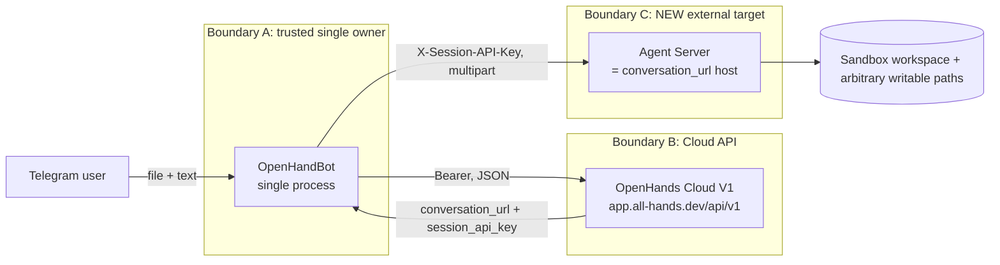
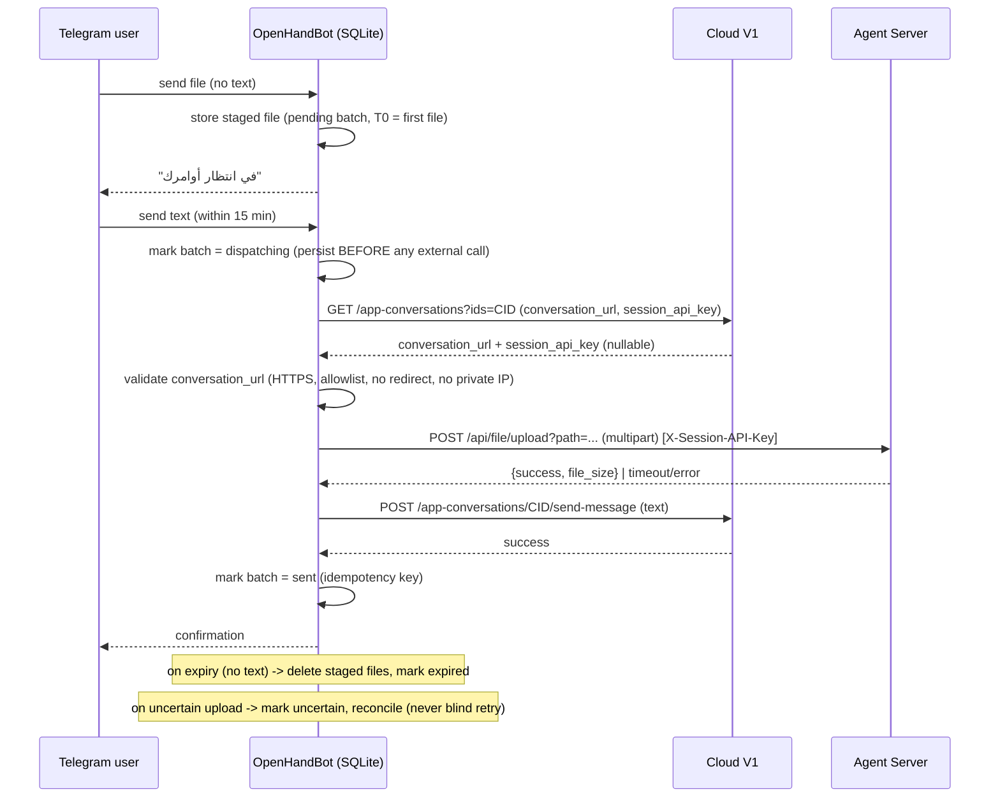

# OHB2-AGENT-SERVER-FILE-UPLOAD-ARCHITECTURE — Design & Threat Model

- **Task ID:** `OHB2-AGENT-SERVER-FILE-UPLOAD-ARCHITECTURE-AND-SECURITY-DESIGN`
- **Revision:** r5 — P0 reopen decision gate re-validation under
  `OHB2-P0-ATTACHMENT-WORKFLOW-REOPEN-AND-SECURE-COMPLETION` (§27): P0 was **explicitly reopened** by
  the owner, the feasibility gate was re-run against the current public API surface, and it **still
  fails** (`BLOCKED — SECURE OPENHANDS UPLOAD CAPABILITY NOT ESTABLISHED`). §1–§26 preserved. Earlier:
  r4 decision record under `OHB2-PLAN-01-APPROVE-DEFERRED-P0-AND-CONTINUE-STAGES-0-5` (§26.4).
- **Related task:** `OHB2-FILE-ATTACHMENT-TEXT-GATE-15M` (deferred — see §26.4)
- **Status:** `BLOCKED — SECURE OPENHANDS UPLOAD CAPABILITY NOT ESTABLISHED` (§27.2). The owner
  **reopened** P0 on 2026-11-12 and authorized implementation **only if** a secure supported upload
  path exists; it does not. Technical cause unchanged (`BLOCKED_BY_SECURITY_OR_API_LIMITATION`, §22).
  The decisive blockers remain **verified** rather than assumed: (B1) the only upload path needs a
  **full-privilege** agent-server credential, and (B2) the `conversation_url` **trusted origin**
  cannot be established from evidence. Both are hard blockers; neither is a weak-check shortcut.
  The earlier Option D product deferral (§26.4) is **superseded** by this reopen; the **safe
  rejection** of unsupported attachments remains in force (fail-closed).
- **Type:** Design-only. No implementation, no schema change, no dependency, no runtime change.
- **Author:** OpenHands agent (autonomous). **Self-review only** (§15, §23) — not an independent security review.
- **Date:** 2026-11-11
- **Repo state when written:** branch `openhands-workspace-3jrWkL2U5fdqzu2fVdxOcW`, HEAD `a29164ff0e5fdc34e35af39b89ff5d8cfa324c3c` (= `origin/main`).

> This is a **new proposal**. It does not modify `AGENTS.md`, `docs/PLAN.md`,
> `docs/plan-openhandBot-2.md`, or any approved decision. It exists to be reviewed and approved,
> or rejected, before any implementation task.

---

## 1. Current architecture baseline (verified from the repository)

The bot is a thin single-process mediator between Telegram and the OpenHands Cloud V1 API.

| Fact | Evidence |
| --- | --- |
| One HTTP integration target: `{base_url}/api/v1`, `Authorization: Bearer` | `bot/openhands_client.py:1-4,38-48` |
| One client instance owns all OpenHands calls; no second client | `bot/openhands_client.py`; `bot/files.py:130`; `bot/handlers.py:130` |
| No arbitrary-URL client exists | `grep -rn "AsyncClient" bot/` → only `bot/openhands_client.py:40` |
| 3xx redirects are rejected (never followed) | `bot/openhands_client.py:66-70` (OHB2-N10-28D) |
| URL logging is suppressed (httpx/httpcore/telegram) to avoid token leakage | `bot/bootstrap.py:82-83` |
| `sandbox_id` is known and used only for `POST /sandboxes/{id}/resume` | `bot/outbox.py:348-352`; `bot/openhands_client.py:373-374` |
| `conversation_url` / `session_api_key` are **not read anywhere today** | `grep -rn "conversation_url\|session_api_key" bot/ tests/` → none |
| Documented stance: no file upload, no second client/worker/table | `bot/files.py:15` |
| Single-owner resource rule | `docs/plan-openhandBot-2.md:61` (§4.1) |
| Architecture diagram: bot ↔ OpenHands Cloud REST V1 only | `docs/PLAN.md:51-58` |
| Sessions stored as SHA-256 hash only (raw token never persisted) | `bot/db.py` `web_sessions` table |
| No Document/Photo/Voice handler exists; non-text messages are dropped | `bot/app.py:80-125` (only `MessageHandler(TEXT & ~COMMAND)`) |
| Telegram update dedup is persistent (`processed_updates`) | `bot/db.py`; `bot/handlers.py` `dedupe_update` |
| At-most-once outbox delivery with CAS states | `bot/outbox.py` |

**Baseline conclusion:** today the bot has exactly **one** external integration (Cloud V1, bearer
auth, JSON-only, redirect-rejecting, no upload). Any upload capability is a **new** integration.

---

## 2. Verified API facts and their sources

All facts below were read from official, public artifacts. **No production call was made and no
production credential was used.**

### 2.A OpenHands Cloud V1 API

- **Spec fetched:** `https://app.all-hands.dev/openapi.json` → `info.version = 1.87.1`, 242 paths.
- **No upload endpoint exists.** Counted in the raw spec: `"upload"` = 0, `"multipart"` = 0,
  `"format": "binary"` = 0. Every `/api/v1/` request body is `application/json`.
- **File operations are read-only:**
  - `GET /api/v1/app-conversations/{conversation_id}/file` — "Read a file from a specific
    conversation's sandbox workspace."
  - `GET /api/v1/app-conversations/{conversation_id}/files` — "List Conversation Files".
  - No `POST`/`PUT`/`PATCH` file route exists under `/api/v1/`.
- **`send-message` cannot carry a file:** `POST /api/v1/app-conversations/{conversation_id}/send-message`
  body `content` is `anyOf: [TextContent, ImageContent]` only. `ImageContent` carries `image_urls`
  (strings: http(s) or base64 data URLs). No generic file/attachment content type.
- **Cloud V1 DOES expose Agent Server connection details** on the conversation object
  (`AppConversation` schema, `GET /api/v1/app-conversations?ids=…` and `/search`):
  - `conversation_url` (`string | null`) — "The URL where the conversation may be accessed".
  - `session_api_key` (`string | null`) — "The Session API Key for REST operations."
  - (Distinct from `conversation_ui_url`, which is the browser UI link.)
  - Source: `openhands/app_server/app_conversation/app_conversation_models.py` (field defs) and
    `docs.openhands.dev/.../batch-get-app-conversations.md` / `search-app-conversations.md`.
- **Cloud provides no upload proxy.** The Cloud V1 proxies only *some* runtime calls
  (`/git/changes`, `/git/diff`, per their descriptions: "Proxy `GET /api/git/…` on the
  conversation's runtime"). There is **no** file-upload proxy route in v1.87.1.

### 2.B Agent Server API

- **Spec fetched:** `https://docs.openhands.dev/openapi/agent-sdk.json`
  (`info.title = "OpenHands Agent Server"`, `info.version = 0.1.0`, 40 paths).
- **Upload operation:** `POST /api/file/upload?path=<absolute>` (query parameter), multipart field
  `file`. Source of truth: `openhands-agent-server/openhands/agent_server/file_router.py`
  (`@file_router.post("/upload")`, `_upload_file`).
  - Response: `{"success": true, "file_size": <bytes>}` (`FileUploadResult(Success)`).
  - 400 if `path` is not absolute; 422 on validation error.
  - **No workspace confinement:** the handler checks only `Path(path).is_absolute()`. There is **no**
    `is_relative_to(workspace)` / `resolve()` confinement in `_upload_file`. Any absolute path the
    sandbox process can write is accepted (e.g. `/etc/cron.d/…`, `/home/*/.bashrc`, `/tmp/…`).
  - **No server-side size limit** in the agent-server config; the body is streamed to disk in 8 KB
    chunks (`_upload_file`). Limits, if any, come from the sandbox/proxy in front, not the API.
- **Authentication (critical):** a **single** `X-Session-API-Key` header guards **every** `/api/*`
  route. Source: `openhands-agent-server/openhands/agent_server/api.py` — one
  `api_router = APIRouter(prefix="/api", dependencies=[Depends(require_initialized),
  Depends(check_session_api_key)])` mounts `bash_router`, `conversation_router`, `file_router`,
  `credential_binding_router`, `skills_router`, `git_router`, `hooks_router`, `mcp_router`, …
  - Header-only on regular `/api/*` routes (`F02.http-header-only`: cookie, `?session_api_key=`, and
    `Authorization: Bearer` all get 401 on non-workspace routes).
  - **No per-endpoint authorization and no upload-scoped credential.** The same key reaches
    `POST /api/bash/execute_bash_command` (arbitrary command execution) and
    `POST /api/conversations/{id}/secrets`.
  - Official doc: an agent-server session key "can execute commands and read or write files in its
    configured workspace" (`docs.openhands.dev/sdk/arch/agent-server.md`).
- **`conversation_url` construction (source):** in
  `openhands/app_server/app_conversation/live_status_app_conversation_service.py`,
  `_build_conversation()` takes the sandbox `exposed_urls` entry whose `name == AGENT_SERVER`,
  appends `/api/conversations/{conversation_id_hex}`, and copies `sandbox.session_api_key`. The
  `AGENT_SERVER` URL itself comes from the runtime API (`runtime['url']`) in
  `openhands/app_server/sandbox/remote_sandbox_service.py`.

### 2.C Source/artifact references (all public)

- Cloud OpenAPI: `https://app.all-hands.dev/openapi.json` (v1.87.1).
- Agent Server OpenAPI: `https://docs.openhands.dev/openapi/agent-sdk.json` (v0.1.0).
- Agent Server auth: `https://docs.openhands.dev/sdk/arch/agent-server.md`.
- Upload endpoint doc: `https://docs.openhands.dev/sdk/guides/agent-server/api-reference/files/upload-file.md`.
- Conversation URL / session key fields:
  `https://docs.openhands.dev/openhands/usage/cloud/api-reference/conversations/batch-get-app-conversations.md`.
- Source repos: `github.com/OpenHands/software-agent-sdk`
  (`openhands-agent-server/openhands/agent_server/{api,file_router,auth_router}.py`,
  `.agents/skills/verify-agent-server/references/feature-map/F02-auth-and-sessions.md`,
  `F14-files.md`), `github.com/OpenHands/sandbox-server`
  (`openhands/app_server/app_conversation/live_status_app_conversation_service.py`,
  `openhands/app_server/sandbox/remote_sandbox_service.py`).

---

## 3. Explicitly UNVERIFIED assumptions

These are **not** established and must not be treated as facts:

1. **UNVERIFIED — Cloud host pattern for `conversation_url`.** We could not obtain, from
   documentation or the repo, the concrete, stable host(s) that OpenHands Cloud returns in
   `conversation_url`. Source shows it derives from the runtime API's `runtime['url']`
   (`remote_sandbox_service.py`), which is infrastructure-dependent (path-mode
   `…/{runtime_id}/…` vs subdomain-mode `…/{service}-{host}/…`, per `_build_service_url`). Whether
   the Cloud returns an `https://` origin with a fixed suffix, and whether it changes across
   regions/versions, is **unknown** to the bot. **No production call was made to learn it.**
2. **UNVERIFIED — that Cloud always populates `conversation_url`/`session_api_key`.** They are
   nullable; the live-status source only fills them when the sandbox is RUNNING with exposed URLs.
3. **UNVERIFIED — sandbox filesystem scope.** The exact set of paths the sandbox user can write
   (does it run as root? is `/etc` writable?) is not established. The API itself imposes no
   confinement, but the *container* may.
4. **UNVERIFIED — actual upload size ceiling** imposed by the Cloud runtime/proxy in front of the
   agent server (the API has none).
5. **UNVERIFIED — key lifetime/rotation semantics for Cloud-issued `session_api_key`.** The
   agent-server supports rotation via `OH_SESSION_API_KEYS_*`, but Cloud's issuance/refresh policy
   for these per-conversation keys is not documented in what we read.
6. **ASSUMPTION (conservative) — the `session_api_key` grants the full agent-server API**, because a
   single dependency guards all `/api/*` routes. We assume worst case: command execution.

---

## 4. Architecture diagram / sequence diagram

### 4.1 Trust boundaries (proposed Option A)

The new element is **Boundary C**: a second external target with a second auth scheme. Boundary C is
reached only via a `conversation_url` supplied by Boundary B; the bot must validate that URL before
trusting it.

### 4.2 Proposed 15-minute pending workflow (design only — NOT implemented)

---

## 5. Credential acquisition and lifecycle design

### 5.1 Where the key originates

- `session_api_key` is returned by Cloud V1 on the conversation object
  (`GET /api/v1/app-conversations?ids=CID`), together with `conversation_url`.
- It is associated with **exactly one conversation** (and its sandbox). The bot already fetches the
  conversation object in `bot/outbox.py` (`get_conversation`), so no new discovery mechanism is
  strictly required — but the field is currently ignored.

### 5.2 Storage and exposure rules (design constraints)

| Rule | Enforcement |
| --- | --- |
| Never expose to the Mini App / browser / Telegram user | Keep it inside the server-side client; never place in `web_sessions.profile`, JSON responses, or Telegram messages. |
| Never persist if avoidable | Prefer **on-demand fetch** per upload (fetch conversation → use key → drop). Avoids at-rest secret. |
| If persistence is unavoidable | Encrypt at rest with a key from env (there is no `OH_SECRET_KEY`-style facility today) — **this is a new capability** and a reason to prefer on-demand fetch. |
| Never log | Follow the existing `bot/bootstrap.py` redaction precedent; add the key to the redaction set and ensure `httpx` URL logs are suppressed for the agent-server host. |
| Never include in exceptions | `ApiError` messages must be constructed without the key; the existing client pattern avoids echoing headers. |
| Access restriction | Only the upload code path may read the key; no generic getter that other modules can call. |

### 5.3 Lifecycle

- **Expiration/revocation:** key validity is tied to the sandbox. A stale key ⇒ 401. The bot must
  treat 401 as "fetch a fresh conversation object and retry once", then fail closed.
- **Rotation/recovery:** the agent-server rotates keys across restarts; a conversation may present a
  new key after resume. On-demand fetch per upload naturally handles rotation.
- **Failure handling:** a 401/403/404/410/503 from the agent server is a **hard failure** for that
  upload; never blind-retry (see §9). Surface a clear Arabic error and leave the batch
  `uncertain` for reconciliation.

### 5.4 The credential is full-privilege (design consequence)

Because one key guards all `/api/*` routers (§2.B), holding it is equivalent to holding
"execute commands in this sandbox + read/write files + manage conversation secrets". The bot would
therefore be entrusted with a **command-execution-capable** credential to perform a **file upload**.
There is **no documented least-privilege option**. Per §5.D of the task, this must be weighed
explicitly — see §11 and §13.

---

## 6. Network and endpoint validation design

The bot must not trust a URL merely because it came from the API. Required, enforceable rules:

| # | Rule | Enforceable? |
| --- | --- | --- |
| N1 | Scheme must be `https` (reject `http`, `file`, others) | Yes (parse + compare) |
| N2 | Host must match an **allowlist** of documented Cloud runtime hosts | **NOT currently** — pattern UNVERIFIED (§3.1) |
| N3 | Reject any userinfo (`user:pass@host`), non-default explicit ports outside an allowed set | Yes |
| N4 | Resolve DNS and reject private/loopback/link-local/multicast/ULA/CGNAT ranges; pin the resolved IP for the connection | Yes (resolve → validate → connect to IP with SNI/Host preserved) |
| N5 | Disable redirects (`follow_redirects=False`) and treat any 3xx as failure | Yes (matches existing client policy) |
| N6 | Reject path that is not the expected `/api/conversations/{uuid}` prefix | Yes |
| N7 | Guard against DNS rebinding (validate the IP actually connected to, not just the pre-check) | Partially (pin IP at connect; httpx makes this awkward) |
| N8 | TLS verification on (never disabled) | Yes |

**Gate G1 (SSRF):** N2 is the blocker. Without a documented, stable host allowlist for
`conversation_url`, the only alternatives are (a) an IP-range check plus "any https host" — which is
**a weak check and explicitly rejected by the task**, or (b) an operator-configured allowlist in
`.env` — which pushes the trust decision to deployment config and is not verifiable from the repo.
Per the task: *"If a safe validation policy cannot be established for actual OpenHands Cloud
endpoints, state that the design is blocked rather than proposing a weak hostname check."*
→ **The design is blocked on G1.**

---

## 7. Threat model and mitigations

Legend — Enforceable: **Y** = technically enforceable in the proposed architecture; **P** = partial;
**N** = only a documentation promise (rejected as a mitigation).

| # | Threat | Attack scenario | Impact | Required mitigation | Enf. | Residual risk | Verification |
| --- | --- | --- | --- | --- | --- | --- | --- |
| T1 | Key leakage via logs/exceptions/DB dump/debug | `session_api_key` echoed in an `ApiError`, an httpx URL log, a traceback, or a Mini App JSON | Full sandbox command execution for an attacker who reads the log/dump | Redaction set incl. the key; no key in URLs/messages; on-demand fetch (no at-rest copy); never in `web_sessions` | P | Any process-level memory/log access still sees it transiently | Unit test: assert key never appears in log records/`ApiError` strings; grep logs in tests |
| T2 | Cross-conversation / cross-user Agent Server access | Bot uses conversation A's key against conversation B's URL, or a stale key from another conversation | File written to the wrong workspace | Bind key↔URL from the **same** conversation object fetch; never cache across conversations | Y | — | Test: mismatched key/URL pair is rejected before any call |
| T3 | SSRF via manipulated `conversation_url` / redirect / DNS | Malicious/erroneous URL points at internal service; or a 30x redirects to metadata | Internal service access, credential leak to attacker host | N1–N8; **host allowlist (N2) is the gate** | **N** (until G1 closed) | HIGH while unclosed | SSRF test suite: `http`, `169.254.169.254`, `127.0.0.1`, `10.x`, `user@host`, redirect → all rejected |
| T4 | Path traversal / arbitrary path upload | Upload to `/etc/cron.d/x` or `../../…` via the `path` query | Overwrite sandbox files; possible sandbox escape if writable system paths | Bot-side: generate destination path internally under a fixed workspace subdir; reject any client-controlled path; normalize + confine | Y (bot-side) | Server imposes **no** confinement, so bot-side confinement is the only guard | Test: only internally generated `/workspace/project/.ohb2_uploads/<safe>` paths are ever sent |
| T5 | Privilege abuse (command execution) via the key | Compromised bot process calls `/api/bash/execute_bash_command` with the key | Arbitrary command execution in the sandbox | **No least-privilege credential exists** → cannot be mitigated within the design | **N** | HIGH: this is the core objection to Option A | N/A (accepted risk if Option A proceeds) |
| T6 | Cross-conversation file attachment | User's file lands in another conversation | Data disclosure to wrong workspace | Same as T2 | Y | — | Same as T2 |
| T7 | Credential expiration/revocation/stale | Upload fails 401 after rotation | Feature fails; possible retry storm | On-demand fetch; on 401 refresh once then fail closed | Y | Feature outage | Test: 401 → single refresh → still 401 → fail closed, no loop |
| T8 | Malicious/oversized file, MIME spoofing, storage exhaustion | Multi-GB file or spoofed type | Disk exhaustion in sandbox; downstream harm | Bot-side size cap + type allowlist + extension sanitization; reject before upload | Y (bot-side) | Server has no size limit; bot cap is the guard | Test: oversize/spoofed rejected locally |
| T9 | Duplicate upload after timeout/uncertain response | Timeout → retry uploads twice | Duplicate file, wasted quota | Idempotency key per batch + "uncertain ⇒ reconcile, no blind retry" | Y (design) | True exactly-once impossible across HTTP | Test: injected timeout yields `uncertain`, not a second upload |
| T10 | Crash between upload and prompt submit | File uploaded, text never sent | Orphan file, user confusion | Persist batch state (`uploaded`/`dispatched`) before each external step; reconcile on restart | Y | — | Restart-simulation test |
| T11 | Temp file exposure / cleanup failure | Staged file remains world-readable / never deleted | Local data leak | Staged dir with restrictive perms; TTL cleanup on expiry/startup | Y | Crash before cleanup | Test: expiry deletes staged files; startup sweeps stale ones |
| T12 | Concurrent requests / races | Two texts arrive for one batch; double dispatch | Duplicate prompt/upload | Single-worker + DB CAS state machine (mirror the outbox pattern) | Y | — | Concurrency test |
| T13 | Redirects / TLS / unsafe proxy | MITM or redirect to attacker host | Credential theft | `follow_redirects=False`; TLS verify on; treat 3xx as failure | Y | Proxy trust is deployment-level | Test: redirect → failure, no `X-Session-API-Key` forwarded |
| T14 | Bot process compromise + stored keys | Attacker with the bot's env/memory reaches the key | Command execution in the owner's sandbox | Minimize key lifetime (on-demand), never persist, redact | P | HIGH (same as T5) | Review of secret handling paths |

**Honest summary:** T3, T5, and T14 are the load-bearing risks. T5/T14 cannot be reduced within the
design (no least-privilege credential); T3 cannot be closed without G1. Everything else is
mitigable with normal engineering.

---

## 8. File handling and upload lifecycle (proposal, not fact)

All values below are **proposals**, not existing facts. They must be confirmed against the repo/API
before implementation.

| Item | Proposed value | Rationale |
| --- | --- | --- |
| Max size | 20 MB (proposal) | Conservative; no server limit exists |
| Allowed types | Text/code, PDF, images, common office docs (proposal) | Avoid executables/archives |
| Content validation | Magic-byte sniff + declared-type cross-check | Detect MIME spoofing |
| Internal naming | `{batch_id}/{index}-{sha256[:16]}.{safe_ext}` | Deterministic, collision-safe, no client name trust |
| Destination dir | `/workspace/project/.ohb2_uploads/<batch_id>/` (proposal) | Inside workspace; hidden |
| Path normalization | `posixpath.normpath`, reject `..`, NUL, backslash, control chars | Mirror `bot/files.py` allowlist rules |
| Upload timeout | 60 s (proposal) | Match SDK client default |
| Temp lifecycle | Staged under a restrictive dir; deleted on success, expiry, or startup sweep | Bound exposure |
| Partial upload | Delete partial; mark batch `uncertain` | Never leave half-written file as success |
| Uncertain result | Mark `uncertain`; reconcile by re-fetching state; never blind-retry | Matches outbox philosophy |

---

## 9. Failure modes and reconciliation strategy

- **State machine (proposed):** `pending → dispatching → uploaded → sent`, with side states
  `expired`, `uncertain`, `failed`.
- **Before any external call:** persist the intent (mirror `bot/outbox.py` CAS discipline).
- **Timeout / 5xx / connection error on upload:** mark `uncertain`. Reconciliation re-fetches the
  conversation and, if feasible, lists the destination to detect whether the file landed; otherwise
  surface the ambiguity to the user. **No blind retry.**
- **Crash between upload and `send-message`:** on restart, a batch in `uploaded` resumes at the
  `send-message` step; a batch in `dispatching` is treated as `uncertain`.
- **Expiry (no text within 15 min):** delete staged files, mark `expired`, notify the user.
- **Distributed-transaction limitation (unavoidable):** the bot's SQLite and the Agent Server cannot
  commit atomically. The bot can only guarantee *local* at-most-once intent plus *idempotent
  reconciliation*. A crash exactly between a successful upload and the local state write leaves an
  orphan file that the bot may not know about; the only mitigation is a reconciliation read, which
  the API does not guarantee (no "list uploads" endpoint). This is a **known residual limitation**.

---

## 10. Compatibility with the 15-minute pending workflow

The workflow (receive file → persist pending → "في انتظار أوامرك" → 15-min window → on text upload
file(s) + send text to the **same** conversation → expire/cleanup → restart-safe → no duplicates →
uncertain reconciliation) is fully expressible **only if Option A is approved**. The workflow's
hard dependency is a working upload path (§2). Without it, the workflow cannot be implemented at
all (which is why `OHB2-FILE-ATTACHMENT-TEXT-GATE-15M` is blocked).

---

## 11. Alternatives comparison

| Criterion | **Option A** — Agent Server upload (existing ownership) | **Option B** — Keep Cloud V1, reject uploads | **Option C** — Defer until Cloud offers upload / a restricted credential |
| --- | --- | --- | --- |
| Security exposure | **HIGH**: full-privilege (command-exec) credential; SSRF surface | **None added** | **None added** |
| Architectural impact | **Large**: second external target + second auth scheme; must stay inside `OpenHandsClient` ownership | **None** | **None** |
| Implementation complexity | High (upload client, URL validation, state machine, cleanup, reconciliation) | Trivial (reject with a clear message) | Trivial now |
| Operational requirements | Must validate hosts; handle rotation; monitor failures | None | None |
| Failure/recovery | Complex (uncertain states, orphan files) | N/A | N/A |
| 15-min workflow compatibility | Full | Not possible | Not possible (until enabled) |
| Long-term maintenance | High (tracks agent-server churn) | None | None until enabled |

**Evidence-driven recommendation:** **Option C is the safest default; Option A should not proceed
to implementation now** because (i) the SSRF gate G1 cannot be closed from available evidence, and
(ii) the credential is full-privilege with no least-privilege alternative (T5/T14). Option B is the
current effective behaviour and is the honest answer for `OHB2-FILE-ATTACHMENT-TEXT-GATE-15M` in the
meantime.

---

## 12. Required approvals and unresolved questions

**Approvals required before any implementation:**

1. Explicit approval of a **second external integration** (new host + `X-Session-API-Key` scheme),
   acknowledging it departs from `bot/files.py:15` and `docs/plan-openhandBot-2.md:61`.
2. Explicit acceptance of the **full-privilege credential risk** (T5/T14) *or* a decision to reject
   the integration.
3. Approval of the **SSRF policy** once G1 is resolved (see below).

**Unresolved questions / evidence required (blocking):**

- **Q1 (G1):** What are the concrete, stable host(s)/patterns OpenHands Cloud returns in
  `conversation_url`? Evidence needed without a production call: an official doc stating the
  runtime host pattern, or a provider-committed allowlist. *Without this, the SSRF mitigation is a
  weak check and must not be shipped.*
- **Q2:** Is there any restricted credential (upload-only) on the roadmap? If not, Option A carries
  command-execution privilege.
- **Q3:** What is the Cloud `session_api_key` lifetime/rotation policy?
- **Q4:** What real upload size ceiling does the Cloud runtime enforce?
- **Q5:** Does Cloud populate `conversation_url`/`session_api_key` for every RUNNING conversation
  the bot manages (nullable fields)?

---

## 13. Recommendation

**Do not implement.** Status: `NEEDS_EVIDENCE`.

- If the owner wants file attachments soon and accepts the risk, **Option A is designable** for
  T1/T2/T4/T6/T7–T13, but it remains blocked by **G1 (SSRF host validation)** and by the
  **full-privilege credential (T5/T14)**. Proceeding without Q1/Q2 would mean shipping a weak host
  check and an over-privileged credential — both explicitly disallowed.
- The conservative, reversible choice today is **Option B** (reject uploads with a clear Arabic
  message), keeping `OHB2-FILE-ATTACHMENT-TEXT-GATE-15M` blocked until Q1/Q2 are answered, with
  **Option C** as the strategic position.

---

## 14. Test strategy for a future implementation task (if approved)

Only *after* approval and only for the implemented code:

1. **URL validation (SSRF):** table-driven tests — reject `http://`, `file://`, userinfo,
   private/loopback/link-local/ULA IPs, unexpected ports, wrong path prefix, and any 3xx response;
   assert `X-Session-API-Key` is never sent to a rejected host.
2. **Credential redaction:** assert the key never appears in log records, `ApiError` text, or Mini
   App payloads.
3. **Path safety:** assert only internally generated destination paths are ever transmitted; reject
   traversal/NUL/backslash.
4. **Size/type:** oversize and MIME-spoofed inputs rejected locally.
5. **State machine:** `pending→dispatching→uploaded→sent`, plus `expired/uncertain/failed`;
   injected timeout ⇒ `uncertain` and **no** second upload; restart between upload and send resumes
   correctly.
6. **Cleanup:** expiry and startup sweeps delete staged files.
7. **Concurrency:** two texts for one batch dispatch exactly once (CAS).
8. **Conversation binding:** key/URL from the same fetch; mismatch rejected.
All tests must use a fake transport (no real network), mirroring the existing
`tests/test_outbox*.py` style.

---

## 15. Adversarial self-review (self-review only — NOT independent)

Challenging the proposal as a security reviewer:

1. **"HTTPS + API key = secure" is rejected.** The proposal explicitly relies on host allowlisting
   and IP validation, not on TLS alone.
2. **Weak-check rejection.** I refused to propose "any https host + private-IP block" as the SSRF
   mitigation; I marked G1 as **blocked** instead. ✅ (matches task instruction)
3. **Second resource owner?** The design keeps a **single** client boundary and a **single** worker
   (the existing outbox/state owner); it does **not** add a second process, DB, or scheduler. ✅
4. **Documentation-only mitigations?** The design does not rely on "we will be careful" anywhere;
   every listed mitigation is a code-level check, except where explicitly marked `N` (T3 until G1,
   T5/T14 — accepted risk). ✅
5. **Credential exposure:** on-demand fetch avoids at-rest storage; redaction is testable; the key
   never touches the Mini App/Telegram. Residual: in-process memory (T1/T14). Honest.
6. **Privilege escalation:** identified and **not** hand-waved — there is no least-privilege
   credential, so this is a reason to reject/defer, not a "mitigated" item.
7. **Cross-conversation access:** bound to the same conversation fetch (T2/T6).
8. **Duplicate external ops:** idempotency + "uncertain ⇒ reconcile" (T9/T10/T12).
9. **Unbacked assumptions flagged:** §3 lists six, including the pivotal host-pattern unknown.
10. **Does the proposal quietly weaken existing controls?** No: redirects stay disabled, bearer
    flow unchanged, no security control removed. It *adds* a target, which is the point of the
    review.

**Verdict of the self-review:** the design is **not safe to proceed to implementation** as-is. It
**requires further evidence** (Q1, Q2) and owner approval of the privilege trade-off, or it should
be rejected in favour of Option B/C. This is a self-review; an **independent** security review is
still required before any implementation.

---

# r2 — Reassessment: `OHB2-P0-FILE-UPLOAD-FEASIBILITY-AND-SECURITY-REASSESSMENT`

> **§1–§15 above are preserved.** This section re-verifies the API surface from primary sources
> (official OpenAPI specs + upstream source at HEAD of `main`) rather than relying on §1–§15, and
> resolves the prior gates (G1/Q1) into **verified blockers**. Legend: **[F] verified fact**,
> **[A] design proposal**, **[G] unresolved question**.

## 16) Verified baseline and governance

- **[F] Branch/HEAD:** `openhands-workspace-3jrWkL2U5fdqzu2fVdxOcW`, HEAD
  `a29164ff0e5fdc34e35af39b89ff5d8cfa324c3c` == `origin/main`, divergence `0 0`.
- **[F] Working tree (preserved untouched):** 4 tracked modifications — `.agent/PROGRESS.md`,
  `README.md`, `bot/app.py`, `bot/handlers.py` (= 101 insertions, from prior tasks) — and 3
  untracked files (`docs/proposals/OHB2-AGENT-SERVER-FILE-UPLOAD-ARCHITECTURE.md` (this file),
  `docs/proposals/OHB2-TELEGRAM-ACK-ARCHITECTURE-ADR.md`, `tests/test_unsupported_attachment_rejection.py`).
- **[F] No P0 scaffolding exists.** `grep -rn "في انتظار أوامرك" bot/ tests/` → none. There is
  **no** pending-file table, staged-file directory, or 15-minute gate in the code today.
- **[F] `conversation_url` / `session_api_key` are read nowhere in first-party code.** Only
  `sandbox_id` is used (`bot/outbox.py:348-352` → `POST /sandboxes/{id}/resume`).
- **[F] The only first-party HTTP client is `bot/openhands_client.py`** (`httpx.AsyncClient`,
  `Authorization: Bearer`, base `{OPENHANDS_BASE_URL}/api/v1`, `follow_redirects` off, 3xx = error).
  No second client, no arbitrary-URL client.
- **[F] No temp-file facility exists.** `grep -rn "tempfile|mkdtemp|TemporaryDirectory|unlink|os.remove" bot/` → none.
- **[F] `bot/config.py` has no `conversation_url`/host allowlist.** It has
  `MINI_APP_ALLOWED_ORIGINS` (a *web* CORS allowlist, unrelated) and validates `OPENHANDS_BASE_URL`
  (must be `https://` for external hosts). There is no runtime-host allowlist.

## 17) Re-verified API surface (primary sources)

### 17.A OpenHands Cloud V1 API — **[F] no upload path**

- **Spec:** `https://app.all-hands.dev/openapi.json`, `info.version = 1.87.1`, **242 paths**.
- **[F] No upload operation anywhere.** Programmatic check over the raw spec: **0** operations
  mention `upload` or `multipart`; `format: binary` is absent.
- **[F] File routes are read-only:** `GET /api/v1/app-conversations/{conversation_id}/file` and
  `GET /api/v1/app-conversations/{conversation_id}/files`. No `POST`/`PUT`/`PATCH` file route.
- **[F] `send-message` cannot carry a generic file.** `POST /api/v1/app-conversations/{conversation_id}/send-message`
  body `AppSendMessageRequest.content` = `array` of `anyOf: [TextContent, ImageContent]`
  (`minItems: 1`). `ImageContent` = `{type:"image", image_urls: [string]}`. `TextContent` =
  `{type:"text", text}`. **No** `FileContent`/attachment type. The endpoint description says it is
  "intentionally a thin proxy that forwards messages to the agent server".
- **[F] The Cloud exposes the agent-server connection details** on `AppConversation`:
  `conversation_url` ("The URL where the conversation may be accessed", `string|null`),
  `session_api_key` ("The Session Api Key for REST operations.", `string|null`),
  `conversation_ui_url` (browser URL), `sandbox_id` (`string`). Source: Cloud OpenAPI
  `components.schemas.AppConversation` and the doc
  `docs.openhands.dev/openhands/usage/cloud/api-reference/conversations/batch-get-app-conversations.md`.
- **[F] Cloud proxies only *some* runtime calls** (`GET …/git/changes`, `GET …/git/diff` —
  "Proxy ``GET /api/git/…`` on the conversation's runtime"). **There is no file-upload proxy.**
- **[A] `ImageContent.image_urls` accepts a `data:` URL (base64)** — the SDK preserves them
  (`openhands-sdk/openhands/sdk/llm/message.py`: `image_urls: Annotated[list[str], PreserveDataUrls()]`).
  This is an **image-only** channel (data URL), **not** a generic file upload. It is the one
  *documented* Cloud-only path that avoids a second credential, but it only works for images the
  configured LLM can accept and it must be verified against Cloud before any use (see §21 Option C).

### 17.B Agent Server API — **[F] the only upload endpoint**

- **Spec:** `https://docs.openhands.dev/openapi/agent-sdk.json`, `title = "OpenHands Agent Server"`,
  `version = 0.1.0`, **40 paths**.
- **[F] Upload:** `POST /api/file/upload/{path}` (path parameter = "Absolute file path"),
  `multipart/form-data` field `file` (`format: binary`). Response `200` → `Success`
  (`{"success": true}`), and the concrete model is `FileUploadResult(Success)` with
  `file_size: int`. `422` on validation error.
- **[F] No workspace confinement.** Upstream `openhands-agent-server/openhands/agent_server/file_router.py`
  (`_upload_file`): the **only** check is `if not target_path.is_absolute(): raise 400`. There is
  **no** `resolve()` / `is_relative_to(workspace)` confinement. `target_path.parent.mkdir(parents=True,
  exist_ok=True)` is called first, so **any absolute path** the sandbox user can write is accepted
  (e.g. `/etc/cron.d/x`, `/home/*/.bashrc`, `/tmp/…`). The write streams in 8 KB chunks.
- **[F] No server-side size limit** in the agent-server upload handler.
- **[F] Authentication is a single full-privilege key.** Upstream `api.py`: one
  `api_router = APIRouter(prefix="/api", dependencies=[Depends(require_initialized), Depends(check_session_api_key)])`
  mounts `file_router`, `bash_router`, `conversation_router`, `credential_binding_router`,
  `git_router`, `skills_router`, `hooks_router`, `mcp_router`, … `dependencies.py`:
  `check_session_api_key` reads the `X-Session-API-Key` header and only checks membership in
  `config.session_api_keys` (401 otherwise) — **no scope, no per-endpoint authorization**.
  So the same key that uploads a file also reaches `POST /api/bash/execute_bash_command`
  (arbitrary command execution) and `POST /api/conversations/{id}/secrets`.
  Official doc confirms: an unauthenticated agent server "can execute commands and read or write
  files in its configured workspace"; clients "must send the session key in the `X-Session-API-Key`
  header"; the key is a **server-wide** session key.
- **[F] `X-Session-API-Key` cannot be obtained without reading Cloud's `session_api_key`.**
  (Cloud issues it per conversation; the agent server accepts only its configured keys.)

## 18) Authentication and authorization analysis

| Candidate | Auth | Scope | Targets existing conversation? | Preserves repo/conv? | Least privilege? |
| --- | --- | --- | --- | --- | --- |
| Cloud `POST /send-message` | `Bearer OPENHANDS_API_KEY` (already held) | Cloud org/user API | Yes | Yes | Yes (same key the bot already uses) |
| Cloud `GET …/file`, `…/files` | same Bearer | read-only | Yes | Yes | Yes |
| Agent Server `POST /api/file/upload/{path}` | `X-Session-API-Key` (Cloud `session_api_key`) | **entire agent-server `/api/*`** | Yes (per-conversation sandbox) | Yes | **No** — full privilege |

- **[F] `session_api_key` grants far more than this feature needs.** The feature needs *one*
  write of *one* file into *one* conversation's workspace. The key grants **command execution** and
  **secret management** in that sandbox. There is **no** upload-scoped credential. This is the
  **B1 blocker** (§22).
- **[A] Binding upload to the authenticated user's conversation is *doable*** (fetch the
  conversation object for the *stored* `conversation_id` the user is acting on, use *that*
  object's `conversation_url`+`session_api_key` together, never cache across conversations). So the
  *binding* problem is solvable; the *privilege* and *origin* problems are not.

## 19) SSRF and `conversation_url` trust boundary

- **[F] The upload target is fully attacker-influenced in the worst case.** `conversation_url`
  comes from Cloud, but if Cloud (or anything upstream of it) returns an unexpected value, the bot
  would send `X-Session-API-Key` to that host. A key sent to an attacker-controlled host = command
  execution in the owner's sandbox for that attacker.
- **[F] There is no trusted-origin anchor available.** The only anchor the bot has is the fixed
  `OPENHANDS_BASE_URL` (`https://app.all-hands.dev`) for the **Cloud** API. The **agent-server**
  origin is *infrastructure-dependent*: upstream `live_status_app_conversation_service.py`
  builds `conversation_url` from the sandbox `exposed_urls` `AGENT_SERVER` entry, which derives
  from the runtime API's `runtime['url']` (`remote_sandbox_service.py`, `_build_service_url`,
  path-mode vs subdomain-mode). No official doc states the concrete host/pattern.
- **Required SSRF controls (all technically enforceable, but insufficient without a trusted origin):**
  N1 scheme `https` only; N3 reject userinfo/odd ports; N4 resolve DNS and reject
  private/loopback/link-local/ULA/CGNAT/multicast, pin the resolved IP for the connection;
  N5 `follow_redirects=False` and treat 3xx as failure; N6 require the expected path prefix;
  N7 guard DNS-rebinding by validating the *connected* IP; N8 TLS verification on.
- **[G] Even all of N1–N8 do not make the target trusted.** "Any `https` host + private-IP block"
  is exactly the **weak hostname check the task forbids**. A *strong* control needs an explicit
  **allowlist of the actual agent-server origins** (N2). That allowlist does not exist in evidence
  and cannot be derived from the repo. This is the **B2 blocker** (§22).
- **[F] Positive note:** the project already never follows redirects and never disables TLS, so the
  *existing* controls would not be weakened — but they are not sufficient for a new target.

## 20) File-security findings (upload lifecycle)

| Item | Finding | Enforceable? |
| --- | --- | --- |
| Server path confinement | **None** (only `is_absolute()`) | Bot-side only |
| Path traversal | Bot must generate the destination path internally; never accept a client path | Yes (bot-side) |
| Size cap | Server has **none**; bot must cap (proposal 20 MB) | Yes (bot-side) |
| Type/spoofing | Magic-byte sniff + declared-type cross-check | Yes (bot-side) |
| Filename | Never trust the Telegram filename; use `{batch}/{index}-{sha256[:16]}.{safe_ext}` | Yes (bot-side) |
| Temp storage | No facility exists today; must be created (restrictive perms, TTL sweep) | Yes (new code) |
| Logs/secrets | `session_api_key` must never enter logs/`ApiError`/Mini App payloads | Yes (redaction + suppress httpx URL logs for the new host) |
| Ambiguous result | Never blind-retry; never delete on uncertainty | Yes (state machine) |

- **[F] `bot/files.py:15` documents the current stance** ("مفيش رفع ملفات … ومفيش عميل تاني ولا
  worker ولا جدول جديد") and the *read* path already had to add a local allowlist because the
  OpenHands read endpoint is unconfined. The **write** endpoint is equally unconfined.

## 21) Implementation options compared

| Criterion | **A** Cloud-supported upload | **B** Agent Server upload (trusted origin + scoped auth) | **C** Other supported existing-conversation mechanism | **D** No safe implementation |
| --- | --- | --- | --- | --- |
| Feasibility | **Not available** — Cloud V1 has no upload route (§17.A) | Technically works, but **blocked** (B1+B2) | **Partial only:** `ImageContent` data-URL, **images only**, Cloud-only; needs Cloud verification; not a generic file | **Available today** |
| Security risk | N/A | **HIGH** — full-privilege key (command exec) + unconfined path + SSRF origin gap | **MEDIUM** (no new credential; data URLs stay inside the existing Bearer boundary) — but not a file upload | **None added** |
| Auth required | — | Cloud `session_api_key` (full privilege) | Existing `Bearer OPENHANDS_API_KEY` | — |
| Architecture fit | N/A | Breaks "one client / no second auth scheme" | Fits (same client), **but** image-only and unverified | Fits perfectly |
| Code/schema changes | — | Upload client, origin allowlist, temp store, state machine, cleanup, reconciliation, new table | Small (extend `send-message` content), **image-only**; schema for the pending batch still needed | None |
| Failure/recovery | — | Complex (uncertain states, orphan files) | Same pending-batch machinery needed | N/A |
| Meets **all** P0 criteria | No | No (blocked) | **No** (image-only ⇒ cannot carry arbitrary files) | Yes, by rejecting files |

**Option C in detail (the one thing worth a follow-up):** `POST /send-message` *can* carry
`ImageContent.image_urls`, and the SDK preserves `data:` (base64) URLs. If Cloud's `send-message`
forwards data URLs unchanged to the agent server, the bot could deliver **images** to the existing
conversation **using only the credential it already holds** — no second host, no `session_api_key`,
no SSRF surface. **But** this is **(a)** image-only (not the general "attached files" the P0
requires), **(b)** **[G] unverified against Cloud** (the OpenAPI says `image_urls: [string]` but
does not document `data:` acceptance, and the Cloud path may reject or re-fetch non-http URLs), and
**(c)** dependent on the configured LLM having vision. It is therefore **not** a solution to P0 as
stated; it is at most a future, narrower feature.

## 22) Verdict and blockers

**Verdict: `P0 BLOCKED BY SECURITY OR API LIMITATION`.**

**B1 — No least-privilege upload credential. [F]** The only upload endpoint
(`POST /api/file/upload/{path}`) is guarded by the **same** `X-Session-API-Key` that also allows
arbitrary command execution and secret management in the sandbox. The feature needs a file write;
it would have to hold a **command-execution-capable** credential. No scoped/upload-only credential
exists or is documented.

**B2 — No trusted origin for `conversation_url`. [F]+[G]** A strong SSRF defense requires an
allowlist of the concrete agent-server origins. That allowlist is not documented and cannot be
derived from the repo or public docs; the origin is infrastructure-dependent. Per the task, a weak
hostname check must **not** be shipped — so the design is **blocked**, not "mitigated".

**Secondary blockers (independent of B1/B2):**
- **[F] The server imposes no path confinement and no size limit** — the bot would be the *only*
  guard; any bot bug becomes an arbitrary-write.
- **[G] No "list uploads"/verification endpoint** — an upload that succeeds at the server but whose
  response is lost cannot be confirmed, so "unknown result ⇒ no blind retry, no premature delete"
  is correct but leaves a permanent `uncertain` state with no reconciliation path.

**Minimum approvals that *would* be required to unblock (not granted, not made):**
1. Product approval to **not** ship file upload (Option D) — the safe default — **or**
2. A decision that the **full-privilege credential (B1) is acceptable**, plus
3. A **provider-committed, stable agent-server origin allowlist (B2)**, plus
4. A **new architectural approval** for a second external target + second auth scheme (departs from
   `bot/files.py:15` and `docs/plan-openhandBot-2.md` §4.1), plus
5. A **new schema** for the pending batch (a new table — also a §4.1 departure).

**None of these approvals is granted here. No architectural change is made.**

## 23) Architecture-constraint compliance (of the *proposed* design, for the record)

The *proposed* (unapproved) design keeps: one process; one SQLite owner; existing workers
(`OutboxWorker`/`CreationWorker`/`CompletionWorker`/`Watcher`/`Notifier`) and their scheduling only;
existing storage only; no second DB; no independent worker/scheduler; **no** automatic conversation
creation; **no** automatic retry on an ambiguous external result. **However**, it *would* require a
**second external target + second auth scheme** and a **new table**, which are themselves
architecture changes needing approval (§22). So the design **cannot** be implemented "within the
existing approved architecture" as-is.

## 24) P0 acceptance-criteria feasibility (per criterion)

| # | P0 requirement | Feasible under A/B/C? | Why |
| --- | --- | --- | --- |
| 1 | File in an existing conversation becomes temporarily pending | Yes (local) | Local state only |
| 2 | Bot replies «في انتظار أوامرك» | Yes (local) | Telegram only |
| 3 | 15-min deadline from first file | Yes (local) | Persisted T0 |
| 4 | Text within deadline sends files+text to the **same** conversation | **No** | Needs the upload path (B1/B2) |
| 5 | No new conversation created | Yes | Design never creates one |
| 6 | Repository association unchanged | Yes | No `PATCH`/create |
| 7 | Multiple files accumulate without extending the deadline | Yes (local) | T0 fixed |
| 8 | Non-text does not trigger submission | Yes (local) | Filter |
| 9 | Expired files are not sent | Yes (local) | TTL |
| 10 | Restart preserves pending state + original deadline | Yes (local) | Persisted |
| 11 | Temp files deleted after confirmed success or safe expiry/cancel | Partly | "Confirmed success" needs the upload path |
| 12 | Unknown upload result ⇒ no blind retry, no premature delete | Yes (local) | State machine |
| 13 | Ownership, storage isolation, cleanup enforced | Yes (local) | Bot-side |

**Conclusion:** every *local* criterion is satisfiable, but the **core** criterion (#4, sending the
files) is **not** satisfiable safely. So P0 as a whole **cannot** be met now.

## 25) Revision history (this proposal)

| Rev | Date | Change | Source |
| --- | --- | --- | --- |
| r1 | 2026-11-11 | Original design + threat model (§1–§15) | `OHB2-AGENT-SERVER-FILE-UPLOAD-ARCHITECTURE-AND-SECURITY-DESIGN` |
| **r2** | 2026-11-11 | **Added §16–§25**: re-verified API surface (Cloud 1.87.1 = no upload; Agent Server 0.1.0 upload + full-privilege auth + no path confinement), SSRF/trusted-origin analysis, file-security findings, options comparison, verdict `BLOCKED`, blocker list, P0-criteria feasibility. **§1–§15 preserved.** Status `NEEDS_EVIDENCE` → `BLOCKED_BY_SECURITY_OR_API_LIMITATION`. | `OHB2-P0-FILE-UPLOAD-FEASIBILITY-AND-SECURITY-REASSESSMENT` |

**Explicit statements (r2):** `P0_IMPLEMENTATION_AUTHORIZED = NO`;
`OTHER_PLAN_PHASES_AUTHORIZED = NO`; `COMMIT_PUSH = NONE`. **No implementation, no schema change,
no dependency/config change, no runtime change.** Self-review only; **no independent review** was
performed.

---

## 26) r3 — P0 decision gate re-validation (`OHB2-PLAN-01-FULL-READ-IMPLEMENT-REVIEW-AND-REPAIR`)

**Purpose.** Re-run the P0 feasibility check against the *current* repo + *live* API specs before any
implementation, per the plan's mandatory order (P0 first). **No runtime code was changed.**

### 26.1 Re-verified evidence (2026-11-11, this session)

| # | Check | Result |
| --- | --- | --- |
| R1 | Cloud V1 `openapi.json` | v**1.87.1**, 242 paths; `multipart`=**absent**, `format: binary`=**absent**; **0** ops mention `upload`; file routes read-only (`GET …/file`, `GET …/files`) |
| R2 | Cloud `send-message` body | `content` = `anyOf[TextContent, ImageContent]` only — **no generic file/attachment block** |
| R3 | Cloud "import/download/fetch" scan | Only `GET …/download` (= **export trajectory zip**, read) and secret-lookup/admin routes — **no file-into-workspace upload** |
| R4 | Cloud proxy routes | Only `GET …/git/changes`, `GET …/git/diff` are proxied to the runtime — **no upload proxy** |
| R5 | Agent Server `agent-sdk.json` | v**0.1.0**, 40 paths; the **only** upload = `POST /api/file/upload/{path}` (multipart `file`); `securitySchemes` empty (auth is a code-level dependency) |
| R6 | Agent Server `file_router.py::_upload_file` | only `Path(path).is_absolute()`; `parent.mkdir(parents=True)` first ⇒ **no workspace confinement**; no size limit |
| R7 | Agent Server `dependencies.py::check_session_api_key` + `api.py` | one `APIRouter(prefix="/api", dependencies=[require_initialized, check_session_api_key])` mounts file+bash+conversation+secrets+git ⇒ **one full-privilege key, no scope** |
| R8 | `conversation_url` origin | built from runtime `exposed_urls` (`AGENT_SERVER`) whose url = `runtime['url']`; `_build_service_url` shows **path-mode** (`…/{runtime_id}/…`) vs **subdomain-mode** (`…/{service}-{netloc}…`) ⇒ host **not stable/documented** |
| R9 | Repo code | **no** `conversation_url`/`session_api_key`/upload/staging/tempfile usage in first-party code; `bot/files.py:15` + `docs/plan-openhandBot-2.md` §4.1 still assert no-upload / single-owner |
| R10 | `ImageContent` data-URL path | SDK preserves `data:` URLs, but it is **image-only**, **unverified against Cloud**, and vision-dependent ⇒ **not** general file support |

### 26.2 Safe-alternative search result

**No safe alternative exists** that satisfies *every* original P0 requirement:
- **A (Cloud upload):** impossible — no endpoint (R1–R4).
- **B (Agent Server upload):** technically works but violates the security requirements (R6/R7) and
  has no trusted origin (R8).
- **C (image data-URL):** image-only ⇒ does **not** meet "attached files" (R10).
- **D (reject):** safe but is **not** the requested feature, and is **not** adopted here.

### 26.3 Decision

**`P0 BLOCKED`** — unchanged. The minimum decision required from the user is **exactly one** of:
1. **Approve abandoning/weakening** the P0 file-upload requirement (adopt a narrower or no-upload
   behavior) — a product decision, **not** made here; **or**
2. **Approve the full-privilege Agent Server credential (B1) AND supply/approve a stable, trusted
   agent-server origin allowlist (B2) AND approve the second-integration + new-table architecture
   change.**

**Nothing in this file authorizes implementation.** `P0_IMPLEMENTATION_AUTHORIZED = NO`;
`OTHER_PLAN_PHASES_AUTHORIZED = NO` (the plan's order forbids later stages while P0 is open);
`COMMIT_PUSH = NONE`. **No runtime change. No schema change. Self-review only.**

**Revision r3 added by:** `OHB2-PLAN-01-FULL-READ-IMPLEMENT-REVIEW-AND-REPAIR`.

### 26.4 Decision record — Option D approval (`OHB2-PLAN-01-APPROVE-DEFERRED-P0-AND-CONTINUE-STAGES-0-5`)

- **Date:** 2026-11-11. **Authorizing actor:** the repository owner (explicit user approval).
- **Decision:** **Option D** — *temporarily defer* the general file-attachment delivery feature.
  The user additionally granted permission to continue **Stages 0–5** of
  `OHB2-PLAN-01-TELEGRAM-ACK-AND-DELIVERY-RELIABILITY` in their original order, and required that
  the **safe rejection of unsupported attachments** be preserved.
- **Effect on the P0-first order:** the original P0-first execution order is **exceptionally
  changed by this explicit product decision only**. Nothing else about the plan changes.
- **P0 status (authoritative):** `BLOCKED / DEFERRED BY EXPLICIT PRODUCT DECISION`.
  P0 is **NOT** DONE / PASS / IMPLEMENTED / CLOSED.
- **P0 requirements preservation:** the complete original P0 requirements in §16–§25 above are
  **preserved unchanged**; this decision record does **not** delete, weaken, or redefine any of
  them. The technical blockers B1/B2 (§22) remain valid for future work.
- **Not approved by this decision:** the ack architecture (Option A), any schema change, and the
  open product decisions in the ACK ADR §28. Those still require separate approval.
- **Reopen conditions:** P0 may be reopened only per §26.3 (product decision to un-defer, **or** a
  scoped upload credential + a stable trusted origin allowlist + architecture approval).

---

## 27) r5 — P0 reopen decision gate re-validation (`OHB2-P0-ATTACHMENT-WORKFLOW-REOPEN-AND-SECURE-COMPLETION`)

**Purpose.** The owner **explicitly reopened P0** and authorized renewed investigation and
implementation of the attachment workflow. This section re-runs the mandatory feasibility gate
against the **current** public API surface. **No runtime code, schema, dependency, or config was
changed.** §1–§26 preserved.

### 27.1 Re-verified evidence (2026-11-12, this session — public sources only, no credential, no production call)

| # | Check | Result |
| --- | --- | --- |
| V1 | Cloud V1 `https://app.all-hands.dev/openapi.json` | `info.version = **1.87.1**`, **242** paths; tokens `"upload"`=**0**, `multipart`=**0**, `format: binary`=**0** |
| V2 | Cloud file routes | only `GET /api/v1/app-conversations/{conversation_id}/file` and `.../files` — **read-only**; no POST/PUT/PATCH file route |
| V3 | Cloud `POST .../send-message` body | `AppSendMessageRequest.content` = array `anyOf[TextContent, ImageContent]` (`minItems: 1`) — **no generic file/attachment content type** |
| V4 | Cloud write routes mentioning file/media/attach | **none** (scan of all POST/PUT/PATCH paths) |
| V5 | Cloud exposes agent-server details on `AppConversation` | `conversation_url` (`string|null`, "URL where the conversation may be accessed"), `session_api_key` (`string|null`, "Session Api Key for REST operations."), `sandbox_id` |
| V6 | Agent Server `https://docs.openhands.dev/openapi/agent-sdk.json` | `version = **0.1.0**`, **40** paths; the **only** upload = `POST /api/file/upload/{path}` (multipart `file`, `format: binary`); `securitySchemes = {}` (auth is a code-level dependency) |
| V7 | Agent Server source `openhands-agent-server/.../file_router.py::_upload_file` (main) | only `if not target_path.is_absolute(): raise 400`; `target_path.parent.mkdir(parents=True, exist_ok=True)` **before** writing ⇒ **no workspace confinement**; no server-side size limit |
| V8 | Agent Server source `.../api.py` + `.../dependencies.py` (main) | **one** `APIRouter(prefix="/api", dependencies=[require_initialized, check_session_api_key])` mounts `bash_router` (`POST /api/bash/execute_bash_command`), `conversation_router`, `credential_binding_router`, `file_router`, … ; `check_session_api_key` = header `X-Session-API-Key` membership only — **no scope, no per-endpoint authz** |
| V9 | Agent Server doc `docs.openhands.dev/sdk/arch/agent-server.md` | the key is a **server-wide** session key; an unauthenticated/held-key server "can execute commands and read or write files in its configured workspace"; clients "must send the session key in the `X-Session-API-Key` header" |
| V10 | Repo first-party code | **no** `upload`/`multipart`/`session_api_key`/`conversation_url`/staging usage anywhere in `bot/`, `automation/`, `main.py` |

### 27.2 Decision

**Verdict: `P0 BLOCKED — SECURE OPENHANDS UPLOAD CAPABILITY NOT ESTABLISHED`.** Unchanged from r2/r3;
the reopening authorizes implementation **only if** a secure, supported upload path exists, and none
does. The decisive blockers are re-verified, not assumed:

- **B1 — no least-privilege upload credential. [F]** (V6–V9) The only upload endpoint is guarded by
  the **same** `X-Session-API-Key` that also allows arbitrary command execution and secret
  management. The feature needs one file write; it would have to hold a **command-execution-capable**
  credential. No scoped/upload-only credential exists.
- **B2 — no trusted origin for `conversation_url`. [F]+[G]** (V5, §19) A strong SSRF defense needs an
  allowlist of the concrete agent-server origins; that origin is infrastructure-dependent and not
  documented. "Any https host + private-IP block" is the weak check the task **forbids**.
- **Secondary [F]:** the server imposes **no** path confinement and **no** size limit (V7) ⇒ the bot
  would be the only guard; and there is no "verify upload" endpoint ⇒ a lost response leaves a
  permanent `uncertain` state with no reconciliation path.

**No secure supported mechanism exists ⇒ implementation MUST NOT proceed.** The only remaining
in-scope path is Option D (reject attachments), which the bot **already** implements safely
(`handlers.handle_unsupported_attachment`; `tests/test_unsupported_attachment_rejection.py`).
Attachment handling stays **fail-closed**. **P0 is NOT DONE / PASS / IMPLEMENTED / CLOSED.**

### 27.3 Exact evidence needed to unblock (all required, none granted)

1. **Product approval** that the **full-privilege, command-execution-capable** agent-server
   credential is acceptable for a file-write feature (**or** an upstream **upload-scoped credential**
   with a documented scope), **and**
2. A **provider-committed, stable agent-server origin allowlist** (documented host pattern for
   `conversation_url`), **and**
3. **Architecture approval** for a second external target + second auth scheme + a new pending-batch
   table (departures from `bot/files.py:15` and `docs/plan-openhandBot-2.md` §4.1), **and**
4. A documented **reconciliation path** for an ambiguous upload outcome (or an explicit product
   acceptance of a permanent `uncertain` state).

**Explicit statements (r5):** `P0_IMPLEMENTATION_AUTHORIZED = NO` (blocked by B1/B2);
`OTHER_PLAN_PHASES_AUTHORIZED = NO`; `COMMIT_PUSH = NONE`. **No runtime change. No schema change.
Self-review only; no independent review performed.**

