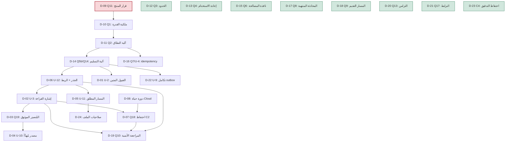

# OHB2-P0-OWNER-DECISIONS-REGISTER — مراجعة عدائية مستقلة

## 1. معرّف المهمة والحُكم (Task ID and verdict)

- **Task ID:** `OHB2-P0-OWNER-DECISIONS-REGISTER-INDEPENDENT-ADVERSARIAL-REVIEW`.
- **المراجَع:** `docs/decisions/OHB2-P0-OWNER-DECISIONS-REGISTER.md` (سجل قرارات المالك، 1254 سطرًا،
  sha256 `7440a84d84edb72a1f02e10594c6aed87bfee3ea38b591155e300b158dab0ba7`).
- **المراجِع:** مراجِع عدائي مستقل بسياق جديد؛ **ليس** مؤلّف السجل، **وليس** مؤلّف المقترح r12، **وليس**
  مؤلّف أي مراجعة أو مراجعة ذاتية سابقة. تقرير إنشاء السجل والمراجعة الذاتية r12 تمّ التعامل معهما على
  أنهما **ادّعاءات تُتحقَّق**، لا أدلّة. جميع الأعمال **قراءة فقط**؛ **لا تعديل** للسجل أو المقترح أو أي
  مراجعة أو الكود أو `PROGRESS.md` أو الذاكرة. هذا الملف هو **الأثر الوحيد** المُنشأ. لا commit/push/PR/
  merge/deploy، ولا تغيير فرع، ولا تواصل مع المشرفين. **P0 يبقى غير مُنفَّذ وغير مُصرَّح به.**

### الحُكم: **`PASS_WITH_NOTES`**

السجل **مكتمل في جوهره ودقيق ومتّسق داخليًا وقابل للاستخدام** من المالك كأساس لمراجعة القرارات: 24 سجلًا
(D-01…D-24) تغطّي كل أسئلة `§12` (Q1–Q22) وكل المتطلّبات الجديدة (U-1…U-12)، كلٌّ بالأقسام السبعة A–G،
وكل توصية موسومة **`RECOMMENDATION — NOT OWNER-APPROVED`** (28 موضعًا)، و**صفر** صناديق مُعلَّمة في قائمة
الاستجابة (§9)، و**صفر** قرار مالك مُتَّخذ. القيود الأمنية الجوهرية محفوظة (لا عامل/DB جديد، لا fallback
إلى محادثة جديدة، لا exactly-once، لا حذف فيزيائي مُدَّعى، fail-closed).

لم أصدر `PASS` لأنني وجدت **عيبًا واحدًا متوسط الخطورة** (F-01): **قاعدة النص المؤهِّل (I7/I8) — «الملفات
وحدها لا تُرسِل؛ فقط نصٌّ مؤهِّل يُفعِّل التسليم» — غير مذكورة في أي سجل قرار ولا في قائمة القيود §11**،
وهي أحد متطلّبات المهمة الصريحة (§10). إضافةً إلى **ثلاث ملاحظات منخفضة** و**ثلاث معلوماتية**، كلها
توثيقية ولا تُبطل صلاحية السجل.

هذا الحُكم **لا يعني** اعتماد أي قرار مالك، ولا يُصرّح بأي تنفيذ، ولا يؤكّد وجود قدرة رفع آمنة.

---

## 2. خط الأساس المُتحقَّق منه والتجزئات (Verified repository baseline and hashes)

- **مسار المستودع:** `/workspace/project/OpenHandBot`.
- **الفرع:** `openhands-workspace-3jrWkL2U5fdqzu2fVdxOcW`.
- **HEAD:** `907b20de3fa6627795c14f29677e9f39c68e82f4`.
- **`origin/main`:** `a29164ff0e5fdc34e35af39b89ff5d8cfa324c3c`.
- **ملف المراجعة الهدف:** `docs/reviews/OHB2-P0-OWNER-DECISIONS-REGISTER-INDEPENDENT-ADVERSARIAL-REVIEW.md`
  — عند الفحص: **غير موجود** (لا تعارض استبدال).

| الوثيقة | المسار | الأسطر | SHA-256 (مُحسوب مستقلًّا) | مطابقة الهدف |
| --- | --- | --- | --- | --- |
| سجل القرارات | `docs/decisions/OHB2-P0-OWNER-DECISIONS-REGISTER.md` | 1254 | `7440a84d84edb72a1f02e10594c6aed87bfee3ea38b591155e300b158dab0ba7` | ✅ `7440a84d…ba7` |
| المقترح r12 | `docs/proposals/OH-P0-SECURE-CONVERSATION-ATTACHMENT-UPLOAD-API.md` | 3185 | `6ea52debd62918e831555a7ea4787cde75fa62c75e376ac5df93ece33e34e4dc` | ✅ `6ea52deb…e4dc` |
| المراجعة المستقلة r12 | `docs/reviews/OHB2-P0-SECURE-UPLOAD-PROPOSAL-R12-INDEPENDENT-ADVERSARIAL-REVIEW.md` | 395 | `b19b07bdcf1f30052e0760be67cf493bdd4755df33727358817956fecc8928ad` | ✅ `b19b07bd…28ad` |
| المراجعة الذاتية r12 | `docs/reviews/OHB2-P0-SECURE-UPLOAD-PROPOSAL-R12-SELF-REVIEW.md` | 96 | `9e39bf033dbba0cb04ed5fb0a4c475a0ea650d6460fe26713ff4c6d009abfa99` | — |
| المراجعة المستقلة r11 | `docs/reviews/OHB2-P0-SECURE-UPLOAD-PROPOSAL-R11-INDEPENDENT-ADVERSARIAL-REVIEW.md` | 258 | `09963ded7bcc7279aabc77f99adf488fe9339686ff248b197ba367414ce6b990` | — |
| المراجعة المستقلة r10 | `docs/reviews/OHB2-P0-SECURE-UPLOAD-PROPOSAL-R10-INDEPENDENT-ADVERSARIAL-REVIEW.md` | 235 | `14d4d8a6c621abdd8d9211b4fdf08b7df2856ec21504d46fa21cdf7d18c24415` | — |

- **التجزئات الثلاث المستهدَفة طابقت قيمها المتوقّعة** (أُعيد حسابها فعليًا).
- **ملفات الذاكرة/التقدّم (قبل المراجعة):**
  - `.openhands/memory/2026-11-11.md` → `a491ac02052a7ad217b4a70d7ace0883f2faa141d5de6baf79c3a64e1adc38ee`
  - `.openhands/memory/MEMORY.md` → `d89d56f481fca2c1b6698c117cccef162d8f94c0a1641f52fcf5906b75e56f82`
  - `.agent/PROGRESS.md` → `241d96954baffadf0c2281cf2933c5b6e4fe3dd5dff1d06a3e08d15348002779`
- **حالة الشجرة الابتدائية** (`git status --short`) — محفوظة حرفيًا:

```
 M .agent/PROGRESS.md
 M bot/handlers.py
 M docs/proposals/OHB2-AGENT-SERVER-FILE-UPLOAD-ARCHITECTURE.md
 M docs/proposals/OHB2-TELEGRAM-ACK-ARCHITECTURE-ADR.md
?? docs/decisions/
?? docs/proposals/OH-P0-SECURE-CONVERSATION-ATTACHMENT-UPLOAD-API.md
?? docs/reviews/OHB2-P0-SECURE-UPLOAD-PROPOSAL-R10-INDEPENDENT-ADVERSARIAL-REVIEW.md
?? docs/reviews/OHB2-P0-SECURE-UPLOAD-PROPOSAL-R10-SELF-REVIEW.md
?? docs/reviews/OHB2-P0-SECURE-UPLOAD-PROPOSAL-R11-INDEPENDENT-ADVERSARIAL-REVIEW.md
?? docs/reviews/OHB2-P0-SECURE-UPLOAD-PROPOSAL-R11-SELF-REVIEW.md
?? docs/reviews/OHB2-P0-SECURE-UPLOAD-PROPOSAL-R12-INDEPENDENT-ADVERSARIAL-REVIEW.md
?? docs/reviews/OHB2-P0-SECURE-UPLOAD-PROPOSAL-R12-SELF-REVIEW.md
?? docs/reviews/OHB2-P0-SECURE-UPLOAD-PROPOSAL-R2-INDEPENDENT-REVIEW.md
?? docs/reviews/OHB2-P0-SECURE-UPLOAD-PROPOSAL-R3-INDEPENDENT-ADVERSARIAL-REVIEW.md
?? docs/reviews/OHB2-P0-SECURE-UPLOAD-PROPOSAL-R3-SELF-REVIEW.md
?? docs/reviews/OHB2-P0-SECURE-UPLOAD-PROPOSAL-R4-INDEPENDENT-ADVERSARIAL-REVIEW.md
?? docs/reviews/OHB2-P0-SECURE-UPLOAD-PROPOSAL-R4-SELF-REVIEW.md
?? docs/reviews/OHB2-P0-SECURE-UPLOAD-PROPOSAL-R5-INDEPENDENT-ADVERSARIAL-REVIEW.md
?? docs/reviews/OHB2-P0-SECURE-UPLOAD-PROPOSAL-R5-SELF-REVIEW.md
?? docs/reviews/OHB2-P0-SECURE-UPLOAD-PROPOSAL-R6-INDEPENDENT-ADVERSARIAL-REVIEW.md
?? docs/reviews/OHB2-P0-SECURE-UPLOAD-PROPOSAL-R6-SELF-REVIEW.md
?? docs/reviews/OHB2-P0-SECURE-UPLOAD-PROPOSAL-R7-INDEPENDENT-ADVERSARIAL-REVIEW.md
?? docs/reviews/OHB2-P0-SECURE-UPLOAD-PROPOSAL-R7-SELF-REVIEW.md
?? docs/reviews/OHB2-P0-SECURE-UPLOAD-PROPOSAL-R8-INDEPENDENT-ADVERSARIAL-REVIEW.md
?? docs/reviews/OHB2-P0-SECURE-UPLOAD-PROPOSAL-R8-SELF-REVIEW.md
?? docs/reviews/OHB2-P0-SECURE-UPLOAD-PROPOSAL-R9-INDEPENDENT-ADVERSARIAL-REVIEW.md
?? docs/reviews/OHB2-P0-SECURE-UPLOAD-PROPOSAL-R9-SELF-REVIEW.md
?? docs/reviews/OHB2-P0-SECURE-UPLOAD-UPSTREAM-PROPOSAL-INDEPENDENT-ADVERSARIAL-REVIEW.md
?? tests/test_stage2_high_ack_blocking_fix.py
?? tests/test_stage4_f1_status_cost_operational_ack.py
```

---

## 3. الوثائق المرجعية المفحوصة (Source documents inspected)

قُرِئت كاملة:
- `docs/decisions/OHB2-P0-OWNER-DECISIONS-REGISTER.md` (1254 سطرًا؛ §1–§12).
- `docs/proposals/OH-P0-SECURE-CONVERSATION-ATTACHMENT-UPLOAD-API.md` (3185 سطرًا) — مع تركيز على `§5.6`,
  `§5.7`, `§5.9`/`§5.9.1`, `§5.10.0`–`§5.10.5`, `§5.11`, `§5.13`, `§5.14`–`§5.16`, `§7.0`–`§7.8`,
  `§8.1`–`§8.4`, `§9`, `§12` (Q1–Q22)، `§13`.
- `docs/reviews/OHB2-P0-SECURE-UPLOAD-PROPOSAL-R12-INDEPENDENT-ADVERSARIAL-REVIEW.md` (395 سطرًا).
- `docs/reviews/OHB2-P0-SECURE-UPLOAD-PROPOSAL-R12-SELF-REVIEW.md` (96 سطرًا).

**المصادر المثبّتة (pinned) التي يستند إليها المقترح** (تحقّقت تجزئاتها في المراجعة المستقلة r12 §3):
`OpenHands/enterprise@3fac53df8c2efcb67ff3537d1162e8c8a108f565`،
`OpenHands/software-agent-sdk@9f7d5cb11b1256c1878f5584a657401feca9ad16`،
`OpenHands/sandbox-server@43e91604ccd0a9960c8d5c52faadd60b30f10e63`،
`OpenHands/OpenHands@a8aaf6813753803cae5182d050909705b0eb02d0`،
والمواصفة الحيّة `https://app.all-hands.dev/openapi.json` (`1.91.0`, 244 paths, `f0f4d4e9…`).

---

## 4. جرد مستقل للبنود غير المحسومة (Independent unresolved-item inventory)

بُني الجرد من **قراءة المقترح مباشرةً**، لا من جدول تغطية السجل. المصدر الحاسم: `§12` يحوي **22 سؤالًا
بالضبط** (Q1–Q22)؛ `§5.15` يحوي **U-1…U-12**؛ `§8.1` يحوي **I1–I15**؛ و`§5.10.1` يحوي **C1–C5**.

| البند | موضعه في المقترح | موضعه في السجل | التغطية | الحالة محفوظة؟ |
| --- | --- | --- | --- | --- |
| **Q1** | §12 Q1 (L3009) | D-10 (L569) | سجل مستقل | ✅ |
| **Q2** | §12 Q2 (L3012) | D-11 (L597) | سجل مستقل | ✅ |
| **Q3** | §12 Q3 (L3014) | D-12 (L626) | سجل مستقل | ✅ |
| **Q4** | §12 Q4 (L3018) | D-13 (L654) | سجل مستقل | ✅ |
| **Q5a** | §12 Q5a (L3024) | D-14 (L678) | مطويّ (مُعلَن L155) | ✅ |
| **Q5b** | §12 Q5b (L3026) | D-14 (L678) | مطويّ | ✅ |
| **Q5c** | §12 Q5c (L3036) | D-02 (L225) | مطويّ | ✅ |
| **Q6** | §12 Q6 (L3043) | D-15 (L705) + D-07 (L449) | مطويّ جزئيًا | ✅ |
| **Q7** | §12 Q7 (L3051) | D-16 (L729) | سجل مستقل | ✅ |
| **Q8** | §12 Q8 (L3053) | D-17 (L754) | سجل مستقل | ✅ |
| **Q9** | §12 Q9 (L3054) | D-18 (L778) | سجل مستقل | ✅ |
| **Q10** | §12 Q10 (L3057) | D-19 (L802) | سجل مستقل | ✅ |
| **Q11** | §12 Q11 (L3058) | D-09 (L532) | سجل مستقل | ✅ |
| **Q12** | §12 Q12 (L3065) | D-01 (L166) | مطويّ | ✅ |
| **Q13** | §12 Q13 (L3077) | D-20 (L824) | سجل مستقل | ✅ |
| **Q14** | §12 Q14 (L3085) | D-14 (L678) + D-24 (L919) | مطويّ | ✅ |
| **Q15** | §12 Q15 (L3095) | D-01 (L166) | مطويّ | ✅ |
| **Q16** | §12 Q16 (L3102) | D-02 (L225) + D-03 (L276) | مطويّ | ✅ |
| **Q17** | §12 Q17 (L3114) | D-21 (L848) | سجل مستقل | ✅ |
| **Q18** | §12 Q18 (L3119) | D-07 (L449) + D-08 (L493) | مطويّ | ✅ |
| **Q19** | §12 Q19 (L3138) | D-03 (L276) | سجل مستقل | ✅ |
| **Q20** | §12 Q20 (L3144) | D-04 (L323) | سجل مستقل | ✅ |
| **Q21** | §12 Q21 (L3150) | D-05 (L363) | سجل مستقل | ✅ |
| **Q22** | §12 Q22 (L3154) | D-06 (L403) | سجل مستقل | ✅ |
| **U-1** | §5.15 U-1 (L1904) | D-14 (L678) | مطويّ (مُعلَن L150) | ⚠️ جزئي (F-03) |
| **U-2** | §5.15 U-2 (L1905) | D-01 (L166) | سجل مستقل | ✅ |
| **U-3** | §5.15 U-3 (L1906) | D-02 (L225) + D-03 (L276) | مطويّ | ✅ |
| **U-4** | §5.15 U-4 (L1907) | D-16 (L729) | مطويّ | ✅ |
| **U-5** | §5.15 U-5 (L1908) | D-15 (L705) | مطويّ (مُعلَن L151) | ⚠️ جزئي (F-03) |
| **U-6** | §5.15 U-6 (L1909) | D-16 (L729) | مطويّ (مُعلَن L152) | ⚠️ جزئي (F-03) |
| **U-7** | §5.15 U-7 (L1910) | D-05 (L363) + D-24 (L919) | مطويّ (مُعلَن L153) | ✅ |
| **U-8** | §5.15 U-8 (L1911) | D-21 (L848) | مطويّ (مُعلَن L154) | ✅ |
| **U-9** | §5.15 U-9 (L1912) | D-22 (L870) | سجل مستقل | ✅ |
| **U-10** | §5.15 U-10 (L1913) | D-04 (L323) | سجل مستقل | ✅ |
| **U-11** | §5.15 U-11 (L1914) | D-05 (L363) | سجل مستقل | ✅ |
| **U-12** | §5.15 U-12 (L1915) | D-06 (L403) | سجل مستقل | ✅ |
| **I1** | §8.1 I1 (L2424) | D-09 (L540) | مذكور | ✅ |
| **I2** | §8.1 I2 (L2425) | D-22 (L886) | مذكور | ✅ |
| **I3** | §8.1 I3 (L2426) | D-22 (L886) | مذكور | ✅ |
| **I4** | §8.1 I4 (L2427) | §11 بند 8 (L1226) | مذكور | ✅ |
| **I5** | §8.1 I5 (L2428) | — | **غائب** | ⚠️ F-02 |
| **I6** | §8.1 I6 (L2429) | §11 بند 8 (L1226) | مذكور | ✅ |
| **I7** | §8.1 I7 (L2430) | — | **غائب** | ⚠️ F-01 |
| **I8** | §8.1 I8 (L2431) | — | **غائب** | ⚠️ F-01 |
| **I9** | §8.1 I9 (L2432) | — | **غائب** | ⚠️ F-02 |
| **I10** | §8.1 I10 (L2433) | — | **غائب** | ⚠️ F-02 |
| **I11** | §8.1 I11 (L2434) | — | **غائب** | ⚠️ F-02 |
| **I12** | §8.1 I12 (L2435) | D-07 (L453) + §11 بند 4 (L1220) | مذكور | ✅ |
| **I13** | §8.1 I13 (L2436) | §11 بند 13 (L1232) | مذكور جزئيًا | ⚠️ F-02 |
| **I14** | §8.1 I14 (L2437) | D-05 (L375) + D-24 (L938) | مذكور | ✅ |
| **I15** | §8.1 I15 (L2438) | D-06 (L442) | مذكور | ✅ |

**نتيجة الجرد.** كل Q1–Q22 وU-1–U-12 **مُمثَّلة**؛ لا سؤال مقترح مُهمَل. الثغرة الجوهرية الوحيدة في
الجرد هي **I7/I8** (F-01)، مع ثغرات أضعف في I5/I9/I10/I11 (F-02) وعدم اكتمال شرح طيّ U-5/U-6 (F-03).

**طيّات U التي جرى التحقّق منها تحديدًا** (طلبت المهمة فحصها):
- **U-1 → D-14:** ✅ صحيح. D-14 ينصّ صراحةً على أن الخيار A «يحتاج U-1 (نقطة تسليم server-to-server)»
  (L697)، ويغطّي المادّية والمسار المطلق — أي جوهر U-1 (نقطة server-to-server + مادّية + مسار مطلق).
- **U-5 → D-15:** ⚠️ **جزئي.** D-15 يذكر «عدم نمذجة الدفعة» و«الخادم لا يحتاج نمذجة الدفعة» (L712)، لكنه
  **لا يذكر التزام U-5 التوثيقي** («the server documents that it has no batch concept»). انظر F-03.
- **U-6 → D-16:** ⚠️ **جزئي.** U-6 (مفتاح idempotency **اختياري** على `send-message`) يُذكر في سطر أدلّة
  D-16 فقط (L740: «لا مفتاح idempotency على `send-message` اليوم (U-6)») ولا في خياراته/توصيته. انظر F-03.
- **U-7 → D-05 + D-24:** ✅ صحيح. D-05 يغطّي عقد المسار/الاحتواء/الاستبدال الذرّي (L384-393) وD-24 يغطّي
  الصلاحيات/الملكية (L925-936) — أي جوهر U-7 (atomic publish + containment + symlink/TOCTOU + readable
  mode/owner + partial-write cleanup + cross-conversation isolation).
- **U-8 → D-21:** ✅ صحيح. D-21 يعيد عقد `client_operation_id` كاملًا (L854-856).
- **Q5a → D-14:** ✅ صحيح. D-14 يذكر «حلّ الـ ref» ضمن آلية التسليم (L684-685).

---

## 5. مصفوفة مراجعة D-01…D-24 (D-01 through D-24 review matrix)

الرموز: **A-G** = الأقسام السبعة موجودة؛ **Ref** = دقّة مرجع المقترح؛ **Prob** = مطابقة بيان المشكلة؛
**Evid** = دعم الأدلّة + التمييز [F]/[UNVERIFIED]؛ **Opt** = خيارات متمايزة/قابلة للتنفيذ؛ **Rec** =
توصية موسومة؛ **Q** = سؤال مالك غير ملتبس؛ **Confl** = لا تعارض مع سجل آخر.

| D-ID | A-G | Ref | Prob | Evid | Opt | Rec | Q | Confl | ملاحظة |
| --- | --- | --- | --- | --- | --- | --- | --- | --- | --- |
| D-01 | ✅ | ✅ | ✅ | ✅ | ⚠️ | ✅ | ✅ | ✅ | الخيار A غير قابل للاستخدام في P0 (F-04) |
| D-02 | ✅ | ✅ | ✅ | ✅ | ✅ | ✅ | ✅ | ✅ | — |
| D-03 | ✅ | ✅ | ✅ | ✅ | ✅ | ✅ | ✅ | ✅ | — |
| D-04 | ✅ | ✅ | ✅ | ✅ | ✅ | ✅ | ✅ | ✅ | — |
| D-05 | ✅ | ✅ | ✅ | ✅ | ✅ | ✅ | ✅ | ✅ | تداخل عرضي مع D-14 design C (F-06) |
| D-06 | ✅ | ✅ | ✅ | ✅ | ✅ | ✅ | ✅ | ✅ | — |
| D-07 | ✅ | ✅ | ✅ | ✅ | ✅ | ✅ | ✅ | ✅ | — |
| D-08 | ✅ | ✅ | ✅ | ✅ | ✅ | ✅ | ✅ | ✅ | — |
| D-09 | ✅ | ✅ | ✅ | ✅ | ✅ | ⚠️ | ✅ | ✅ | التوصية تميل لمنتج (F-05) |
| D-10 | ✅ | ✅ | ✅ | ✅ | ✅ | ✅ | ✅ | ✅ | — |
| D-11 | ✅ | ✅ | ✅ | ✅ | ✅ | ✅ | ✅ | ✅ | — |
| D-12 | ✅ | ✅ | ✅ | ✅ | ✅ | ✅ | ✅ | ✅ | — |
| D-13 | ✅ | ✅ | ✅ | ✅ | ✅ | ✅ | ✅ | ✅ | — |
| D-14 | ✅ | ✅ | ✅ | ✅ | ✅ | ✅ | ✅ | ✅ | — |
| D-15 | ✅ | ✅ | ✅ | ✅ | ✅ | ✅ | ✅ | ✅ | U-5 غير مُصرَّح (F-03) |
| D-16 | ✅ | ✅ | ✅ | ✅ | ✅ | ✅ | ✅ | ✅ | U-6 في الأدلّة فقط (F-03) |
| D-17 | ✅ | ✅ | ✅ | ✅ | ✅ | ✅ | ✅ | ✅ | — |
| D-18 | ✅ | ✅ | ✅ | ✅ | ✅ | ✅ | ✅ | ✅ | — |
| D-19 | ✅ | ✅ | ✅ | ✅ | ✅ | ✅ | ✅ | ✅ | — |
| D-20 | ✅ | ✅ | ✅ | ✅ | ✅ | ✅ | ✅ | ✅ | — |
| D-21 | ✅ | ✅ | ✅ | ✅ | ✅ | ✅ | ✅ | ✅ | — |
| D-22 | ✅ | ✅ | ✅ | ✅ | ✅ | ✅ | ✅ | ✅ | — |
| D-23 | ✅ | ✅ | ✅ | ✅ | ✅ | ✅ | ✅ | ✅ | — |
| D-24 | ✅ | ✅ | ✅ | ✅ | ✅ | ✅ | ✅ | ✅ | — |

**نتيجة المصفوفة:** كل السجلات الـ24 تحوي **A–G كاملة** (تحقّق آلي: 7 أقسام لكل سجل)؛ كل مراجع المقترح
موجودة فعلًا (تحقّق مقابل بنية §12/§5.15/§5.10/§8.1)؛ لا سجل يعرض توصية كمتطلّب معتمَد؛ ولا تعارضات
متقاطعة تُبطل أي سجل. الملاحظات أعلاه موثّقة كملاحظات F-01…F-07 في §11.

---

## 6. نتائج مفصّلة للقرارات عالية المخاطر (Detailed findings for high-risk decisions)

**D-01 (U-2).** آلة الحالة: D-01 يوضّح أن خيار «القبول المتين» يضيف طور `consumed_at` إلى الترتيب المتين،
وأن إسقاطه يُبقي الترتيب على `stored`/`expires_at` (سليم). التوقيت: يشير إلى أن `pending-messages` بدء
فقط وأن `send-message` thin proxy — مطابق للمصدر (R12 §5.9.1). لا خلط بين `consumed_at` والتفويض بالحذف
(D-01 ينصّ صراحةً على أن `consumed_at` لا يُصرّح بالحذف). **العيب الوحيد (F-04):** الخيار A مُدرَج كخيار
«قابل للاعتماد» في §9 رغم أن السجل نفسه يقول إنه «غير قابل للاستخدام في هدف P0».

**D-02 (U-3).** حدود المُصدِر: D-02 يحيل صراحةً إلى D-03/D-04 للثقة/الاتساق. هل الخيارات تمنع انتحال هوية
المُتّصل؟ D-02 نفسه لا يذكر المُصدِر في خياراته (يحيله إلى D-03) — وهذا **صحيح تصميميًا** (فصل الاهتمامات)
لكنه يعني أن سؤال «هل يمنع هذا الانتحال؟» يُجاب في D-03 لا D-02. D-03 يغطّي ذلك بوضوح (يرفض أي حقل يسمّيه
العميل `issuer/success/read/verified`، ويشترط مُصدِرًا خدميًا غير وكيلي). لا ثغرة.

**D-03 (Q19).** هل يكرّر D-02 أم يختلف؟ **يختلف وليس تكرارًا مبالغًا فيه:** D-02 = *هل نعتمد U-3؟*؛ D-03 =
*مَن المُصدِر وكيف نثق به؟*. التداخل في إشارة U-3 (كلاهما يشير إليها) مشروع لأن U-3 **بلا معنى** بلا مُصدِر
موثوق، وقد صرّح السجل بذلك. لا تعارض.

**D-04 (U-10).** الملكية/التفويض: D-04 يوجّه إلى الخيار B (إعادة تحقّق من agent-server) الذي يستخدم
الحالة الموثوقة، والخيار C (لا دليل حدثي). لا يزعم أن `events/search` موثوق. سليم. ملاحظة: D-04 هو
**الاعتماد الخارجي الأنسب**، وربطه بـ U-3 صحيح.

**D-05 (U-11).** هل هو متميّز عن D-10 أم تابع؟ **متميّز.** U-10 = اتساق مصدر الدليل الحدثي؛ U-11 = عقد
المسار المطلق للملف المُسلَّم. لا تكرار. تبعية U-11 على U-12 صحيحة (المسار المطلق يُبنى فوق الجذر الموثوق).
**ملاحظة F-06:** خيار D-05 B = design C في D-14 (تداخل عرضي مُشار إليه).

**D-06 (U-12).** الربط بين principal + المحادثة القائمة + العملية + هوية مساحة العمل/المستودع: D-06 ينصّ
صراحةً على أن **الجذر وحده لا يُثبت التفويض** («لا شيء يربط ذلك الجذر بالثلاثي ويثبّت تفويض الكتابة»،
L416-418)، ويشترط fail-closed عند غياب الربط. مطابق للمقترح §5.15.6 وT-25. لا مغالاة.

**D-07 (C2/Q18).** الاحتفاظ/الانتهاء/التنظيف/الاستعادة/تبعية دورة الحياة الخارجية: D-07 يفصل C2 عن
`expires_at`، ويذكر أن الأرشفة تحفظ المجلد، وأن الحذف الفيزيائي المربوط host **UNVERIFIED**. يعتمد على
D-08 للحدّ الخارجي — مُصرَّح به. سليم.

**D-08 (Cloud/runtime-api).** هل يُقدَّم السلوك الخارجي كمُتحقَّق؟ **لا.** D-08 يوسم محفّز/تأخير التفكيك
والتأثير الفيزيائي بأنه **UNVERIFIED** صراحةً (L510-511)، ويعرض الخيار C (افتراض حدّ ثابت) **مرفوضًا**.
سليم تمامًا.

**D-09 (Q11).** هل يُخلط القرار المنتجي بالجدوى التقنية/تصريح التنفيذ؟ D-09 ينصّ: «إن أراد المالك P0، فلا
يجوز بدء التنفيذ قبل حلّ الحواجز صراحةً» — أي **يفصل** الجدوى عن التنفيذ. التوصية (الخيار B) صحيحة تقنيًا
لكنها **تميل لمنتج** (F-05، معلوماتية).

**D-22 (U-9).** العلاقة بالقرارات الأمنية/التفويضية: D-22 يخصّ **تكامل outbox** (نصّي فقط)، ويوصي بنوع
عنصر جديد يحفظ الملكية الواحدة (I2) والترتيب المتين. لا يمسّ التفويض/التسليم (D-14/D-06) ولا يُضعف
fail-closed. ملاحظة F-02: D-22 لا يعيد التأكيد على أن الـ outbox يجب أن يبقى **at-most-once** ويحفظ I13.

**D-10…D-24.** فُحصت كلها: لا تكرار غير مُبرَّر؛ لا تعارض؛ لا سجل يعرض توصية كمتطلّب. D-24 (صلاحيات
الملف) وD-05 متكاملان (U-7). D-12/D-13/D-15/D-17/D-18/D-20/D-21/D-23 تأكيدات/سياسات سليمة.

---

## 7. تحليل الترابط بين القرارات (Cross-decision dependency analysis)

أعدتُ بناء الرسم من الصفر (لا من رسم السجل).



**تحقّق النقاط المطلوبة:**
- **D-02 مقابل D-03:** علاقة **تبعية** (D-03 يحدّد مُصدِر الإشارة التي يعتمدها D-02)، وليست تكرارًا.
- **D-04 مقابل D-05:** **مستقلّان موضوعيًا** (اتساق دليل حدثي مقابل عقد مسار ملف). كلاهما مستهلك لنتيجة
  U-12، لكن **U-10 لا يعتمد على جذر مساحة العمل** (تصحيح F-07 أدناه).
- **D-06 مقابل D-02/D-04/D-05:** D-06 **شرط تصميمي مسبق** لها جميعًا (وجهة موثوقة).
- **D-07 مقابل D-08:** **تبعية** (سياسة الاحتفاظ تعتمد على تأكيد الحدّ الخارجي).
- **D-01 مقابل D-09:** D-09 **بوّابة**؛ D-01 يقيّد آلة الحالة المعلّقة فقط.
- **D-22 مقابل قرارات التفويض/الأمن:** **مستقل** (تكامل محلي)، لا يمسّ D-14/D-06/D-11.
- **D-10/D-11/D-14/D-24:** سلسلة معمارية D-10 → D-11 → D-14، وD-24 تابع لـ D-05.

**التصنيف:**
- **يجب حسمها معًا:** حزمة الأمان {D-06 → D-02 → D-03 → D-04}؛ حزمة الاحتفاظ {D-07, D-08}؛ البوّابة D-09
  قبل الكل.
- **مستقلّة:** D-12, D-13, D-15, D-17, D-18, D-20, D-21, D-23.
- **تتطلّب تأكيدًا خارجيًا:** D-01, D-02/D-03, D-04, D-08, D-18, D-19.
- **تتطلّب موافقة مالك المنتج:** D-09, D-10, D-11, D-12, D-14, D-07, D-22.
- **لا يمكن تأجيلها بأمان:** D-09, D-06, D-02/D-03, D-14, D-22 (وD-01 للتكامل).

**لا توجد تبعيات دائرية** في الرسم المُعاد بناؤه. **لا تناقض في التوصيات** (راجع §8).

---

## 8. تقييم جودة التوصيات (Recommendation quality assessment)

> المنهج: تحدي كل توصية بدلًا من قبولها. كل التوصيات موسومة `RECOMMENDATION — NOT OWNER-APPROVED`، ولا
> واحدة منها تُقرأ كمتطلّب. المالك يحتفظ بالاختيار النهائي في كل الحالات.

- **D-01 → C (إسقاط `consumed_at`):** *أقوى اعتراض:* إن احتاج المنتج إشارة message-accept للتحليلات، فالإسقاط
  يفقدها. *الافتراض:* أن `consumed_at` غير مطلوب وظيفيًا. *مقايضة أمنية:* لا شيء (لا يصرّح بالحذف أصلًا).
  *تكلفة:* صفر. *فشل:* لا مرحلة جديدة. *دعم:* هندسي/تحفّظي (مسند إلى أن U-2 غير موجود upstream).
- **D-02 → B (fallback):** *أقوى اعتراض:* يمنع `delivered` نهائيًا ⇒ لا استعادة staging مبكرة (نمو محدود
  بـ15 دقيقة فقط، وهو مقبول). *الافتراض:* أن غياب `delivered` لا يكسر P0. *مقايضة:* لا `delivered`.
  *فشل:* `stored` حتى `expires_at`. *دعم:* أدلّة (U-3 غير موجود). **آمن**.
- **D-03 → C (لا U-3 الآن):** *أقوى اعتراض:* يؤجّل قدرة قد يحتاجها المنتج. *الافتراض:* أن المُصدِر سيوفّره
  upstream لاحقًا. *مقايضة:* لا استعادة مبكرة. *دعم:* أدلّة (لا مُصدِر). **آمن**.
- **D-04 → C/B:** *أقوى اعتراض:* الخيار B يتطلّب وصولًا لجانب agent-server (تكلفة/حدود). *دعم:* هندسي.
- **D-05 → A (مسار مطلق):** *أقوى اعتراض:* يكشف المسار الحقيقي للوكيل (مقصود). *دعم:* أدلّة (القارئ يرفض
  النسبي، `a1d735d4…`). **مطابق للمقترح**.
- **D-06 → A (وسم + ربط U-12):** *أقوى اعتراض:* الربط **غير موجود** (UNVERIFIED) ⇒ لا يزال عملًا جديدًا.
  *دعم:* أدلّة جزئية (القراءة موجودة، الربط لا). **fail-closed إلزامي** — سليم.
- **D-07 → D (الافتراضي المحافظ):** *أقوى اعتراض:* نمو تخزين غير مقيَّد. *الافتراض:* أن الأمان يتقدّم على
  الكلفة. *دعم:* أدلّة (لا حذف فيزيائي مضمون). **آمن**.
- **D-08 → B (fail-safe):** *أقوى اعتراض:* لا يحلّ النمو. *دعم:* أدلّة (خارجي غير مُنمذَج). **آمن**.
- **D-09 → B (fail-closed):** *أقوى اعتراض:* يمنع ميزة مطلوبة. *ملاحظة:* توصية **منتجة** مُقدَّمة بحجّة أمنية
  (F-05، معلوماتية). *دعم:* هندسي/تحفّظي. **لا يُصرّح بالتنفيذ**.
- **D-10 → A (Cloud V1):** *أقوى اعتراض:* عمل Cloud جديد. *دعم:* هندسي + أدلّة (مشكلة الأصل، §2.4).
- **D-11 → A (مسار مفوَّض):** *أقوى اعتراض:* لا token قابل للمشاركة. *دعم:* هندسي.
- **D-12 → A/B:** *أقوى اعتراض:* A يحدّ الملفات الكبيرة؛ B يزيد التخزين. *دعم:* أدلّة (سقف الواجهة 3 MB).
- **D-13 → A:** تأكيد؛ اعتراض ضعيف. **D-14 → A:** *أقوى اعتراض:* يحتاج U-1. *دعم:* أدلّة (نموذج الرسالة نص/صورة).
- **D-15/D-17/D-20/D-21 → A:** تأكيدات؛ لا اعتراض جوهري. **D-16 → A:** *أقوى اعتراض:* نافذة dedup تحتاج
  تعريفًا. *دعم:* هندسي. **D-18 → A:** تعايش؛ *اعتراض:* يبقي سطحًا قديمًا واسع الصلاحية (مُفصح عنه).
- **D-19 → A (بوابة إصدار):** *اعتراض:* زمن/كلفة. *دعم:* هندسي. **D-22 → A:** *اعتراض:* توسيع مخطط outbox.
  *دعم:* أدلّة (outbox نصّي). **D-23 → B:** إعادة استخدام سياسة Cloud. **D-24 → A:** ضبط صريح.

**فحص الافتراضات المحظورة على كل توصية:**
- لا توصية تفترض **عاملًا/مجدولًا/قاعدة بيانات/عملية جديدة**؛ D-22 يحفظ I2/I3 صراحةً.
- لا توصية تنتهك **ملكية SQLite الواحدة**.
- لا توصية تُدخل **fallback إلى محادثة جديدة** (D-09/D-06 يمنعان ذلك).
- لا توصية تُضعف **fail-closed** (D-06/D-02/D-03 يشترطونه).
- لا توصية تُشير إلى **exactly-once** (§11 بند 9 ينصّ على at-most-once + مصالحة).
- لا توصية تفترض **مثابرة/رفع ملفات بعيدين غير مُتحقَّقَين** (§11 بند 11).
- لا توصية تفترض **حذفًا فيزيائيًا لبيانات host** (D-07/D-08 يوسمانه UNVERIFIED).
- لا توصية تفترض **سلوك دورة حياة Cloud/runtime-api** بلا دليل (D-08).

---

## 9. تقييم جاهزية التنفيذ (Implementation-readiness assessment)

تحقّقت من أن كل تصنيف مُبرَّر، وأن «جاهز لتصميم التنفيذ» **لا يعني** «مصرَّح بالتنفيذ». السجل يذكر هذا
التمييز صراحةً (L1050-1051).

| المجال | تصنيف السجل | تصنيف المراجعة | مُبرَّر؟ |
| --- | --- | --- | --- |
| Upload transport | BLOCKED BY OWNER DECISION | مطابق | ✅ (D-10/D-11) |
| Trusted issuer and caller identity | BLOCKED BY EXTERNAL CONFIRMATION | مطابق | ✅ (D-03) |
| Conversation ownership | READY FOR IMPLEMENTATION DESIGN | مطابق (تصميم فقط) | ✅ |
| Operation binding and idempotency | BLOCKED BY OWNER DECISION | مطابق | ✅ (D-16/D-21) |
| Temporary storage | READY FOR IMPLEMENTATION DESIGN | مطابق | ✅ |
| File validation and path confinement | READY FOR IMPLEMENTATION DESIGN | مطابق | ✅ |
| Attachment batching | READY FOR IMPLEMENTATION DESIGN | مطابق | ✅ |
| Fifteen-minute text-wait state machine | READY FOR IMPLEMENTATION DESIGN | مطابق | ✅ |
| Multi-file behavior | READY FOR IMPLEMENTATION DESIGN | مطابق | ✅ |
| Expiry and cleanup | BLOCKED BY OWNER DECISION | مطابق | ✅ (D-07/D-08) |
| Delivery to the same OpenHands conversation | BLOCKED BY OWNER DECISION | مطابق | ✅ (D-14/D-06/D-05) |
| Unknown-result reconciliation | READY FOR IMPLEMENTATION DESIGN | مطابق | ✅ |
| Failure recovery | READY FOR IMPLEMENTATION DESIGN | مطابق | ✅ (D-22 مُحال) |
| Audit logging and sensitive-data handling | READY FOR IMPLEMENTATION DESIGN | مطابق | ✅ (D-23 مُحال) |
| Successful-read evidence (F6b) / `delivered` | BLOCKED BY EXTERNAL CONFIRMATION | مطابق | ✅ (D-02/D-03/D-04) |
| Quiesced evidence source | BLOCKED BY EXTERNAL CONFIRMATION | مطابق | ✅ (D-04) |
| Workspace-root provenance/binding | BLOCKED BY MISSING TECHNICAL EVIDENCE | مطابق | ✅ (D-06) |
| Delivered-file permissions/ownership | BLOCKED BY MISSING TECHNICAL EVIDENCE | مطابق | ✅ (D-24) |
| Active-conversation durable accept | BLOCKED BY EXTERNAL CONFIRMATION | مطابق | ✅ (D-01) |
| C2 retention policy | BLOCKED BY OWNER DECISION | مطابق | ✅ (D-07/D-08) |
| Product go/no-go for P0 | BLOCKED BY OWNER DECISION | مطابق | ✅ (D-09) |
| Independent security review gate | NOT YET REVIEWED | مطابق | ✅ (D-19) |
| Legacy route deprecation | NOT YET REVIEWED | مطابق | ✅ (D-18) |

**النتيجة:** **لا يوجد** مجال مُصنَّف «جاهز» رغم وجود حدّ أمني غير محسوم؛ ولا تصنيف يوحي بتصريح تنفيذ.
جميع تصنيفات «جاهز» تخصّ مجالات مستقلة عن الحدود الأمنية المعلّقة (التخزين المؤقّت، الاحتواء، الدفعة،
آلة الحالة، المصالحة، الاستعادة، التدقيق).

---

## 10. تدقيق الثوابت الأمنية والمعمارية (Security and architecture invariant audit)

| الثابت المطلوب | محفوظ في السجل؟ | الموضع |
| --- | --- | --- |
| عملية بوت/ASGI واحدة | ✅ | §11 بند 7 (L1224) |
| مالك SQLite واحد موثوق | ✅ | §11 بند 7 (L1224)؛ D-22 (L886) |
| outbox/عمّال/مجدولات قائمة فقط | ✅ | §11 بند 7 (L1224)؛ D-22 (L870-891) |
| لا قاعدة بيانات/عامل/مجدول جديد | ✅ | §11 بند 7 (L1224) |
| المحادثة القائمة فقط | ✅ | D-09 (L540) |
| لا fallback إلى محادثة جديدة | ✅ | §11 بند 1/3 + D-09 |
| لا تسليم فوري للمرفق | ✅ (غير مذكور صراحةً؛ لا ما يناقضه) | — |
| بدء نافذة 15 دقيقة عند **استلام الملف** | ⚠️ جزئي (تأكيد المهلة في D-15/§11 بند 8؛ لكن **بدء العدّ عند الاستلام** غير مُصرَّح) | D-15 (L711)، §11 بند 8 |
| **فقط نصٌّ مؤهِّل يُفعِّل التسليم** | ❌ **غائب** | — (F-01) |
| ملفات إضافية تنضمّ للدفعة بلا تمديد | ✅ | §11 بند 8 (L1226)؛ D-15 |
| انتهاء المهلة يُلغي الطلب وينظّف المؤقّت بأمان | ⚠️ جزئي (D-07/D-08 يعالجان C2؛ **تنظيف staging عند الانتهاء** مُصرَّح في D-02/D-07) | D-02 (L252)، D-07 |
| نتائج بعيدة غير معروفة لا تُطلق إعادة إرسال عمياء | ❌ **غير مُصرَّح كقيد** (I11) | — (F-02) |
| لا ضمان exactly-once | ✅ | §11 بند 9 (L1227) |
| لا ادّعاء بقدرة رفع آمنة قبل التنفيذ والتحقّق | ✅ | §11 بند 11 (L1229)؛ §1 |

**النتيجة:** الثوابت الجوهرية محفوظة (لا عامل/DB جديد، لا fallback، لا exactly-once، لا ادّعاء قدرة). لكن
**I7/I8 (F-01)** و**I10/I11 (F-02)** غير مُصرَّحين، و**I5/I9** غير مذكورين (F-02)، و**I13** مُشار إليه
بشكل عام فقط (F-02). لا يوجد ثابت **مُناقَض** — الثغرات **إغفال** لا تناقض.

---

## 11. النتائج مرتّبة حسب الشدّة مع مواضع السجل الدقيقة (Severity-ranked findings)

**F-01 — MEDIUM (إغفال ثابت نصّي جوهر).** ثابت **I7/I8** (المقترح §8.1، L2430-2431: «Accompanying text
required before sending — files alone never dispatch» / «No sending files without accompanying text»)
**غير مذكور** في أي سجل قرار (D-01…D-24) ولا في قائمة القيود §11 (L1211-1232، 13 بندًا). تحقّق: `grep "\bI7\b|\bI8\b"` في السجل = **0**؛ كلمة «نص» تظهر فقط داخل أسماء/سياقات أخرى؛ لا عبارة «الملفات وحدها
لا تُرسِل» ولا «فقط نصٌّ مؤهِّل يُفعِّل التسليم». **لماذا يهم:** المهمة §10 تشترطه صراحةً؛ وهو القيد المرئي
الأكثر عرضة للانتهاك الصامت أثناء تصميم التنفيذ، ويوضّح **الغرض** من نافذة الـ15 دقيقة (الانتظار حتى وصول
النص) — وهو غرض غير مذكور أيضًا. **التصحيح المطلوب:** إضافة بند صريح في §11 (وإشارة في D-01) يعيد نصّ I7/I8
وأن بدء العدّ عند **استلام الملف**.

**F-02 — LOW (عدم اكتمال قائمة القيود §11).** §11 (13 بندًا) لا يذكر: **I5** (دفعات معلّقة متينة)، **I9**
(عزل الملكية/المحادثة)، **I10** (الحفاظ على الملفات عند نتيجة غير معروفة)، **I11** (لا إعادة إرسال عمياء).
كذلك **I13** يُذكر عمومًا («ضمانات Telegram ack ... دون تغيير») دون **جوهره** (at-most-once + عدم تغيير
الـ outbox)، وD-22 لا يعيد تأكيده. تحقّق: `grep "\bI5\b|\bI9\b|\bI10\b|\bI11\b"` = **0**. **لماذا يهم:**
المهمة §10 تطلب التحقّق من حفظ كل الثوابت؛ وقائمة §11 هي الأثر الذي يحملها. **التصحيح:** إضافة I5/I9/I10/I11
إلى §11، وإضافة صياغة I13 الجوهرية في D-22.

**F-03 — LOW (عدم اكتمال شرح الطيّ في §4).** §4 (L149-155) يُعلن طيّ **U-5 → D-15** و**U-6 → D-16**، لكن:
D-15 (L705-725) **لا يذكر** التزام U-5 التوثيقي («the server documents that it has no batch concept»)؛
وU-6 يُذكر في D-16 **في سطر الأدلّة فقط** (L740) لا في خياراته/توصيته. تحقّق مباشر للنصّين. **لماذا يهم:**
قارئ يتحقّق «هل U-5/U-6 مُغطّى؟» يجد ادّعاءً لا يُخدَم بالكامل داخل السجل المشار إليه. **التصحيح:** صياغة
U-5/U-6 صراحةً في D-15/D-16 (أو في §4).

**F-04 — LOW (خيار غير قابل للاستخدام مُقدَّم كخيار).** D-01 الخيار A («إعادة استخدام `pending-messages`
كما هو») — والسجل نفسه ينصّ أنه **«بدء فقط ⇒ لا يخدم المحادثة القائمة»** (L194) — مُدرَج في §9 كـ
«Approve option A» (L1104). **لماذا يهم:** قد يختار المالك خيارًا ميّتًا. **التصحيح:** وسم الخيار A بأنه
غير قابل للاستخدام في P0 (معلوماتي)، أو دمجه في بيان المشكلة.

**F-05 — INFO (توصية D-09 تميل لمنتج).** D-09 يوصي بالخيار B («الإبقاء على الرفض fail-closed») بحجّة
«الأكثر تحفّظًا وأقلّ كلفة» (L557). هذا **حكم منتجي**، لا استنتاج تقني. السجل محترم في فصله الجدوى عن
التنفيذ («إن أراد المالك P0، فلا يجوز بدء التنفيذ قبل حلّ الحواجز»)، لكن التوصية تُقدّم fail-closed كأنه
الجواب الصحيح. **التصحيح:** عرض الخيارات المنتجية باحياد، وإبقاء القيد التقني كحقيقة لا كسبب للتفضيل.

**F-06 — INFO (تداخل عرضي D-05/D-14).** خيار D-05 B («رمز غير شفّاف + أداة قراءة على جانب الوكيل
(design C)»، L386) يساوي design C في D-14 (L693). ليس عيبًا (الإحالة موجودة) لكنه يظهر في قائمتي §9.
**التصحيح:** إضافة إحالة صريحة «D-05 B ⇔ D-14 design C».

**F-07 — INFO (عدم دقّة في §6.1).** العبارة الثانية في §6.1 (L953-955) تقول إن U-10 وU-11 «كلاهما مستهلكان
لنتيجة U-12؛ وU-10 يقرأ الدليل المرتبط بذلك الجذر». U-10 في المقترح (§5.15.4) يخصّ **اتساق مصدر الدليل
الحدثي (replica مقابل agent-server)**، **لا** جذر مساحة العمل. **التصحيح:** تصحيح العبارة لتبيّن أن U-10
**مستقل** عن الجذر، وأن U-11 فقط يبنى على U-12.

**ملخّص الشدّة:** MEDIUM = 1 (F-01)؛ LOW = 3 (F-02، F-03، F-04)؛ INFO = 3 (F-05، F-06، F-07). **لا HIGH،
ولا حاجز.** لا شيء منها يُبطل صلاحية السجل للمراجعة.

**نقاط إيجابية مُتحقَّقة (لا نتائج):** 24 سجلًا A-G كاملة؛ مطابقة كل مراجع المقترح؛ 28 وسم
`RECOMMENDATION — NOT OWNER-APPROVED`؛ **0** صندوق مُعلَّم و**122** غير مُعلَّم؛ لا قرار مُعتمَد؛
الرسم بلا تبعيات دائرية؛ مصفوفة الجاهزية مُبرَّرة؛ الثوابت الجوهرية محفوظة.

---

## 12. الأدلّة غير المُتحقَّقة والحدود (Unverified evidence and limitations)

- **أدلّة المقترح نفسها غير المُتحقَّقة** (كما وسمها المقترح؛ نقلها السجل بأمانة): المُصدِر الموثوق (U-3)،
  قناة مصادقة service-to-service، `sleep_interval`/تأخّر webhooks، ربط الجذر بالثلاثي (U-12)، الحذف
  الفيزيائي للمجلد المربوط host، دورة حياة Cloud/runtime-api، صلاحيات/ملكية الملف المُسلَّم، أثر
  `ImageContent` على المثابرة.
- **حدود هذه المراجعة:** لم أُعِد جلب المصادر المثبّتة من `raw.githubusercontent.com` في هذه المهمة؛
  اعتمدت على تجزئات المصادر التي أكّدتها المراجعة المستقلة r12 (استرجاع مستقل) — وهي مذكورة في السجل §3.
  الحقائق التقنية الأساسية (سطور، تجزئات، أسماء) قابلة للتتبّع إلى r12 ولم أجد ما يناقضها.
- **لا اختبارات تشغيلية:** السجل والمقترح توثيق؛ لا قدرة لاختبارها.
- **بند ثانوي:** السجل لا يُفرد صفًا لمصفوفة الجاهزية لثابت **I7/I8** ولا لمجال «qualifying-text trigger»؛
  مُدرَج ضمن F-01.
- **لا أُعيد فتح** مراجعة استشهادات r12 (لا دليل جديد)، ولم أُعالج N12-1.

---

## 13. مقارنة الشجرة الابتدائية/النهائية (Initial vs final working-tree comparison)

- **الابتدائية:** كما في §2 (4 ملفات `M`، وملف `?? docs/decisions/` الجديد، و27 ملفًا `??`).
- **النهائية:** نفس الحالة **بالإضافة إلى** ملف واحد جديد غير متعقَّب:
  `?? docs/reviews/OHB2-P0-OWNER-DECISIONS-REGISTER-INDEPENDENT-ADVERSARIAL-REVIEW.md`.
- **الفرق الوحيد:** إنشاء ملف المراجعة هذا. لم يُعدَّل أي ملف قائم.

---

## 14. التحقّق من تجزئات الملفات المحمية (Protected-file hash verification)

| الملف | sha256 قبل | sha256 بعد | ثبات |
| --- | --- | --- | --- |
| `.openhands/memory/2026-11-11.md` | `a491ac02…c38ee` | `a491ac02…c38ee` | ✅ بايت-ببايت |
| `.openhands/memory/MEMORY.md` | `d89d56f4…6f82` | `d89d56f4…6f82` | ✅ بايت-ببايت |
| `.agent/PROGRESS.md` | `241d9695…2779` | `241d9695…2779` | ✅ بايت-ببايت |

وتجزئات **السجل والمقترح والمراجعة المستقلة r12** أُعيد حسابها بعد المراجعة و**لم تتغيّر** (راجع §13 في
التقرير النهائي).

---

## 15. الملفات المُنشأة/المُعدَّلة بدقّة (Exact files created or modified)

- **مُنشأ (1 فقط):** `docs/reviews/OHB2-P0-OWNER-DECISIONS-REGISTER-INDEPENDENT-ADVERSARIAL-REVIEW.md`.
- **مُعدَّل:** **لا شيء**.

---

## 16. تأكيد العمليات المحظورة التي لم تُنفَّذ (Prohibited-operation confirmation)

**لم يُنفَّذ:** أي تعديل على السجل أو المقترح أو أي مراجعة/مراجعة ذاتية أو الكود أو الاختبارات أو المخططات
أو الإعدادات أو أي توثيق قائم أو `PROGRESS.md` أو أي ملف ذاكرة؛ لا `git reset`/`clean`/`checkout`/`restore`/
`stash`/حذف واسع؛ لا `git add .`/`git add -A`؛ لا commit/push/PR/merge/إنشاء أو تبديل فرع/نشر؛ لا استدعاء
إنتاجي؛ لا أسرار أو اعتمادات؛ لا قرار مالك ولا موافقة. **لم تحدث أي مخالفة نطاق.** الملف الوحيد المُنشأ هو
هذا.

---

## 17. توصية الخطوة التالية (Next-step recommendation)

**الخطوة التالية: مراجعة المالك لنتائج هذه المراجعة (F-01…F-07)، ثم البدء في عملية قرار المالك الفعلية
عبر قائمة §9 من السجل — بدءًا من D-09.** يُوصى بإصلاح **F-01** (إضافة I7/I8) قبل استخدام السجل كمرجع
نهائي للقرارات، لأن الثابت النصّي غير مُصرَّح. **لا يُبدأ أي تنفيذ.**

---

**إفصاح الاستقلالية.** أُعِدَّت هذه المراجعة بواسطة مراجِع بسياق جديد ليس مؤلّف السجل ولا المقترح r12 ولا
أي مراجعة/مراجعة ذاتية سابقة. جميع الأعمال كانت قراءة فقط؛ الملف الوحيد المُنشأ هو هذا. لم تُستخدم أي أسرار
أو اعتمادات أو استدعاءات إنتاجية. **لا قرار مالك مُتَّخذ، وP0 يبقى غير مُنفَّذ وغير مُصرَّح به.**

*أُعِدَّت هذه المراجعة بواسطة وكيل ذكاء اصطناعي (OpenHands) نيابةً عن مالك المستودع.*
